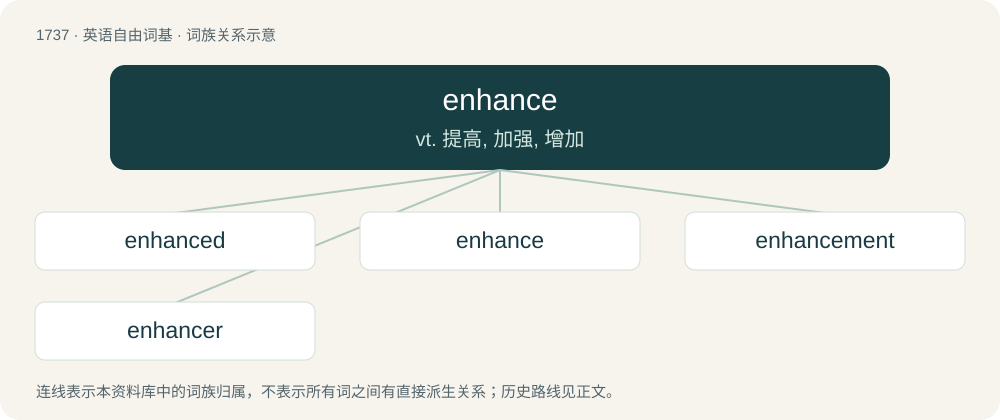

# 1837 · enhance — vt. 提高, 加强, 增加

[总目录](../00_总目录_按常用程度.md)

**类型**：英语自由词基　｜　**来源语言**：见词源记录

## 核心含义与来源

- 核心含义：vt. 提高, 加强, 增加
- 英文含义：To augment or make something greater.
- 词形：enhance

**来源记录 1**（动词；To augment or make something greater.）

From Middle English enhauncen, anhaunsen, from Anglo-Norman anhauncer (“enhance, raise”), from Vulgar Latin \*inaltiāre (“raise”), derived from Latin in + altus (“high”). The /h/ in Old French was taken from haut (“high”), where it resulted from Frankish influence.

## 词族图

## 单词速览（常用到不常用）

| 单词 | 音标 | 释义 |
|---|---|---|
| [enhanced](#w-1) | /inˈhɑːnst. -ˈhænst/ | a. 增大的；加强的 |
| [enhance](#w-2) | 英 /ɪnˈhɑːns/；美 /ɪnˈhæns/ | vt. 提高, 加强, 增加 |
| [enhancement](#w-3) | 英 /ɪnˈhɑːns.mənt/；美 /ɪnˈhæns.mənt/ | n. 提高, 美化, 增进, 增强, 增加；\[计\] 增强, 加强, 提高, 充实 |
| [enhancer](#w-4) | 英 /ɪnˈhɑːnsə/；美 /ɪnˈhænsɚ/ | \[化\] 增强子 |

## 逐词详解

### 1. enhanced

**词性**：形容词　｜　**音标**：/inˈhɑːnst. -ˈhænst/

**中文释义**：a. 增大的；加强的

**英文义项**：In a version or form that has been improved or made better than some other standard form. / Raised up, amplified.

**构词拆分**：From enhance + -ed.

**词源与演化**：

From enhance + -ed.

**例句**：

> They have enhanced security checks and are prepared for the worst.

### 2. enhance

**词性**：动词　｜　**音标**：英 /ɪnˈhɑːns/；美 /ɪnˈhæns/

**中文释义**：vt. 提高, 加强, 增加

**英文义项**：To augment or make something greater. / To improve something by adding features.

**词源与演化**：

From Middle English enhauncen, anhaunsen, from Anglo-Norman anhauncer (“enhance, raise”), from Vulgar Latin \*inaltiāre (“raise”), derived from Latin in + altus (“high”). The /h/ in Old French was taken from haut (“high”), where it resulted from Frankish influence.

**例句**：

> A debt enhances rapidly by compound interest.

该用例对应义项：To be raised up; to grow larger.

### 3. enhancement

**词性**：名词　｜　**音标**：英 /ɪnˈhɑːns.mənt/；美 /ɪnˈhæns.mənt/

**中文释义**：n. 提高, 美化, 增进, 增强, 增加；\[计\] 增强, 加强, 提高, 充实

**英文义项**：An improvement or supplement that tends to increase a sense of esteem. / The degree to which the image of a scan stands out as a bright area.

**构词拆分**：enhance + -ment

**词源与演化**：

From enhance + -ment.

**例句**：

> The original product, with its simplistic design, has undergone many enhancements over the years.

该用例对应义项：An improvement or supplement that tends to increase a sense of esteem.

### 4. enhancer

**词性**：名词　｜　**音标**：英 /ɪnˈhɑːnsə/；美 /ɪnˈhænsɚ/

**中文释义**：\[化\] 增强子

**英文义项**：Something that enhances. / A short region of DNA that can increase transcription of genes.

**构词拆分**：enhance + -er

**词源与演化**：

From enhance + -er.
