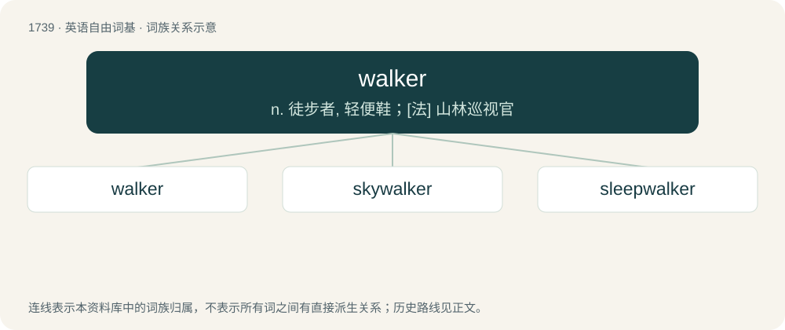

# 1839 · walker — n. 徒步者, 轻便鞋；\[法\] 山林巡视官

[总目录](../00_总目录_按常用程度.md)

**类型**：英语自由词基　｜　**来源语言**：见词源记录

## 核心含义与来源

- 核心含义：n. 徒步者, 轻便鞋；\[法\] 山林巡视官
- 英文含义：The agent noun of to walk: a person who walks or a thing which walks, especially a pedestrian or a participant in a walking race.
- 词形：walker

**来源记录 1**（名词；The agent noun of to walk: a person who walks or a thing which walks, especially a pedestrian or a participant in a walking race.）

From Middle English walkere (“one who walks, traveller”), equivalent to walk + -er.

## 词族图

## 单词速览（常用到不常用）

| 单词 | 音标 | 释义 |
|---|---|---|
| [walker](#w-1) | 英 /ˈwɔːkə/；美 /ˈwɔkɚ/ | n. 徒步者, 轻便鞋；\[法\] 山林巡视官 |
| [skywalker](#w-2) | 英 /ˈskaɪwɔːkə(ɹ)/；美 /ˈskaɪwɔkəɹ/ | n. 天行者（星球大战中的人物名） |
| [sleepwalker](#w-3) | /ˈsliːpwɒːkə/ | n. 梦游病者 |

## 逐词详解

### 1. walker

**词性**：名词　｜　**音标**：英 /ˈwɔːkə/；美 /ˈwɔkɚ/

**中文释义**：n. 徒步者, 轻便鞋；\[法\] 山林巡视官

**英文义项**：The agent noun of to walk: a person who walks or a thing which walks, especially a pedestrian or a participant in a walking race. / One who walks (takes for a walk).

**构词拆分**：walk + -er

**词源与演化**：

From Middle English walkere (“one who walks, traveller”), equivalent to walk + -er.

**例句**：

> The elderly woman used a walker to help her move around more easily.

该用例对应义项：A walking frame or baby walker.

### 2. skywalker

**词性**：名词　｜　**音标**：英 /ˈskaɪwɔːkə(ɹ)/；美 /ˈskaɪwɔkəɹ/

**中文释义**：n. 天行者（星球大战中的人物名）

**英文义项**：A member of the Mohawk group of Native Americans; especially one who is or was involved in steelworking on tall buildings in New York City. / Any ironworker working at a height.

**构词拆分**：sky + walker

**词源与演化**：

From sky + walker.

**例句**：

> According to my headcanon, Luke Skywalker is a gay ace.

### 3. sleepwalker

**词性**：名词　｜　**音标**：/ˈsliːpwɒːkə/

**中文释义**：n. 梦游病者

**英文义项**：A somnambulist; one who walks, or is active, while asleep. / A person from whom a voodoo practitioner (a bocor) has taken over control of their mind, making them a zombie who must do the bocor's bidding.

**构词拆分**：sleep + walker；sleepwalk + -er

**词源与演化**：

From sleep + walker or sleepwalk + -er.

**例句**：

> When you walk like that you look like a sleepwalker.
