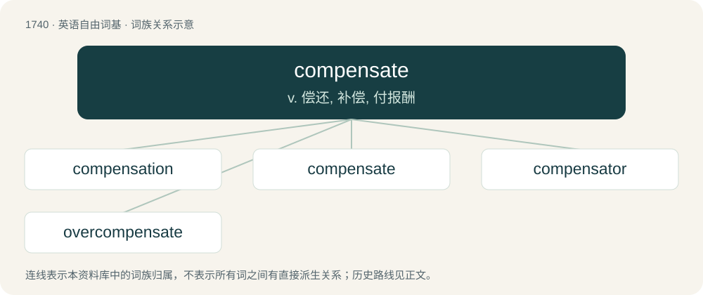

# 1840 · compensate — v. 偿还, 补偿, 付报酬

[总目录](../00_总目录_按常用程度.md)

**类型**：英语自由词基　｜　**来源语言**：见词源记录

## 核心含义与来源

- 核心含义：v. 偿还, 补偿, 付报酬
- 英文含义：To do (something good) after (something bad) happens.
- 词形：compensate

**来源记录 1**（动词；To do (something good) after (something bad) happens.）

Borrowed from Latin compēnsātus, perfect passive participle of compensō (“to weight together one thing against another, balance, make good”), -ate (verb-forming suffix) for more.

## 词族图

## 单词速览（常用到不常用）

| 单词 | 音标 | 释义 |
|---|---|---|
| [compensation](#w-1) | 英 /ˌkɒm.pənˈseɪ.ʃən/；美 /ˌkɑm.pənˈseɪ.ʃən/ | n. 补偿, 赔偿金, 工资；\[医\] 代偿(机能), 补偿 |
| [compensate](#w-2) | 英 /ˈkɒm.pən.seɪt/；美 /ˈkɑm.pənˌseɪt/ | v. 偿还, 补偿, 付报酬 |
| [compensator](#w-3) | /ˈkɒmpenseitə/ | n. 赔偿者, 自耦变压器, 补偿物；\[化\] 补偿器; 补偿剂; 张力调节器; 松紧调节辊 |
| [overcompensate](#w-4) | /,əuvəˈkɔmpənseit/ | vi. 给予过多的补偿, 过度补偿 |

## 逐词详解

### 1. compensation

**词性**：名词　｜　**音标**：英 /ˌkɒm.pənˈseɪ.ʃən/；美 /ˌkɑm.pənˈseɪ.ʃən/

**中文释义**：n. 补偿, 赔偿金, 工资；\[医\] 代偿(机能), 补偿

**英文义项**：The act or principle of compensating. / Something which is regarded as an equivalent; something which compensates for loss.

**构词拆分**：compensate + -ion

**词源与演化**：

From Middle English compensacioun, from Old French compensacion, from Latin compensātiōnem, accusative singular of compensātiō. Equivalent to compensate + -ion.

**例句**：

> He received a large sum of money in compensation for his injury.

### 2. compensate

**词性**：动词　｜　**音标**：英 /ˈkɒm.pən.seɪt/；美 /ˈkɑm.pənˌseɪt/

**中文释义**：v. 偿还, 补偿, 付报酬

**英文义项**：To do (something good) after (something bad) happens. / To pay or reward someone in exchange for work done or some other consideration.

**词源与演化**：

Borrowed from Latin compēnsātus, perfect passive participle of compensō (“to weight together one thing against another, balance, make good”), -ate (verb-forming suffix) for more.

**例句**：

> To compensate me for his tree landing on my shed, my neighbor paved my driveway.

该用例对应义项：To make up for; to do something in place of something else; to correct, satisfy; to reach an agreement such that the scales are literally or (metaphorically) balanced; to equalize or make even.

### 3. compensator

**词性**：名词　｜　**音标**：/ˈkɒmpenseitə/

**中文释义**：n. 赔偿者, 自耦变压器, 补偿物；\[化\] 补偿器; 补偿剂; 张力调节器; 松紧调节辊

**英文义项**：A party or thing which compensates, pays or otherwise provides a compensation / Any device used to compensate for something, notably to achieve a better balance.

**构词拆分**：From compensate + -or.

**词源与演化**：

From compensate + -or.

**例句**：

> Compensators ensure less heat is provided to a room on a warmer day. They may be implemented mechanically, electronically or in software.

该用例对应义项：A building control device used to deliver the compensation relationship or curve between the air temperature outside a building and the temperature of water or air provided to spaces or zones within the building for purposes of heating or cooling.

### 4. overcompensate

**词性**：动词　｜　**音标**：/,əuvəˈkɔmpənseit/

**中文释义**：vi. 给予过多的补偿, 过度补偿

**英文义项**：To do an excessive amount in one area in an effort to overcome a perceived lack in another area. / To provide with excessive pay or reward for work performed.

**构词拆分**：over- + compensate

**词源与演化**：

From over- + compensate.
