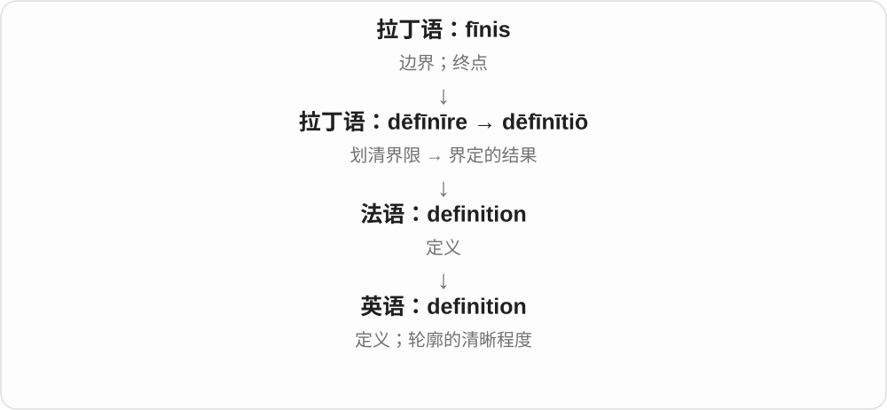

# 1841 · definition — 给概念划界，再看重新划界或定义问题

[逐词精讲目录](../00_逐词精讲目录.md) · [总目录](../00_总目录_按常用程度.md)

## 核心词根与来源

定义可以改变看待事物的边界，不只是换个名称。讨论定义时，也要区分 definitional 和 definitive 的用途。

**DEFINITION：说清“算什么、不算什么”**

definition → redefinition 重新界定；definitional 与定义有关。

- **定义基础**：definition
- **重新界定与相关性质**：redefinition · definitional

## 词形与演化规律

dēfīnīre、dēfīnītiō 等 → definition；re- + definition → redefinition；definition + -al → definitional。

## 单词速览（按词族由简到繁）

同一基础词的相关扩展放在一起，先读基础形式，再读扩展；各组之间优先读常用的。具体词源关系见各词讲解。

| 单词 | 音标 | 核心意思 |
|---|---|---|
| [definition](#w-1) | /ˌdefɪˈnɪʃən/ | 定义；清晰度 |
| [definitional](#w-3) | /ˌdefɪˈnɪʃənəl/ | 定义的、有关定义的；按定义成立的 |
| [redefinition](#w-2) | /ˌriːdefɪˈnɪʃən/ | 重新定义、重新界定 |

## 逐词讲解

### 1. definition — 定义；清晰度

**音标**：/ˌdefɪˈnɪʃən/

**先抓住这个画面**

definition 像给一个概念画圈：圈内哪些算它，圈外哪些不算。图像的 definition 则关心轮廓能不能清清楚楚分开。

**怎么拆**

来自拉丁语 dēfīnītiō，经法语传入。现代可把它与 define 联系，但拼写不是直接写 define + tion；词形对应为 define → definition。

**怎么变成今天的意思**

“界限清楚”同时解释了两个常见意思：定义让概念边界清楚，图像清晰度让物体轮廓清楚。high definition 因而是高清晰度。

**常见搭配与例句**

the definition of…（……的定义）；by definition（按照定义）；high definition（高清晰度）。

> Can you give me a simple definition of the word?

你能用简单的话解释这个词的定义吗？

> The new screen shows the image in high definition.

新屏幕能以高清晰度显示这幅图像。

**别混淆**

definition 说明一个概念到底指什么；example 给出它的一个实例。一个好例子很有帮助，但不一定能代替完整定义。

### 2. definitional — 定义的、有关定义的；按定义成立的

**音标**：/ˌdefɪˈnɪʃənəl/

**先抓住这个画面**

大家争的可能不是事实，而是“这个词到底算哪些东西”；这种围绕划界的问题就是 definitional。

**怎么拆**

definition + -al，组成相关性质形容词，保留 definition 的 -tion 部分；不能简单丢成 define + -al。

**怎么变成今天的意思**

**拉丁 dēfīnīre、dēfīnītiō 等 → 法语、英语 definition**  
划定边界 → 说明一个概念到底包含什么

↓

**definition + -al → definitional**  
与定义、概念界定相关

a definitional issue 定义问题，a definitional dispute 概念界定争议，a definitional difference 定义上的差异。

**常见搭配与例句**

a definitional issue；a definitional dispute；a definitional difference。

> The disagreement is largely definitional.

分歧很大程度上出在定义不同。

> We need to settle the definitional issue first.

我们得先解决概念如何界定的问题。

**别混淆**

definitional 说定义方面，definitive 常说决定性的、权威定本的；都看着像 define 词族，不能只靠中文“定”互换。

### 3. redefinition — 重新定义、重新界定

**音标**：/ˌriːdefɪˈnɪʃən/

**先抓住这个画面**

原来圈出的范围是这样，现在把边界重新画：某个职位包含什么、一个词指哪些情况，都可重新界定。

**怎么拆**

re- 再 + definition 定义，名词组合；也与 redefine 动词对应。definition 的较早来源接划定界限，不把 redefinition 只理解成再抄一次词典。

**怎么变成今天的意思**

**拉丁 dēfīnīre、dēfīnītiō 等 → 法语、英语 definition**  
划定边界 → 说明一个概念到底包含什么

↓

**英语直接扩展**  
redefinition 重新界定；definitional 定义方面的

a redefinition of success 重新界定成功，a redefinition of roles 重新界定角色，a radical redefinition 大幅重新定义。

**常见搭配与例句**

a redefinition of；a radical redefinition；require redefinition。

> The project led to a redefinition of everyone’s role.

项目促使大家的角色分工被重新界定。

> The essay calls for a redefinition of success.

文章主张重新界定成功。

**别混淆**

redefinition 改界定，renaming 改名字；名称没变也能改定义，名称变了也未必改了范围。

## 这一组要分清什么

redefinition/renaming 改定义与改名；definitional/definitive 定义方面与决定、权威性质。

## 串起来练习

A definitional dispute led to a redefinition of the term.

一场定义争议促成了对这个术语的重新界定。
