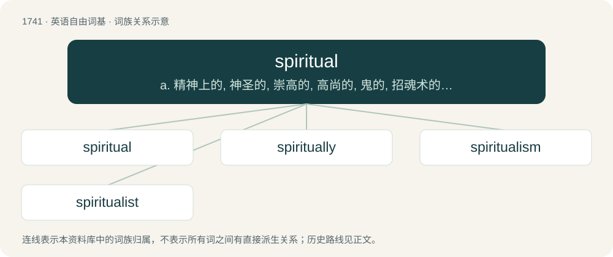

# 1841 · spiritual — a. 精神上的, 神圣的, 崇高的, 高尚的, 鬼的, 招魂术的；n. 有关教会的事

[总目录](../00_总目录_按常用程度.md)

**类型**：英语自由词基　｜　**来源语言**：见词源记录

## 核心含义与来源

- 核心含义：a. 精神上的, 神圣的, 崇高的, 高尚的, 鬼的, 招魂术的；n. 有关教会的事
- 英文含义：Of or pertaining to the spirit or the soul.
- 词形：spiritual

**来源记录 1**（形容词；Of or pertaining to the spirit or the soul.）

From Middle English spiritual, spirituel, from Old French spirituel, from Late Latin spīrituālis, from Latin spīritus. By surface analysis, spirit + -ual.

## 词族图

## 单词速览（常用到不常用）

| 单词 | 音标 | 释义 |
|---|---|---|
| [spiritual](#w-1) | 英 /ˈspɪɹɪtʃʊəl/；美 /ˈspɪɹɪt͡ʃuəl/ | a. 精神上的, 神圣的, 崇高的, 高尚的, 鬼的, 招魂术的；n. 有关教会的事 |
| [spiritually](#w-2) |  | adv. 在精神上地 |
| [spiritualism](#w-3) | /ˈspɪɹɪtjuəlɪzəm/ | n. 唯灵论 |
| [spiritualist](#w-4) | /ˈspiritjjəlist,-tʃjə-/ | n. 唯灵论者, 迷信招魂术者 |

## 逐词详解

### 1. spiritual

**词性**：形容词　｜　**音标**：英 /ˈspɪɹɪtʃʊəl/；美 /ˈspɪɹɪt͡ʃuəl/

**中文释义**：a. 精神上的, 神圣的, 崇高的, 高尚的, 鬼的, 招魂术的；n. 有关教会的事

**英文义项**：Of or pertaining to the spirit or the soul. / Of or pertaining to God or a place of worship; sacred, pure; (Christianity, specifically) inspired by the Holy Spirit.

**构词拆分**：By surface analysis, spirit + -ual

**词源与演化**：

From Middle English spiritual, spirituel, from Old French spirituel, from Late Latin spīrituālis, from Latin spīritus. By surface analysis, spirit + -ual.

**例句**：

> Respect towards ancestors is an essential part of Thai spiritual practice.

该用例对应义项：Of or pertaining to the spirit or the soul.

### 2. spiritually

**词性**：副词

**中文释义**：adv. 在精神上地

**英文义项**：In a manner affecting, relating or pertaining to the spirit or the soul. / Identical (or similar) in vibes to; best understood through the connotations of

**构词拆分**：spiritual + -ly

**词源与演化**：

From spiritual + -ly.

**例句**：

> Oxford is spiritually London.

该用例对应义项：Identical (or similar) in vibes to; best understood through the connotations of

### 3. spiritualism

**词性**：名词　｜　**音标**：/ˈspɪɹɪtjuəlɪzəm/

**中文释义**：n. 唯灵论

**英文义项**：A doctrine, opposing materialism, that claims transcendency of the divine being, the altogether spiritual character of reality and the value of inwardness of consciousness. / A belief that the dead communicate with the living, especially through a medium. Used in a broader sense than spiritism.

**构词拆分**：spiritual + -ism

**词源与演化**：

From spiritual + -ism. In Allan Kardec's book The Spirits Book (1857) (Le Livre des Esprits in the original French), in which a distinction between spiritism and spiritualism is defined.

**例句**：

> Philosophically spiritualism shows a strong tendency to develop into either panpsychism or transcendentalism.

### 4. spiritualist

**词性**：名词　｜　**音标**：/ˈspiritjjəlist,-tʃjə-/

**中文释义**：n. 唯灵论者, 迷信招魂术者

**英文义项**：One who professes a regard for spiritual things only; one whose employment is of a spiritual character; an ecclesiastic. / One who maintains the philosophic doctrine of spiritualism.

**构词拆分**：spiritual + -ist

**词源与演化**：

From spiritual + -ist.

**例句**：

> Many prominent bourgeois philosophers in England are members of spiritualist and theosophical societies.
