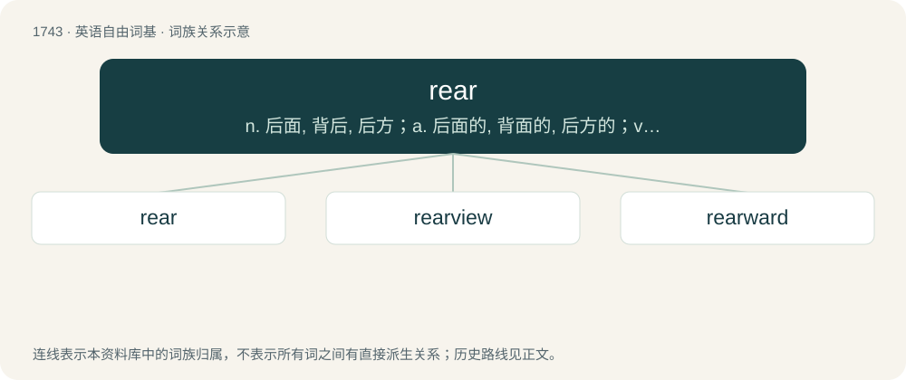

# 1842 · rear — n. 后面, 背后, 后方；a. 后面的, 背面的, 后方的；vt. 养育, 培养, 饲养, 举起, 树立, 栽种

[总目录](../00_总目录_按常用程度.md)

**类型**：英语自由词基　｜　**来源语言**：见词源记录

## 核心含义与来源

- 核心含义：n. 后面, 背后, 后方；a. 后面的, 背面的, 后方的；vt. 养育, 培养, 饲养, 举起, 树立, 栽种
- 英文含义：To bring up to maturity, as offspring; to educate; to instruct; to foster.
- 词形：rear

**多个词源／构词路径**：同一拼写可能有不同来源；以下按词性和含义分别列出。

**来源记录 1**（动词；To bring up to maturity, as offspring; to educate; to instruct; to foster.）

From Middle English reren (“to raise”), from Old English rǣran (“to raise, set upright, promote, exalt, begin, create, give rise to, excite, rouse, arouse, stir up”), from Proto-West Germanic \*raiʀijan, from Proto-Germanic \*raizijaną, \*raisijaną (“to cause to rise, raise”), from Proto-Indo-European \*h₁rey- (“to lift oneself, rise”). Cognate with Scots rere (“to construct, build, rear”), Icelandic reisa (“to raise”), Gothic 𐍂𐌰𐌹𐍃𐌾𐌰𐌽 (raisjan, “to cause to rise, lift up, establish”), German reisen (“to travel”, literally “to rear up and depart”); and a doublet of raise. More at rise. Related to rise and raise, which is used for several of its now archaic or obsolete senses and for some of its senses that are currently more common in other dialects of English.

**来源记录 2**（形容词；Being behind, or in the hindmost part; hindmost.）

From Middle English rere, from Anglo-Norman rere, ultimately from Latin retro. Compare arrear. Doublet of retro.

**来源记录 3**（动词；To move; stir.）

From Middle English reren, from Old English hrēran (“to move, shake, agitate”), from Proto-Germanic \*hrōzijaną (“to stir”), from Proto-Indo-European \*ḱroHs- (“to mix, stir, cook”). Cognate with Dutch roeren (“to stir, shake, whip”), German rühren (“to stir, beat, move”), Swedish röra (“to touch, move, stir”), Icelandic hræra (“to stir”).

**来源记录 4**（形容词；(of eggs) Underdone; nearly raw.）

From Middle English rere, from Old English hrēr, hrēre (“not thoroughly cooked, underdone, lightly boiled”), from hrēran (“to move, shake, agitate”), from Proto-Germanic \*hrōzijaną (“to stir”), from Proto-Indo-European \*ḱroHs- (“to mix, stir, cook”). Related to Old English hrōr (“stirring, busy, active, strong, brave”), Dutch roeren (“to stir, shake, whip”), German rühren (“to stir, beat, move”), Swedish röra (“to touch, move, stir”), Icelandic hræra (“to stir”).

## 词族图

## 单词速览（常用到不常用）

| 单词 | 音标 | 释义 |
|---|---|---|
| [rear](#w-1) | 英 /ˈɹɪə/；美 /ˈɹɪɚ/ | n. 后面, 背后, 后方；a. 后面的, 背面的, 后方的；vt. 养育, 培养, 饲养, 举起, 树立, 栽种 |
| [rearview](#w-2) | 英 /ˈɹɪəvjuː/；美 /ˈɹɪɹvjuː/ | mirror(车辆上的)后视镜 |
| [rearward](#w-3) | 英 /ˈɹɪəwɜːd/；美 /ˈɹiɹwɝd/ | adv. 在背后, 向后方；n. 后方, 后部, 背后；a. 向后方的, 在末尾的 |

## 逐词详解

### 1. rear

**词性**：动词　｜　**音标**：英 /ˈɹɪə/；美 /ˈɹɪɚ/

**中文释义**：n. 后面, 背后, 后方；a. 后面的, 背面的, 后方的；vt. 养育, 培养, 饲养, 举起, 树立, 栽种

**英文义项**：To bring up to maturity, as offspring; to educate; to instruct; to foster. / To breed and raise.

**词源与演化**：

From Middle English reren (“to raise”), from Old English rǣran (“to raise, set upright, promote, exalt, begin, create, give rise to, excite, rouse, arouse, stir up”), from Proto-West Germanic \*raiʀijan, from Proto-Germanic \*raizijaną, \*raisijaną (“to cause to rise, raise”), from Proto-Indo-European \*h₁rey- (“to lift oneself, rise”). Cognate with Scots rere (“to construct, build, rear”), Icelandic reisa (“to raise”), Gothic 𐍂𐌰𐌹𐍃𐌾𐌰𐌽 (raisjan, “to cause to rise, lift up, establish”), German reisen (“to travel”, literally “to rear up and depart”); and a doublet of raise. More at rise. Related to rise and raise, which is used for several of its now archaic or obsolete senses and for some of its senses that are currently more common in other dialects of English.

**例句**：

> The family has been rearing cattle for 200 years.

该用例对应义项：To breed and raise.

### 2. rearview

**词性**：形容词　｜　**音标**：英 /ˈɹɪəvjuː/；美 /ˈɹɪɹvjuː/

**中文释义**：mirror(车辆上的)后视镜

**英文义项**：That provides a view from or to the rear.

**构词拆分**：From rear + view.

**词源与演化**：

From rear + view.

**例句**：

> Tom had a pair of fuzzy dice hanging from his rearview mirror.

### 3. rearward

**词性**：形容词　｜　**音标**：英 /ˈɹɪəwɜːd/；美 /ˈɹiɹwɝd/

**中文释义**：adv. 在背后, 向后方；n. 后方, 后部, 背后；a. 向后方的, 在末尾的

**英文义项**：Toward the back or rear of something.

**构词拆分**：rear + -ward

**词源与演化**：

From rear + -ward.

**例句**：

> The rearward seats of the bus were unpleasantly close to the toilet facilities.

该用例对应义项：Toward the back or rear of something.
