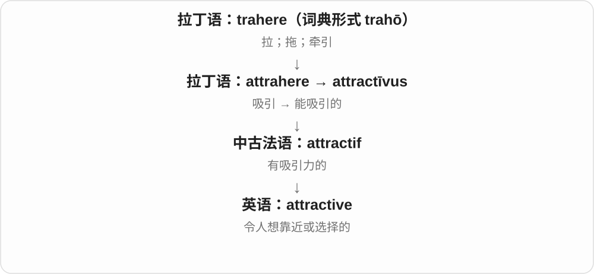
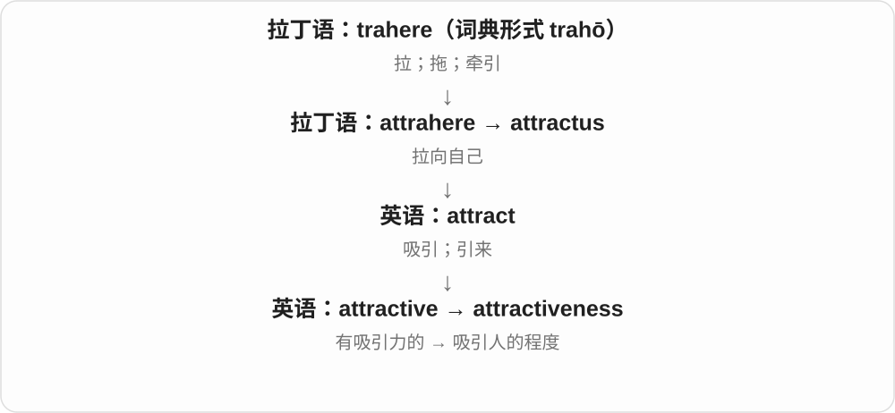

# 1843 · attractive — 吸引眼光，也吸引兴趣和选择

[逐词精讲目录](../00_逐词精讲目录.md) · [总目录](../00_总目录_按常用程度.md)

## 核心词根与来源

美观、价格合意、条件诱人都能是 attractive，别把整族只缩成形容人的长相。

**ATTRACTIVE：像把注意力拉过来**

attractive → attractively、attractiveness；unattractive 缺少吸引力。

- **吸引性质、方式与吸引力**：attractive · attractively · attractiveness
- **缺乏吸引力**：unattractive

## 词形与演化规律

attrahere、attract- → attractive；+ -ly/-ness；un- + attractive。

## 单词速览（按词族由简到繁）

同一基础词的相关扩展放在一起，先读基础形式，再读扩展；各组之间优先读常用的。具体词源关系见各词讲解。

| 单词 | 音标 | 核心意思 |
|---|---|---|
| [attractive](#w-1) | /əˈtræktɪv/ | 有吸引力的；好看的；诱人的 |
| [attractiveness](#w-3) | /əˈtræktɪvnəs/ | 吸引力；吸引人的程度 |
| [attractively](#w-4) | /əˈtræktɪvli/ | 有吸引力地；美观地；有诱惑力地 |
| [unattractive](#w-2) | /ˌʌnəˈtræktɪv/ | 不好看的；缺乏吸引力的、不诱人的 |

## 逐词讲解

### 1. attractive — 有吸引力的；好看的；诱人的

**音标**：/əˈtræktɪv/

**先抓住这个画面**

attractive 让人愿意靠近、选择或多看一眼。人可以好看，价格可以划算，工作机会可以很值得考虑。

**怎么拆**

经法语 attractif，来自拉丁语 attractīvus；现代对照 attract + -ive。

**怎么变成今天的意思**

它把“吸引”变成对象的特点。attractive salary 通常是薪资条件不错，绝不是说数字长得漂亮。

**常见搭配与例句**

an attractive offer；an attractive price；look attractive；attractive to buyers。

> The apartment is attractive to people who work downtown.

这套公寓对在市中心工作的人很有吸引力。

> They offered her an attractive salary.

他们给她开出了诱人的薪资。

**别混淆**

beautiful 更直接评价美；attractive 的范围更广，能包括实惠、便利和机会。

### 2. attractiveness — 吸引力；吸引人的程度

**音标**：/əˈtræktɪvnəs/

**先抓住这个画面**

attractiveness 问“为什么人愿意选它、它有多吸引人”。它可以来自外貌，也可以来自地段、价格或方便程度。

**怎么拆**

attractive + -ness，表示“有吸引力”这种性质。

**怎么变成今天的意思**

形容词夸这个对象有吸引力，名词让你进一步分析或比较这种吸引力。不是只用于外貌打分。

**常见搭配与例句**

the attractiveness of…；increase attractiveness；commercial attractiveness；physical attractiveness。

> Better transport increased the attractiveness of the area.

交通改善提高了这个地区的吸引力。

> The study examined the attractiveness of different job offers.

研究考察了不同工作机会的吸引力。

**别混淆**

attractiveness 评价吸引人的程度；attraction 还可以数具体的景点。三个景点是 three attractions，不是 three attractivenesses。

### 3. attractively — 有吸引力地；美观地；有诱惑力地

**音标**：/əˈtræktɪvli/

**先抓住这个画面**

东西摆出来、价格报出来，让人愿意多看一眼、考虑一下；副词说做法怎样把兴趣拉过来。

**怎么拆**

attractive + -ly，修饰布置、设计、定价等动作。吸引可以靠外观、条件或好处，不只人的长相。

**怎么变成今天的意思**

**拉丁 attrahere、attract- 词族 → attractive**  
拉过来 → 有把注意、兴趣拉过来的力量

↓

**attractive + -ly → attractively**  
以美观、引人兴趣的方式

attractively designed 设计美观，attractively displayed 陈列得诱人，attractively priced 价格有吸引力。

**常见搭配与例句**

attractively designed；attractively displayed；attractively priced。

> The products were attractively displayed in the window.

产品在橱窗里陈列得很吸引人。

> The rooms are attractively priced for weekend visitors.

对周末游客来说，这些房间的价格很有吸引力。

**别混淆**

attractively priced 表示价格吸引目标顾客，不必是全场最低；attractively 说方式，attractiveness 才是名词吸引力。

### 4. unattractive — 不好看的；缺乏吸引力的、不诱人的

**音标**：/ˌʌnəˈtræktɪv/

**先抓住这个画面**

看了不想多看，或条件摆出来觉得不值得去选；除了外表，还常评价报价、选择和结果。

**怎么拆**

un- 不 + attractive 有吸引力的，否定的是吸引性质，不是 undo 那种把动作反过来。

**怎么变成今天的意思**

**拉丁 attrahere、attract- 词族 → attractive**  
拉过来 → 有把注意、兴趣拉过来的力量

↓

**un- + attractive → unattractive**  
不吸引眼光、兴趣或选择

an unattractive building 不好看的建筑，an unattractive offer 不诱人的报价，an unattractive prospect 不令人向往的前景。

**常见搭配与例句**

an unattractive building；an unattractive offer；an unattractive prospect。

> The extra fees made the offer unattractive.

额外费用让报价失去了吸引力。

> The building is plain rather than unattractive.

这栋楼只是朴素，还不至于难看。

**别混淆**

unattractive 不吸引，不等于 impossible 不可能；有个选择虽然 unattractive，仍可能不得不选。

## 这一组要分清什么

attractively/attractiveness 副词方式与名词；unattractive/impossible 不想选与无法选。

## 串起来练习

Attractive packaging adds to the product’s attractiveness, but an unattractive price can still put people off.

好看的包装会增添产品吸引力，但不诱人的价格仍会让人退却。
