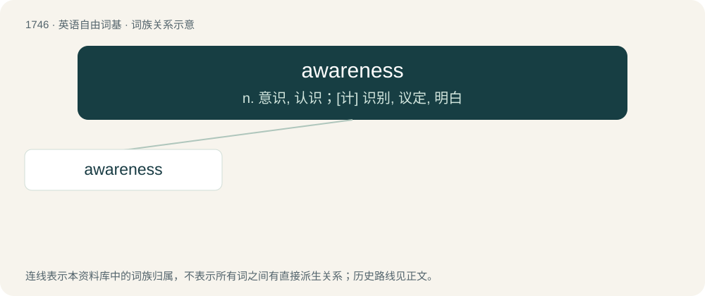

# 1844 · awareness — n. 意识, 认识；\[计\] 识别, 议定, 明白

[总目录](../00_总目录_按常用程度.md)

**类型**：英语自由词基　｜　**来源语言**：见词源记录

## 核心含义与来源

- 核心含义：n. 意识, 认识；\[计\] 识别, 议定, 明白
- 英文含义：The state or level of consciousness where sense data can be confirmed by an observer.
- 词形：awareness

**来源记录 1**（名词；The state or level of consciousness where sense data can be confirmed by an observer.）

From aware + -ness.

## 词族图

## 单词速览（常用到不常用）

| 单词 | 音标 | 释义 |
|---|---|---|
| [awareness](#w-1) | 英 /əˈwɛə.nəs/；美 /əˈwɛɹ.nəs/ | n. 意识, 认识；\[计\] 识别, 议定, 明白 |

## 逐词详解

### 1. awareness

**词性**：名词　｜　**音标**：英 /əˈwɛə.nəs/；美 /əˈwɛɹ.nəs/

**中文释义**：n. 意识, 认识；\[计\] 识别, 议定, 明白

**英文义项**：The state or level of consciousness where sense data can be confirmed by an observer. / The state or quality of being aware of something.

**构词拆分**：aware + -ness

**词源与演化**：

From aware + -ness.

**例句**：

> I gradually passed from sleep to full awareness.

该用例对应义项：The state or level of consciousness where sense data can be confirmed by an observer.
