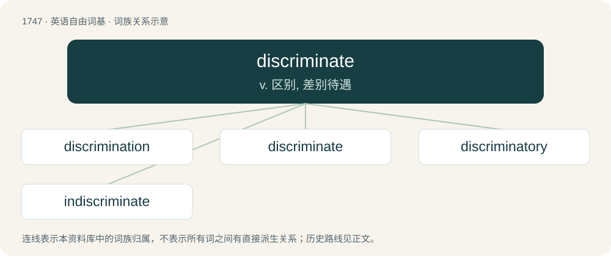

# 1845 · discriminate — v. 区别, 差别待遇

[总目录](../00_总目录_按常用程度.md)

**类型**：英语自由词基　｜　**来源语言**：见词源记录

## 核心含义与来源

- 核心含义：v. 区别, 差别待遇
- 英文含义：To make distinctions.
- 词形：discriminate

**来源记录 1**（动词；To make distinctions.）

First attested in 1615; borrowed from Latin discrīminātus, perfect passive participle of discrīminō (“to divide, separate, distinguish”) (see -ate (verb-forming suffix) and -ate (adjective-forming suffix)), from discrīmen (“a space between, division, separation, distinction”), from discernō (“to divide, separate, distinguish, discern”). By surface analysis, dis- + criminate.

## 词族图

## 单词速览（常用到不常用）

| 单词 | 音标 | 释义 |
|---|---|---|
| [discrimination](#w-1) | 英 /dɪskɹɪmɪˈneɪʃən/；美 /dɪˌskɹɪm.əˈneɪʃən/ | n. 差别, 岐视, 辨别力；\[化\] 鉴别 |
| [discriminate](#w-2) | 英 /dɪˈskɹɪm.ɪ.neɪt/；美 /dɪˈskɹɪm.əˌneɪt/ | v. 区别, 差别待遇 |
| [discriminatory](#w-3) | 英 /dɪsˈkɹɪmɪnət(ə)ɹɪ/；美 /dɪsˈkɹɪmɪnəˌtɔɹi/ | a. 有辨识力的, 有差别的 |
| [indiscriminate](#w-4) | 英 /ɪn.dɪsˈkɹɪm.ɪn.ət/ | a. 无差别的, 任意的, 杂乱的；\[医\] 无差别的, 普遍的 |

## 逐词详解

### 1. discrimination

**词性**：名词　｜　**音标**：英 /dɪskɹɪmɪˈneɪʃən/；美 /dɪˌskɹɪm.əˈneɪʃən/

**中文释义**：n. 差别, 岐视, 辨别力；\[化\] 鉴别

**英文义项**：Discernment, the act of discriminating, discerning, distinguishing, noting or perceiving differences between things, with the intent to understand rightly and make correct decisions. / Differential treatment of an individual or group to their disadvantage; treatment or consideration based on class or category rather than individual merit; partiality; prejudice; bigotry.

**构词拆分**：discriminate + -ion

**词源与演化**：

Learned borrowing from Latin discrīminātiō, discrīminātiōnem, the action noun to discrīminō, discrīmināre (“distinguish”). Equivalent to discriminate + -ion. In English use from the 17th century.

**用法示例／搭配（非完整句）**：

> sexual or racial discrimination

该用例对应义项：Differential treatment of an individual or group to their disadvantage; treatment or consideration based on class or category rather than individual merit; partiality; prejudice; bigotry.

### 2. discriminate

**词性**：动词　｜　**音标**：英 /dɪˈskɹɪm.ɪ.neɪt/；美 /dɪˈskɹɪm.əˌneɪt/

**中文释义**：v. 区别, 差别待遇

**英文义项**：To make distinctions. / To treat or affect differently, depending on differences in traits.

**词源与演化**：

First attested in 1615; borrowed from Latin discrīminātus, perfect passive participle of discrīminō (“to divide, separate, distinguish”) (see -ate (verb-forming suffix) and -ate (adjective-forming suffix)), from discrīmen (“a space between, division, separation, distinction”), from discernō (“to divide, separate, distinguish, discern”). By surface analysis, dis- + criminate.

**例句**：

> Since he was color blind he was unable to discriminate between the blue and green bottles.

该用例对应义项：To make distinctions.

### 3. discriminatory

**词性**：形容词　｜　**音标**：英 /dɪsˈkɹɪmɪnət(ə)ɹɪ/；美 /dɪsˈkɹɪmɪnəˌtɔɹi/

**中文释义**：a. 有辨识力的, 有差别的

**英文义项**：Of or pertaining to discrimination (in all senses). / Showing prejudice or bias.

**构词拆分**：discriminate + -ory

**词源与演化**：

From discriminate + -ory.

**用法示例／搭配（非完整句）**：

> be discriminatory towards/against someone

该用例对应义项：Showing prejudice or bias.

### 4. indiscriminate

**词性**：形容词　｜　**音标**：英 /ɪn.dɪsˈkɹɪm.ɪn.ət/

**中文释义**：a. 无差别的, 任意的, 杂乱的；\[医\] 无差别的, 普遍的

**英文义项**：Not marked by discrimination or discernment; (by extension) confused, promiscuous. / Without care in making distinctions, thoughtless.

**构词拆分**：in- + discriminate

**词源与演化**：

First attested in 1598; from in- + discriminate.

**例句**：

> How can anyone be so indiscriminate in making friends as he is?

该用例对应义项：Without care in making distinctions, thoughtless.
