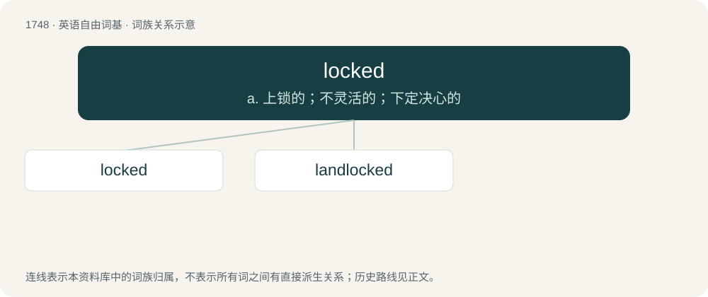

# 1848 · locked — a. 上锁的；不灵活的；下定决心的

[总目录](../00_总目录_按常用程度.md)

**类型**：英语自由词基　｜　**来源语言**：见词源记录

## 核心含义与来源

- 核心含义：a. 上锁的；不灵活的；下定决心的
- 英文含义：Having undergone locking; secured by a lock.
- 词形：locked

**来源记录 1**（形容词；Having undergone locking; secured by a lock.）

\* (drunk): Perhaps from airlocked.

## 词族图

## 单词速览（常用到不常用）

| 单词 | 音标 | 释义 |
|---|---|---|
| [locked](#w-1) | 英 /lɒkt/；美 /lɑkt/ | a. 上锁的；不灵活的；下定决心的 |
| [landlocked](#w-2) | 英 /ˈlændlɒkt/；美 /ˈlændlɑkt/ | a. 被陆地围住的 |

## 逐词详解

### 1. locked

**词性**：形容词　｜　**音标**：英 /lɒkt/；美 /lɑkt/

**中文释义**：a. 上锁的；不灵活的；下定决心的

**英文义项**：Having undergone locking; secured by a lock. / Protected by a mutex or other token restricting access to a resource.

**词源与演化**：

\* (drunk): Perhaps from airlocked.

**例句**：

> You can't delete a locked computer file.

该用例对应义项：Protected by a mutex or other token restricting access to a resource.

### 2. landlocked

**词性**：形容词　｜　**音标**：英 /ˈlændlɒkt/；美 /ˈlændlɑkt/

**中文释义**：a. 被陆地围住的

**英文义项**：Of a country, region, etc., surrounded by land (having no borders with the sea). / Living in freshwater, such as landlocked salmon.

**构词拆分**：land + locked

**词源与演化**：

From land + locked (i.e. "locked-in by land on all sides").

**例句**：

> Switzerland is landlocked and obviously will never be a great sea power and must always trade overland.

该用例对应义项：Of a country, region, etc., surrounded by land (having no borders with the sea).
