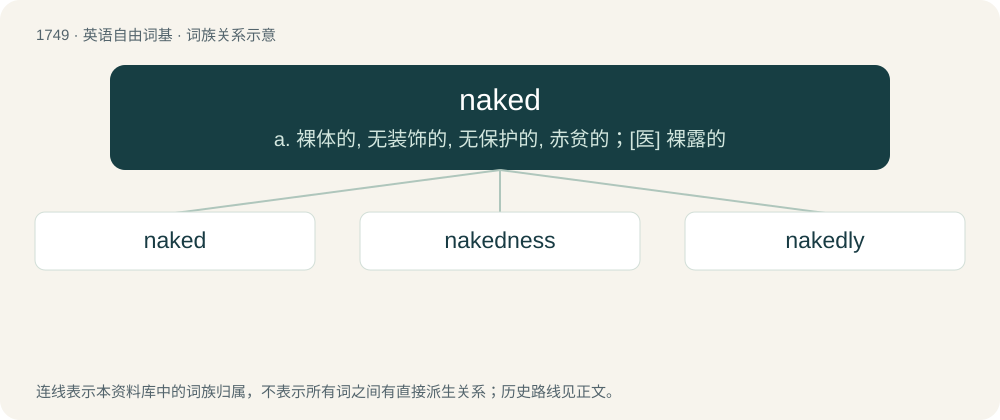

# 1849 · naked — a. 裸体的, 无装饰的, 无保护的, 赤贫的；\[医\] 裸露的

[总目录](../00_总目录_按常用程度.md)

**类型**：英语自由词基　｜　**来源语言**：见词源记录

## 核心含义与来源

- 核心含义：a. 裸体的, 无装饰的, 无保护的, 赤贫的；\[医\] 裸露的
- 英文含义：Bare, not covered by clothing.
- 词形：naked

**来源记录 1**（形容词；Bare, not covered by clothing.）

From Middle English naked, from Old English nacod, from Proto-West Germanic \*nak(k)wad, from Proto-Germanic \*nakwadaz, from Proto-Indo-European \*negʷ- (“naked”). Doublet of nude (remotely).

## 词族图

## 单词速览（常用到不常用）

| 单词 | 音标 | 释义 |
|---|---|---|
| [naked](#w-1) | /ˈneɪkɪd/ | a. 裸体的, 无装饰的, 无保护的, 赤贫的；\[医\] 裸露的 |
| [nakedness](#w-2) | /ˈneikidnis/ | n. 裸, 明显, 赤身裸体 |
| [nakedly](#w-3) |  | adv. 裸体地；露出地 |

## 逐词详解

### 1. naked

**词性**：形容词　｜　**音标**：/ˈneɪkɪd/

**中文释义**：a. 裸体的, 无装饰的, 无保护的, 赤贫的；\[医\] 裸露的

**英文义项**：Bare, not covered by clothing. / Unadorned, without decoration or circumlocution; put bluntly.

**词源与演化**：

From Middle English naked, from Old English nacod, from Proto-West Germanic \*nak(k)wad, from Proto-Germanic \*nakwadaz, from Proto-Indo-European \*negʷ- (“naked”). Doublet of nude (remotely).

**例句**：

> We naked apes must be ever watchful for thorns and poison ivy as we hike the trail.

该用例对应义项：Having no fur, feathers or scales on the skin; like a human.

### 2. nakedness

**词性**：名词　｜　**音标**：/ˈneikidnis/

**中文释义**：n. 裸, 明显, 赤身裸体

**英文义项**：The state or condition of being naked; nudity; bareness; defenselessness; undisguisedness.

**构词拆分**：naked + -ness

**词源与演化**：

From Middle English nakednesse, from Old English nacodnes (“nakedness”); equivalent to naked + -ness. Cognate with West Frisian neakenens (“nakedness”).

**例句**：

> The nakedness of woman is the work of God.

### 3. nakedly

**词性**：副词

**中文释义**：adv. 裸体地；露出地

**英文义项**：In a naked manner; without concealing anything; blatantly or openly.

**构词拆分**：naked + -ly

**词源与演化**：

From Middle English nakidly; equivalent to naked + -ly.

**例句**：

> They were attacked as they huddled nakedly on the bare hill.

该用例对应义项：in an exposed manner; without protection or defense
