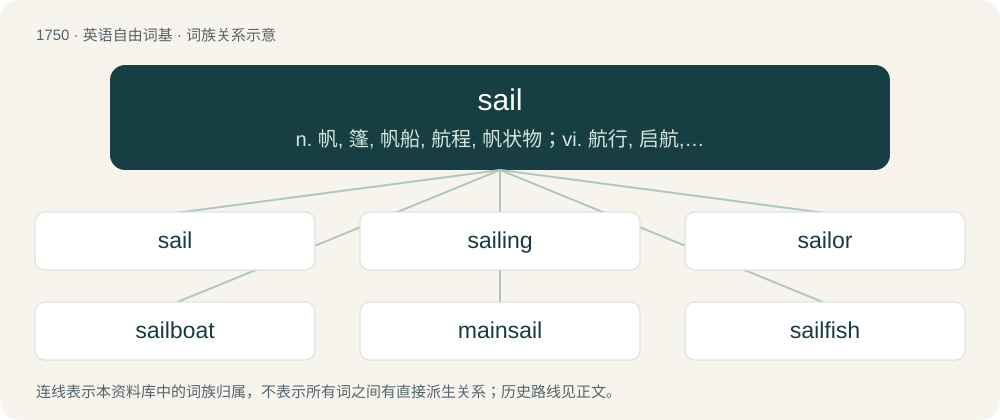

# 1850 · sail — n. 帆, 篷, 帆船, 航程, 帆状物；vi. 航行, 启航, 张帆而行；vt. 航行于, 驾船

[总目录](../00_总目录_按常用程度.md)

**类型**：英语自由词基　｜　**来源语言**：见词源记录

## 核心含义与来源

- 核心含义：n. 帆, 篷, 帆船, 航程, 帆状物；vi. 航行, 启航, 张帆而行；vt. 航行于, 驾船
- 英文含义：A piece of fabric attached to a boat and arranged such that it causes the wind to drive the boat along. The sail may be attached to the boat via a combination of mast, spars and ropes.
- 词形：sail

**多个词源／构词路径**：同一拼写可能有不同来源；以下按词性和含义分别列出。

**来源记录 1**（名词；A piece of fabric attached to a boat and arranged such that it causes the wind to drive the boat along. The sail may be attached to the boat via a combination of mast, spars and ropes.）

From Middle English saile, sayle, seil, seyl, from Old English seġl, from Proto-West Germanic \*segl, from Proto-Germanic \*seglą. Cognate with West Frisian seil, Low German Segel, Dutch zeil, German Segel, Danish sejl, Swedish segel.

**来源记录 2**（动词；To be impelled or driven forward by the action of wind upon sails, as a ship on water; to be impelled on a body of water by steam or other power.）

From Middle English sailen, saylen, seilen, seilien, from Old English seġlan, siġlan (“to sail”), from Proto-West Germanic \*siglijan, from \*siglijaną. Cognate with West Frisian sile, Low German seilen, Dutch zeilen, German segeln, Danish sejle, Swedish segla, Icelandic sigla.

## 词族图

## 单词速览（常用到不常用）

| 单词 | 音标 | 释义 |
|---|---|---|
| [sail](#w-1) | /seɪl/ | n. 帆, 篷, 帆船, 航程, 帆状物；vi. 航行, 启航, 张帆而行；vt. 航行于, 驾船 |
| [sailing](#w-2) | /ˈseɪ.lɪŋ/ | n. 航行, 航海术, 启航；a. 航行的 |
| [sailor](#w-3) | 英 /ˈseɪ.lə/；美 /ˈseɪ.lɚ/ | n. 水手, 船员, 海员；\[法\] 水手, 船员, 海员 |
| [sailboat](#w-4) | 英 /ˈseɪlˌbəʊt/；美 /ˈseɪlˌboʊt/ | n. 帆船 |
| [mainsail](#w-5) | /ˈmeɪnseɪl/ | n. 大桅的帆, 主帆 |
| [sailfish](#w-6) | /ˈseɪlˌfɪʃ/ | n. 旗鱼 |
| [topsail](#w-7) | 英 /ˈtɒp.seɪl/；美 /ˈtɑp.seɪl/ | n. 上桅帆 |

## 逐词详解

### 1. sail

**词性**：名词　｜　**音标**：/seɪl/

**中文释义**：n. 帆, 篷, 帆船, 航程, 帆状物；vi. 航行, 启航, 张帆而行；vt. 航行于, 驾船

**英文义项**：A piece of fabric attached to a boat and arranged such that it causes the wind to drive the boat along. The sail may be attached to the boat via a combination of mast, spars and ropes. / The concept of a sail or sails, as if a substance.

**词源与演化**：

From Middle English saile, sayle, seil, seyl, from Old English seġl, from Proto-West Germanic \*segl, from Proto-Germanic \*seglą. Cognate with West Frisian seil, Low German Segel, Dutch zeil, German Segel, Danish sejl, Swedish segel.

**例句**：

> Take in sail: a storm is coming.

该用例对应义项：The concept of a sail or sails, as if a substance.

### 2. sailing

**词性**：形容词　｜　**音标**：/ˈseɪ.lɪŋ/

**中文释义**：n. 航行, 航海术, 启航；a. 航行的

**英文义项**：Travelling by ship.

**构词拆分**：sail + -ing

**词源与演化**：

From Middle English saylinge, seilinge, variants of sailende, seilende; equivalent to sail + -ing. Cognate with Dutch zeilend (“sailing”).

**例句**：

> I would if I could, but I'm taking sailing lessons this week.

### 3. sailor

**词性**：名词　｜　**音标**：英 /ˈseɪ.lə/；美 /ˈseɪ.lɚ/

**中文释义**：n. 水手, 船员, 海员；\[法\] 水手, 船员, 海员

**英文义项**：A person who sails; one whose occupation is sailing or navigating ships or other waterborne craft. / In particular, a member of the crew of a (civilian or military) vessel, as opposed to a captain, admiral, etc.; a mariner; a common seaman.

**构词拆分**：sail + -or

**词源与演化**：

Alteration of earlier sailer, from Middle English sailer, sayler, saylere, equivalent to sail + -or. Cognate with German Segler (“sailor”). Eclipsed non-native Middle English marinel, marynell (“sailor”) borrowed from Old French marinel (“sailor”). See mariner.

**例句**：

> He's a talented sailor and has spent many years at sea.

该用例对应义项：A person who sails; one whose occupation is sailing or navigating ships or other waterborne craft.

### 4. sailboat

**词性**：名词　｜　**音标**：英 /ˈseɪlˌbəʊt/；美 /ˈseɪlˌboʊt/

**中文释义**：n. 帆船

**英文义项**：A boat propelled by a sail. / A playing card with the rank of four.

**构词拆分**：sail + boat

**词源与演化**：

From sail + boat.

**例句**：

> The sun glittered on the water in front of the old sailboat.

### 5. mainsail

**词性**：名词　｜　**音标**：/ˈmeɪnseɪl/

**中文释义**：n. 大桅的帆, 主帆

**英文义项**：The largest (or only) sail on a sailing vessel.

**构词拆分**：From main + sail.

**词源与演化**：

From main + sail.

### 6. sailfish

**词性**：名词　｜　**音标**：/ˈseɪlˌfɪʃ/

**中文释义**：n. 旗鱼

**英文义项**：A fish of the genus Istiophorus, having a characteristic sail-like fin on its back. / The basking shark (Cetorhinus maximus).

**构词拆分**：sail + fish

**词源与演化**：

From sail + fish.

**例句**：

> It took us four hours to land that sailfish.

### 7. topsail

**词性**：名词　｜　**音标**：英 /ˈtɒp.seɪl/；美 /ˈtɑp.seɪl/

**中文释义**：n. 上桅帆

**英文义项**：A sail or either of the two sails rigged just above the course sail and supported by the topmast on a square-rigged sailing ship. / In a fore-and-aft-rigged sailing boat, the sail that is set above the gaff at the top part of the mast.

**构词拆分**：top + sail

**词源与演化**：

From Middle English topsail, topsayl, topseyle, topsaill, equivalent to top + sail.
