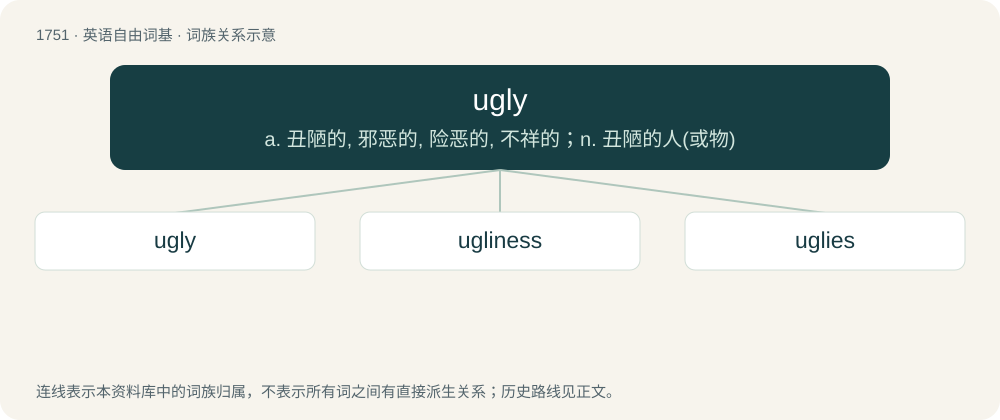

# 1851 · ugly — a. 丑陋的, 邪恶的, 险恶的, 不祥的；n. 丑陋的人(或物)

[总目录](../00_总目录_按常用程度.md)

**类型**：英语自由词基　｜　**来源语言**：见词源记录

## 核心含义与来源

- 核心含义：a. 丑陋的, 邪恶的, 险恶的, 不祥的；n. 丑陋的人(或物)
- 英文含义：Displeasing to the eye; aesthetically unpleasing.
- 词形：ugly

**来源记录 1**（形容词；Displeasing to the eye; aesthetically unpleasing.）

Inherited from Middle English ugly, uggely, uglike, borrowed from Old Norse uggligr (“fearful, dreadful, horrible in appearance”), from uggr (“fear, apprehension, dread”) (possibly related to agg (“strife, hate”)), equivalent to ug + -ly. Cognate with Scots ugly, uglie, Icelandic ugglegur. Meaning softened to "very unpleasant to look at" around the late 14th century, and sense of "morally offensive" attested from around 1300. For the meaning development compare Bulgarian грозен (grozen) (&lt; Proto-Slavic \*grozьnъ), Russian стра́шный (strášnyj) (&lt; Proto-Slavic \*strašьnъ &lt; \*straxъ); Latin foedus (&lt; Proto-Indo-European \*bʰeyh₂-).

## 词族图

## 单词速览（常用到不常用）

| 单词 | 音标 | 释义 |
|---|---|---|
| [ugly](#w-1) | /ˈʌɡli/ | a. 丑陋的, 邪恶的, 险恶的, 不祥的；n. 丑陋的人(或物) |
| [ugliness](#w-2) | 美 /ˈʌɡlinɪs/ | n. 丑陋 |
| [uglies](#w-3) |  | (ugly 的复数) a. 丑陋的, 邪恶的, 险恶的, 不祥的；n. 丑陋的人(或物) |

## 逐词详解

### 1. ugly

**词性**：形容词　｜　**音标**：/ˈʌɡli/

**中文释义**：a. 丑陋的, 邪恶的, 险恶的, 不祥的；n. 丑陋的人(或物)

**英文义项**：Displeasing to the eye; aesthetically unpleasing. / Displeasing to the ear or some other sense.

**构词拆分**：ug + -ly

**词源与演化**：

Inherited from Middle English ugly, uggely, uglike, borrowed from Old Norse uggligr (“fearful, dreadful, horrible in appearance”), from uggr (“fear, apprehension, dread”) (possibly related to agg (“strife, hate”)), equivalent to ug + -ly. Cognate with Scots ugly, uglie, Icelandic ugglegur. Meaning softened to "very unpleasant to look at" around the late 14th century, and sense of "morally offensive" attested from around 1300. For the meaning development compare Bulgarian грозен (grozen) (&lt; Proto-Slavic \*grozьnъ), Russian стра́шный (strášnyj) (&lt; Proto-Slavic \*strašьnъ &lt; \*straxъ); Latin foedus (&lt; Proto-Indo-European \*bʰeyh₂-).

**例句**：

> With all this competition, expect things to get ugly.

该用例对应义项：Unpleasant; disagreeable; likely to cause trouble or loss.

### 2. ugliness

**词性**：名词　｜　**音标**：美 /ˈʌɡlinɪs/

**中文释义**：n. 丑陋

**英文义项**：The condition of being ugly. / An unsightly or frightful object.

**构词拆分**：ugly + -ness

**词源与演化**：

From ugly + -ness.

**例句**：

> There was some ugliness at the council meeting.

该用例对应义项：Unpleasant behaviour.

### 3. uglies

**词性**：名词

**中文释义**：(ugly 的复数) a. 丑陋的, 邪恶的, 险恶的, 不祥的；n. 丑陋的人(或物)

**英文义项**：Ugliness.

**构词拆分**：ugly + -s

**词源与演化**：

From ugly + -s.
