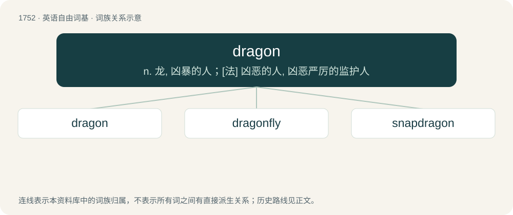

# 1854 · dragon — n. 龙, 凶暴的人；\[法\] 凶恶的人, 凶恶严厉的监护人

[总目录](../00_总目录_按常用程度.md)

**类型**：英语自由词基　｜　**来源语言**：见词源记录

## 核心含义与来源

- 核心含义：n. 龙, 凶暴的人；\[法\] 凶恶的人, 凶恶严厉的监护人
- 英文含义：In European mythologies, a gigantic beast, typically reptilian with leathery bat-like wings, lion-like claws, scaly skin and a lizard-like body, often a monster with fiery breath.
- 词形：dragon

**多个词源／构词路径**：同一拼写可能有不同来源；以下按词性和含义分别列出。

**来源记录 1**（名词；In European mythologies, a gigantic beast, typically reptilian with leathery bat-like wings, lion-like claws, scaly skin and a lizard-like body, often a monster with fiery breath.）

From Middle English dragoun, borrowed from Old French dragon, from Latin dracō(n), from Ancient Greek δράκων (drákōn, “a serpent of huge size, a python, a dragon”), probably from δέρκομαι (dérkomai, “to see clearly”). Displaced Old English wyrm, whence modern worm. Mostly displaced Old English draca (whence modern drake)—from the same Latin source, as are Draco, Dracon, dracone, and dragoon.

**来源记录 2**（名词；Synonym of drag queen.）

Alteration from drag queen.

## 词族图

## 单词速览（常用到不常用）

| 单词 | 音标 | 释义 |
|---|---|---|
| [dragon](#w-1) | /ˈdɹæɡən/ | n. 龙, 凶暴的人；\[法\] 凶恶的人, 凶恶严厉的监护人 |
| [dragonfly](#w-2) | /ˈdɹæɡənˌflaɪ/ | n. 蜻蜓 |
| [snapdragon](#w-3) | 美 /ˈsnæpdɹæɡən/ | n. 金鱼草 |

## 逐词详解

### 1. dragon

**词性**：名词　｜　**音标**：/ˈdɹæɡən/

**中文释义**：n. 龙, 凶暴的人；\[法\] 凶恶的人, 凶恶严厉的监护人

**英文义项**：In European mythologies, a gigantic beast, typically reptilian with leathery bat-like wings, lion-like claws, scaly skin and a lizard-like body, often a monster with fiery breath. / In Eastern Asian mythologies, a large, snake-like monster with the eyes of a hare, the horns of a stag and the claws of a tiger, usually beneficent.

**词源与演化**：

From Middle English dragoun, borrowed from Old French dragon, from Latin dracō(n), from Ancient Greek δράκων (drákōn, “a serpent of huge size, a python, a dragon”), probably from δέρκομαι (dérkomai, “to see clearly”). Displaced Old English wyrm, whence modern worm. Mostly displaced Old English draca (whence modern drake)—from the same Latin source, as are Draco, Dracon, dracone, and dragoon.

**例句**：

> Napoleon already warned of the awakening of the Dragon.

该用例对应义项：The (historical) Chinese empire or the People's Republic of China.

### 2. dragonfly

**词性**：名词　｜　**音标**：/ˈdɹæɡənˌflaɪ/

**中文释义**：n. 蜻蜓

**英文义项**：An insect of the suborder Epiprocta or, more strictly, the infraorder Anisoptera, having four long transparent wings held perpendicular to a long body when perched.

**构词拆分**：dragon + fly

**词源与演化**：

From dragon + fly. Compare drakefly (“mayfly”).

**例句**：

> We just saw a frog eat an entire dragonfly in one bite.

### 3. snapdragon

**词性**：名词　｜　**音标**：美 /ˈsnæpdɹæɡən/

**中文释义**：n. 金鱼草

**英文义项**：Any plant of the genus Antirrhinum, with showy yellow, white or red flowers. / A game in which raisins are snatched from a vessel containing burning brandy, and eaten; the substance snatched and eaten during the playing of the game; the vessel used for the game.

**构词拆分**：snap + dragon

**词源与演化**：

(1570s) From snap + dragon, from a fancied resemblance, especially by playing children that the flower is a dragon that opens its "mouth" when squeezed on the sides. Compare for this sense the etymology of Dutch leeuwenbek (“snapdragon”, literally “lion's mouth”) and German Löwenmaul. An ancient name was Old English hundeshéafod (literally “dog's head”). For the parlour game sense, the 1704 Swift quotation is apparently the earliest appearance in print. Other animal-based names for the flower are common; compare Greek σκυλάκι (skyláki, literally “puppy”) and Finnish leijonankita (literally “lion's mouth”).
