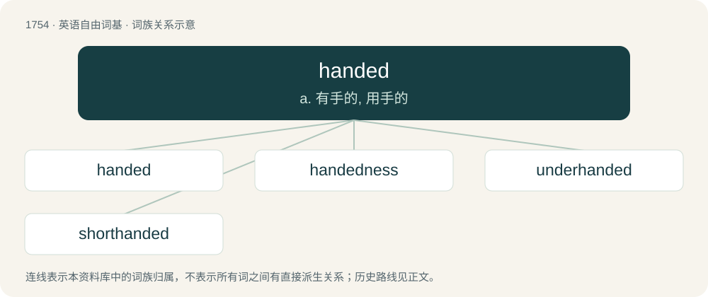

# 1855 · handed — a. 有手的, 用手的

[总目录](../00_总目录_按常用程度.md)

**类型**：英语自由词基　｜　**来源语言**：见词源记录

## 核心含义与来源

- 核心含义：a. 有手的, 用手的
- 英文含义：Having a certain kind or number of hands.
- 词形：handed

**来源记录 1**（形容词；Having a certain kind or number of hands.）

From hand + -ed.

## 词族图

## 单词速览（常用到不常用）

| 单词 | 音标 | 释义 |
|---|---|---|
| [handed](#w-1) | 英 /ˈhændɪd/；美 /ˈhændəd/ | a. 有手的, 用手的 |
| [handedness](#w-2) | 英 /ˈhændɪdnəs/ | \[医\] 左利或右利(偏于用一侧手工作) |
| [underhanded](#w-3) | /ˈʌndəˈhændid/ | a. 人手不足的, 秘密的, 卑劣的 |
| [shorthanded](#w-4) | /ˈʃɒːtˈhændid/ | a. 人手不足的 |

## 逐词详解

### 1. handed

**词性**：形容词　｜　**音标**：英 /ˈhændɪd/；美 /ˈhændəd/

**中文释义**：a. 有手的, 用手的

**英文义项**：Having a certain kind or number of hands. / Synonym of chiral.

**构词拆分**：hand + -ed

**词源与演化**：

From hand + -ed.

**例句**：

> A handed, tree-living animal.

该用例对应义项：having or involving the use of hands

### 2. handedness

**词性**：名词　｜　**音标**：英 /ˈhændɪdnəs/

**中文释义**：\[医\] 左利或右利(偏于用一侧手工作)

**英文义项**：A preference (usually innate) for using one hand rather than the other. / The property that distinguishes an asymmetric object from its mirror image. For example, the essential difference between a left and right glove.

**构词拆分**：handed + -ness

**词源与演化**：

From handed + -ness.

### 3. underhanded

**词性**：形容词　｜　**音标**：/ˈʌndəˈhændid/

**中文释义**：a. 人手不足的, 秘密的, 卑劣的

**英文义项**：Done by moving the hand (and arm) from below. / Sly, dishonest, corrupt, cheating.

**构词拆分**：under- + handed

**词源与演化**：

From under- + handed.

**例句**：

> His underhanded trick backfired and he was disqualified.

该用例对应义项：Sly, dishonest, corrupt, cheating.

### 4. shorthanded

**词性**：形容词　｜　**音标**：/ˈʃɒːtˈhændid/

**中文释义**：a. 人手不足的

**英文义项**：Lacking sufficient staff or people, as for normal or efficient operations. / Having less than a quorum.

**构词拆分**：short + handed

**词源与演化**：

From short + handed.

**例句**：

> The tiny restaurant usually got by with three workers on that shift, but found itself shorthanded when the tour bus pulled in.

该用例对应义项：Lacking sufficient staff or people, as for normal or efficient operations.
