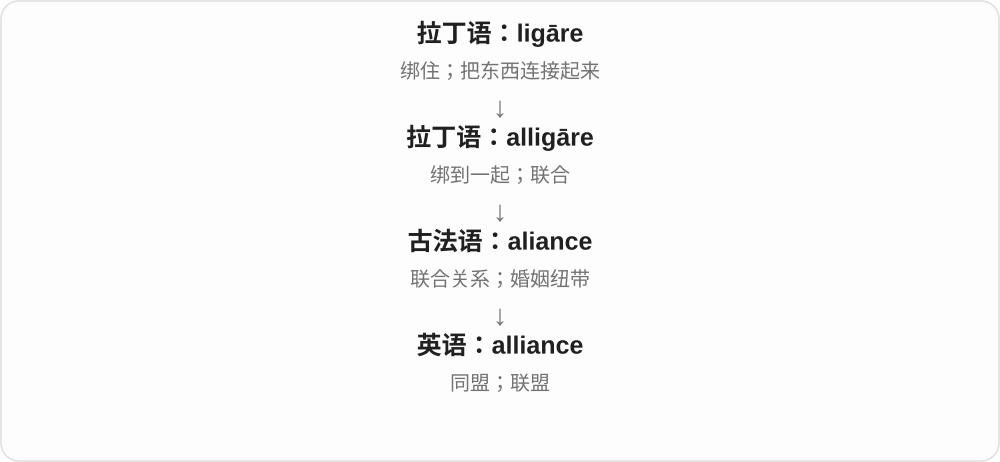

# 1856 · ally — 结盟；盟友

[逐词精讲目录](../00_逐词精讲目录.md) · [总目录](../00_总目录_按常用程度.md)

## 核心词根与来源

ally 经法语上溯拉丁 alligare 联结，历史上 ad- 与 ligare 组合并发生同化。alliance 经相应法语名词进入，不是把现代 ally 直接换一个字母就能解释完整。

**ALLY：通过联结形成合作关系**

不同的人或组织，为了共同目的站到一起。

- **合作方与结盟**：ally
- **关系与组织**：alliance

## 词形与演化规律

ally 可作名词或动词，名词重音常在前、动词常在后；复数 allies。alliance 是结盟关系或联盟。

## 单词速览（按词族由简到繁）

同一基础词的相关扩展放在一起，先读基础形式，再读扩展；各组之间优先读常用的。具体词源关系见各词讲解。

| 单词 | 音标 | 核心意思 |
|---|---|---|
| [ally](#w-2) | 名词 /ˈælaɪ/；动词常读 /əˈlaɪ/ | 盟友；与……结盟 |
| [alliance](#w-1) | /əˈlaɪəns/ | 联盟；同盟关系 |

## 逐词讲解

### 1. ally — 盟友；与……结盟

**音标**：名词 /ˈælaɪ/；动词常读 /əˈlaɪ/

**先抓住这个画面**

把 ally 想成在某件事上与你站在同一阵线的人。彼此可以没有私人友谊，甚至在其他问题上有分歧；只要围绕共同目标相互支持，就可以成为 allies。这个词既能指国家，也能指同事、组织或支持某个群体的人。

**怎么拆**

历史上是 ad-（朝向、附着）+ ligāre（绑）。ad- 遇到 l 时发生同化，成为 al-，形成 alligāre。现代 ally 已经过法语和英语的变化，不能拆成 al + 副词后缀 -ly。名词复数是 allies，词尾读 /z/。

**怎么变成今天的意思**

词形经过法语发生了较大变化，所以英语里已看不到完整的 lig。理解词义时，可以把“将东西系到一起”联系到“让人或团体形成共同关系”；历史上这个词也用于婚姻和亲属联合，后来广泛用于政治与军事结盟。名词 ally 指参与这种联合的人。

**常见搭配与例句**

a close ally（紧密盟友）；an ally in the fight against…（在反对……的行动中的盟友）；ally oneself with…（与……结盟）。

> The two groups became allies in their campaign for cleaner water.

这两个团体在争取更清洁水源的行动中成为盟友。

> She allied herself with colleagues who wanted to change the policy.

她与希望改变这项政策的同事联合起来。

**别混淆**

friend 强调感情，partner 强调共同参与，ally 强调共同立场和支持。ally 与 alien、alienate 的开头相似，但后两者来自 alius“别的”，不是 ligāre 这一支。

### 2. alliance — 联盟；同盟关系

**音标**：/əˈlaɪəns/

**先抓住这个画面**

alliance 指人或团体为了共同目的形成的合作关系，也可指结成的联盟组织。它比一次临时帮忙更有持续合作的意味，但未必需要正式条约。

**怎么拆**

可与 ally + -ance 联系记忆，-ance 常形成表示状态或关系的名词。不过英语 alliance 是经法语 aliance 借入，不能把现代英语的组合分析当成它第一次产生的过程。

**怎么变成今天的意思**

“绑在一起”在这里落到关系本身。它曾用于婚姻联合，继而用于家族、国家和其他组织的合作。ally 是关系中的参与者，alliance 是参与者之间形成的关系或组织。

**常见搭配与例句**

form / build an alliance（建立联盟）；a strategic alliance（战略联盟）；an alliance between A and B（A 与 B 的联盟）。

> The two universities formed an alliance to share research facilities.

两所大学结成联盟，共享研究设施。

> Their alliance lasted long after the election.

选举结束很久以后，他们的联盟仍然存在。

**别混淆**

alliance 不等于 merger：前者可以让各方保持独立，后者通常指组织或企业合并。

## 这一组要分清什么

ally 不等于 forever friend；它说明某事上的支持或合作。ally 的 -ly 也不是副词后缀。

## 串起来练习

The two groups became allies and formed an alliance.

两个团体成为盟友，并组成联盟。
