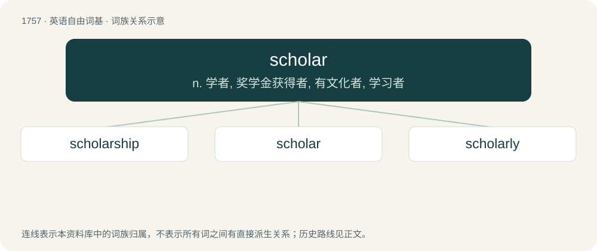

# 1856 · scholar — n. 学者, 奖学金获得者, 有文化者, 学习者

[总目录](../00_总目录_按常用程度.md)

**类型**：英语自由词基　｜　**来源语言**：见词源记录

## 核心含义与来源

- 核心含义：n. 学者, 奖学金获得者, 有文化者, 学习者
- 英文含义：A student; one who studies at school or college, typically having a scholarship.
- 词形：scholar

**来源记录 1**（名词；A student; one who studies at school or college, typically having a scholarship.）

From Middle English scolar, scolare, scoler, scolere (also scholer), from Old English scōlere (“scholar, learner”), from Late Latin scholāris, from schola (“school”), from Ancient Greek σχολή (skholḗ, “spare time, leisure", later, "conversations and the knowledge gained through them during free time; the places where these conversations took place”), equivalent to school + -ar. Doublet of schooler, Schuyler, and escolar. Compare Saterland Frisian Sköiler, Middle Low German schö̂lære, schö̂lere, schö̂ler (&gt; modern German Low German Schöler), Dutch scholier, German Schüler.

## 词族图

## 单词速览（常用到不常用）

| 单词 | 音标 | 释义 |
|---|---|---|
| [scholarship](#w-1) | 英 /ˈskɒləʃɪp/；美 /ˈskɑːləɹʃɪp/ | n. 学问, 学术成就, 奖学金 |
| [scholar](#w-2) | 英 /ˈskɒlə/；美 /ˈskɑlɚ/ | n. 学者, 奖学金获得者, 有文化者, 学习者 |
| [scholarly](#w-3) | /skɒ.lə.li/ | a. 学者派头的, 学者风度的, 有学问的, 博学的, 好学的 |

## 逐词详解

### 1. scholarship

**词性**：名词　｜　**音标**：英 /ˈskɒləʃɪp/；美 /ˈskɑːləɹʃɪp/

**中文释义**：n. 学问, 学术成就, 奖学金

**英文义项**：A grant-in-aid to a student. / The character or qualities of a scholar.

**构词拆分**：scholar + -ship

**词源与演化**：

From scholar + -ship.

**例句**：

> I'd still be spinning my wheels if I hadn't gotten that scholarship.

### 2. scholar

**词性**：名词　｜　**音标**：英 /ˈskɒlə/；美 /ˈskɑlɚ/

**中文释义**：n. 学者, 奖学金获得者, 有文化者, 学习者

**英文义项**：A student; one who studies at school or college, typically having a scholarship. / A specialist in a particular branch of knowledge.

**构词拆分**：school + -ar

**词源与演化**：

From Middle English scolar, scolare, scoler, scolere (also scholer), from Old English scōlere (“scholar, learner”), from Late Latin scholāris, from schola (“school”), from Ancient Greek σχολή (skholḗ, “spare time, leisure", later, "conversations and the knowledge gained through them during free time; the places where these conversations took place”), equivalent to school + -ar. Doublet of schooler, Schuyler, and escolar. Compare Saterland Frisian Sköiler, Middle Low German schö̂lære, schö̂lere, schö̂ler (&gt; modern German Low German Schöler), Dutch scholier, German Schüler.

**例句**：

> The English scholar is not conscious of his lack of common sense.

### 3. scholarly

**词性**：形容词　｜　**音标**：/skɒ.lə.li/

**中文释义**：a. 学者派头的, 学者风度的, 有学问的, 博学的, 好学的

**英文义项**：Characteristic of a scholar. / Of or relating to scholastics or scholarship.

**构词拆分**：scholar + -ly

**词源与演化**：

From scholar + -ly.

**例句**：

> Scholarly as he is, he can't be relied on.
