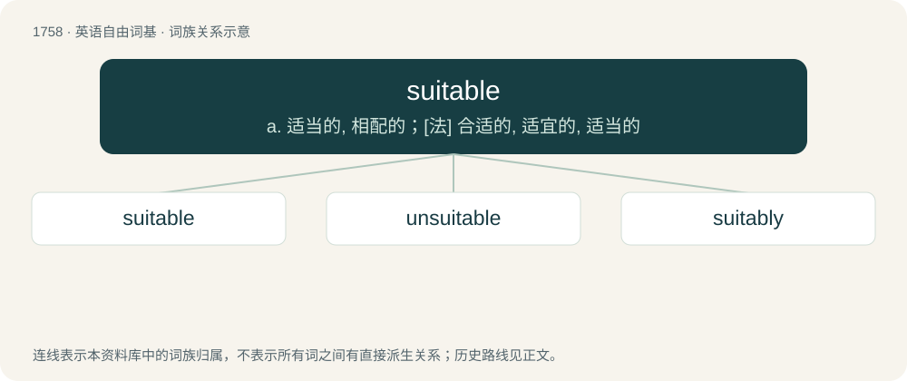

# 1857 · suitable — a. 适当的, 相配的；\[法\] 合适的, 适宜的, 适当的

[总目录](../00_总目录_按常用程度.md)

**类型**：英语自由词基　｜　**来源语言**：见词源记录

## 核心含义与来源

- 核心含义：a. 适当的, 相配的；\[法\] 合适的, 适宜的, 适当的
- 英文含义：Having sufficient or the required properties for a certain purpose or task; appropriate to a certain occasion.
- 词形：suitable

**来源记录 1**（形容词；Having sufficient or the required properties for a certain purpose or task; appropriate to a certain occasion.）

From suit + -able.

## 词族图

## 单词速览（常用到不常用）

| 单词 | 音标 | 释义 |
|---|---|---|
| [suitable](#w-1) | /ˈsjuːtəbl/ | a. 适当的, 相配的；\[法\] 合适的, 适宜的, 适当的 |
| [unsuitable](#w-2) | /ʌnˈsuːtəbəl/ | a. 不适合的；\[法\] 不适合的, 不适当的 |
| [suitably](#w-3) | /ˈsjuːtəbli/ | adv. 合适地, 适当地, 相配地 |

## 逐词详解

### 1. suitable

**词性**：形容词　｜　**音标**：/ˈsjuːtəbl/

**中文释义**：a. 适当的, 相配的；\[法\] 合适的, 适宜的, 适当的

**英文义项**：Having sufficient or the required properties for a certain purpose or task; appropriate to a certain occasion.

**构词拆分**：suit + -able

**词源与演化**：

From suit + -able.

**例句**：

> A tractor suitable (or fit) for heavy duty.

该用例对应义项：meant or adapted for an occasion or use

### 2. unsuitable

**词性**：形容词　｜　**音标**：/ʌnˈsuːtəbəl/

**中文释义**：a. 不适合的；\[法\] 不适合的, 不适当的

**英文义项**：Not suitable.

**构词拆分**：un- + suitable

**词源与演化**：

From un- + suitable.

**例句**：

> A solvent unsuitable for use on wood surfaces.

该用例对应义项：not meant or adapted for a particular purpose

### 3. suitably

**词性**：副词　｜　**音标**：/ˈsjuːtəbli/

**中文释义**：adv. 合适地, 适当地, 相配地

**英文义项**：In a suitable manner; with propriety.

**构词拆分**：suitable + -ly

**词源与演化**：

From suitable + -ly.

**例句**：

> After her mother's lecture, Mary looked suitably chastened.
