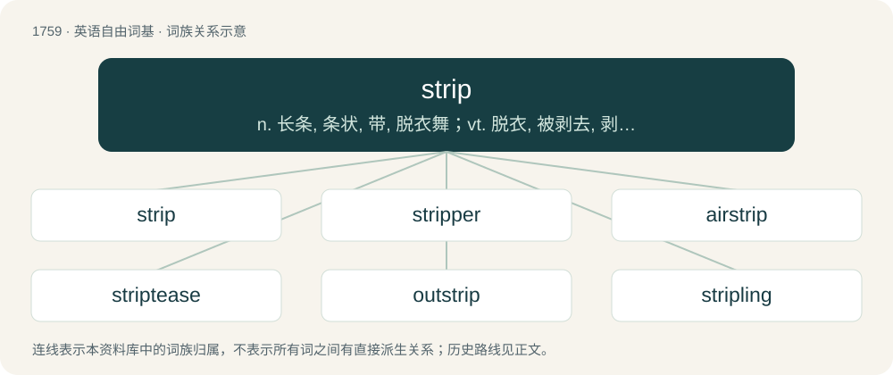

# 1858 · strip — n. 长条, 条状, 带, 脱衣舞；vt. 脱衣, 被剥去, 剥夺, 拆卸；vi. 脱衣服

[总目录](../00_总目录_按常用程度.md)

**类型**：英语自由词基　｜　**来源语言**：见词源记录

## 核心含义与来源

- 核心含义：n. 长条, 条状, 带, 脱衣舞；vt. 脱衣, 被剥去, 剥夺, 拆卸；vi. 脱衣服
- 英文含义：A long, thin piece of land; any long, thin area.
- 词形：strip

**多个词源／构词路径**：同一拼写可能有不同来源；以下按词性和含义分别列出。

**来源记录 1**（名词；A long, thin piece of land; any long, thin area.）

From alteration of stripe or from Middle Low German strippe, of uncertain ultimate origin, perhaps derived from a lost strong verb Proto-Germanic \*strīpaną, with no clear cognates outside of Germanic except for Irish sríab (“line, stripe”).

**来源记录 2**（动词；To remove or take away, often in strips or stripes.）

From Middle English strepen, strippen, from Old English strīepan (“plunder”), from Proto-Germanic \*strēpōną, from Proto-Indo-European \*(s)ter(h₁)- (“to be stiff; be rigid; exert”). Probably related to German Strafe (“deprivation, fine, punishment”).

## 词族图

## 单词速览（常用到不常用）

| 单词 | 音标 | 释义 |
|---|---|---|
| [strip](#w-1) | /ˈstɹɪp/ | n. 长条, 条状, 带, 脱衣舞；vt. 脱衣, 被剥去, 剥夺, 拆卸；vi. 脱衣服 |
| [stripper](#w-2) | /stɹɪpɚ/ | n. 剥...的人, 刮毛器, 折卸器, 剥皮器, 露天矿矿工, 低产井, 枯竭井；\[化\] 汽提塔; 去漆药水 |
| [airstrip](#w-3) | /ˈɛə(ɹ)stɹɪp/ | n. 飞机跑道 |
| [striptease](#w-4) | 美 /ˈstɹɪpˌtiz/ | n. 脱衣舞；vi. 跳脱衣舞 |
| [outstrip](#w-5) | 英 /ˌaʊtˈstɹɪp/；美 /ˌaʊtˈstɹɪp/ | vt. 追过, 胜过, 凌驾 |
| [stripling](#w-6) | 英 /ˈstɹɪplɪŋ/ | n. 年轻人, 小伙子 |

## 逐词详解

### 1. strip

**词性**：名词　｜　**音标**：/ˈstɹɪp/

**中文释义**：n. 长条, 条状, 带, 脱衣舞；vt. 脱衣, 被剥去, 剥夺, 拆卸；vi. 脱衣服

**英文义项**：A long, thin piece of land; any long, thin area. / A long, thin piece of any material; any such material collectively.

**词源与演化**：

From alteration of stripe or from Middle Low German strippe, of uncertain ultimate origin, perhaps derived from a lost strong verb Proto-Germanic \*strīpaną, with no clear cognates outside of Germanic except for Irish sríab (“line, stripe”).

**例句**：

> The countries were in dispute over the ownership of a strip of desert about 100 metres wide.

该用例对应义项：A long, thin piece of land; any long, thin area.

### 2. stripper

**词性**：名词　｜　**音标**：/stɹɪpɚ/

**中文释义**：n. 剥...的人, 刮毛器, 折卸器, 剥皮器, 露天矿矿工, 低产井, 枯竭井；\[化\] 汽提塔; 去漆药水

**英文义项**：Someone who removes their clothing in a sexually provocative manner, especially as a form of paid entertainment. / A chemical or tool used to remove paint, sheathing, etc. from something.

**构词拆分**：From strip + -er.

**词源与演化**：

From strip + -er.

**例句**：

> Yanni started dating a stripper in what was a very toxic relationship.

### 3. airstrip

**词性**：名词　｜　**音标**：/ˈɛə(ɹ)stɹɪp/

**中文释义**：n. 飞机跑道

**英文义项**：An aircraft landing field, usually with one runway and only basic facilities.

**构词拆分**：air + strip

**词源与演化**：

From air + strip.

**例句**：

> The outfitter deposited us at a small airstrip out in the bush, promising to pick us up again in a week's time.

该用例对应义项：An aircraft landing field, usually with one runway and only basic facilities.

### 4. striptease

**词性**：名词　｜　**音标**：美 /ˈstɹɪpˌtiz/

**中文释义**：n. 脱衣舞；vi. 跳脱衣舞

**英文义项**：The act of slowly taking off one's clothes to sexually arouse the viewer, often accompanied by music and in exchange for money.

**构词拆分**：From strip + tease.

**词源与演化**：

From strip + tease.

**例句**：

> I find striptease frustrating, as it doesn't often culminate in actual sex.

### 5. outstrip

**词性**：动词　｜　**音标**：英 /ˌaʊtˈstɹɪp/；美 /ˌaʊtˈstɹɪp/

**中文释义**：vt. 追过, 胜过, 凌驾

**英文义项**：To move more quickly than (someone or something) so as to outrun or leave it behind. / To exceed or surpass (someone or something).

**构词拆分**：out- (prefix forming verbs with the sense of exceeding or surpassing) + strip (“(obsolete) to move or pass by quickly”)

**词源与演化**：

From out- (prefix forming verbs with the sense of exceeding or surpassing) + strip (“(obsolete) to move or pass by quickly”).

**例句**：

> “The U.N. has assessed that by 2030 the global demand for water will outstrip supply by 40 percent,” he said.

### 6. stripling

**词性**：名词　｜　**音标**：英 /ˈstɹɪplɪŋ/

**中文释义**：n. 年轻人, 小伙子

**英文义项**：A young man in the state of adolescence, or just passing from boyhood to manhood; a lad. . / A seedling with most of the leaves stripped off.

**构词拆分**：strip (“long, narrow piece”) + -ling

**词源与演化**：

From Middle English stripling (“an adolescent, a youth (specifically one who is male); a child”) \[and other forms\], possibly from strepen (“to remove the clothes of, undress, strip; to peel off; to skin (an animal); to remove; to take something away from someone; to plunder, rob”) (connoting something that is stripped and thin, and yet to reach its full size) + -ling (suffix forming diminutives). Strepen is derived from Old English \*strēpan (Anglian), \*strīepan, \*strīpan, \*strȳpan (West Saxon), from Proto-West Germanic \*straupijan, from Proto-Germanic \*straupijaną (“to strip; to pluck; to wipe”), from \*streupaną (“to touch”) (ultimately from Proto-Indo-European \*strew-, \*sterw-, \*ster- (“a strip; a streak; a beam, ray”)) + \*-janą (suffix forming causatives from strong verbs with the sense of ‘to cause to do’). The English word is analysable as strip (“long, narrow piece”) + -ling.
