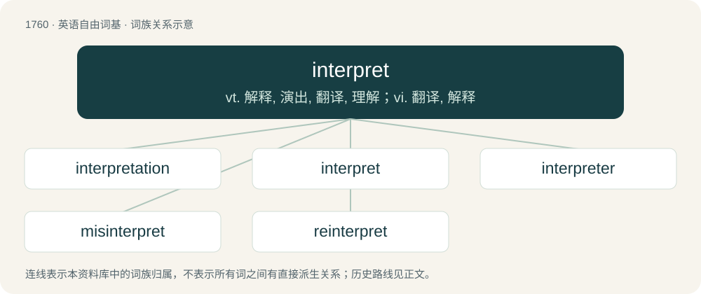

# 1859 · interpret — vt. 解释, 演出, 翻译, 理解；vi. 翻译, 解释

[总目录](../00_总目录_按常用程度.md)

**类型**：英语自由词基　｜　**来源语言**：见词源记录

## 核心含义与来源

- 核心含义：vt. 解释, 演出, 翻译, 理解；vi. 翻译, 解释
- 英文含义：To decode the meaning of a topic and then act, whether to continue researching the topic, follow through, act in opposition, or further the understanding through sharing an interpretation.
- 词形：interpret

**来源记录 1**（动词；To decode the meaning of a topic and then act, whether to continue researching the topic, follow through, act in opposition, or further the understanding through sharing an interpretation.）

From Middle English interpreten, from Old French enterpreter, (French interpréter), from Latin interpretor (“to explain, expound, interpret”), past participle interpretatus, from interpres (“an agent, broker, explainer, interpreter, negotiator”), from inter (“between”) + -pres, probably the root of pretium (“price”); -pres is probably connected with Ancient Greek φράζειν (phrázein, “to point out, show, explain, declare, speak”), from which φραδή (phradḗ, “understanding”), φράσις (phrásis, “speech”); see phrase.

## 词族图

## 单词速览（常用到不常用）

| 单词 | 音标 | 释义 |
|---|---|---|
| [interpretation](#w-1) | 英 /ɪnˌtɜːpɹəˈteɪʃən/；美 /ɪnˌtɝpɹəˈteɪʃən/ | n. 解释, 演出, 翻译；\[计\] 插值; 插值法; 解释 |
| [interpret](#w-2) | 英 /ɪnˈtɜː.pɹɪt/；美 /ɪnˈtɝ.pɹɪt/ | vt. 解释, 演出, 翻译, 理解；vi. 翻译, 解释 |
| [interpreter](#w-3) | 英 /ɪnˈtɜː.pɹɪ.tə/；美 /ɪnˈtɝ.pɹɪ.tɚ/ | n. 直译程序, 解释者, 口译者, 注释器；\[计\] 注释器 |
| [misinterpret](#w-4) | 英 /ˌmɪs.ɪnˈtɜː.pɹɪt/；美 /ˌmɪs.ɪnˈtɝ.pɹɪt/ | vt. 曲解 |
| [reinterpret](#w-5) | /.riːinˈtəːprit/ | vt. 重新解释 |

## 逐词详解

### 1. interpretation

**词性**：名词　｜　**音标**：英 /ɪnˌtɜːpɹəˈteɪʃən/；美 /ɪnˌtɝpɹəˈteɪʃən/

**中文释义**：n. 解释, 演出, 翻译；\[计\] 插值; 插值法; 解释

**英文义项**：An act of interpreting or explaining something unclear; a translation; a version. / A sense given by an interpreter; an exposition or explanation given; meaning.

**构词拆分**：interpret + -ation

**词源与演化**：

From Middle English interpretacioun, from the Anglo-Norman form of Old French interpretacion, from Latin interpretātiō, noun of action from interpretor (“to explain, expound, interpret, understand, conclude, infer, comprehend”). Morphologically interpret + -ation.

**例句**：

> Commentators give various interpretations of the same passage of Scripture.

该用例对应义项：A sense given by an interpreter; an exposition or explanation given; meaning.

### 2. interpret

**词性**：动词　｜　**音标**：英 /ɪnˈtɜː.pɹɪt/；美 /ɪnˈtɝ.pɹɪt/

**中文释义**：vt. 解释, 演出, 翻译, 理解；vi. 翻译, 解释

**英文义项**：To decode the meaning of a topic and then act, whether to continue researching the topic, follow through, act in opposition, or further the understanding through sharing an interpretation. / To explain or tell the meaning of; to translate orally into intelligible or familiar language or terms. applied especially to language, but also to dreams, signs, conduct, mysteries, etc.

**词源与演化**：

From Middle English interpreten, from Old French enterpreter, (French interpréter), from Latin interpretor (“to explain, expound, interpret”), past participle interpretatus, from interpres (“an agent, broker, explainer, interpreter, negotiator”), from inter (“between”) + -pres, probably the root of pretium (“price”); -pres is probably connected with Ancient Greek φράζειν (phrázein, “to point out, show, explain, declare, speak”), from which φραδή (phradḗ, “understanding”), φράσις (phrásis, “speech”); see phrase.

**例句**：

> He interpreted at the meeting between the Chinese and French associates.

该用例对应义项：To convey what a user of one language is saying or signing, in real time or shortly after that person has finished communicating, to a user of a different language.

### 3. interpreter

**词性**：名词　｜　**音标**：英 /ɪnˈtɜː.pɹɪ.tə/；美 /ɪnˈtɝ.pɹɪ.tɚ/

**中文释义**：n. 直译程序, 解释者, 口译者, 注释器；\[计\] 注释器

**英文义项**：A person or thing that interprets the meaning of something for another, particularly / A person or thing that translates speech or signing, as opposed to texts.

**构词拆分**：interpret + -er

**词源与演化**：

From Middle English interpreter, interpretour, etc., from Old French interpreteur, interpreteeur, etc., from Late Latin interpretātōr, from classical Latin interpretātus (“explained, translated”) + -or (“-er: forming agent nouns”), from interpretārī (“to explain, to translate”), from interpres (“go-between, translator”) + -ārī (“to be ~ed”), q.v. In reference to divine emissaries, a calque of Mercury's Latin epithet interpres divum (“go-between of the gods”). In reference to the rhetorical device, a calque of Latin interpretatio. Equivalent to interpret + -er. Displaced native Old English wealhstod.

**例句**：

> At the historic site, there are a number of interpreters who demonstrate ancient crafts.

该用例对应义项：Synonym of guide, one who explains a thing, person, or group of people.

### 4. misinterpret

**词性**：动词　｜　**音标**：英 /ˌmɪs.ɪnˈtɜː.pɹɪt/；美 /ˌmɪs.ɪnˈtɝ.pɹɪt/

**中文释义**：vt. 曲解

**英文义项**：To make an incorrect interpretation; to misunderstand.

**构词拆分**：mis- + interpret

**词源与演化**：

From mis- + interpret.

**例句**：

> It's easy to misinterpret things when they're taken out of context.

### 5. reinterpret

**词性**：动词　｜　**音标**：/.riːinˈtəːprit/

**中文释义**：vt. 重新解释

**英文义项**：To interpret again.

**构词拆分**：re- + interpret

**词源与演化**：

From re- + interpret.

**例句**：

> If you look at it that way, you can reinterpret all the old evidence so that it supports the new theory.

该用例对应义项：To interpret again.
