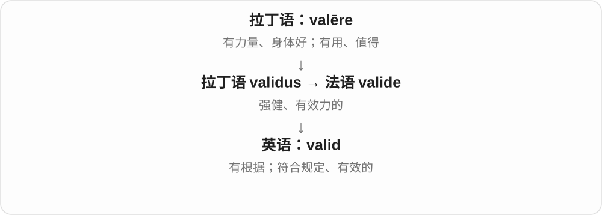
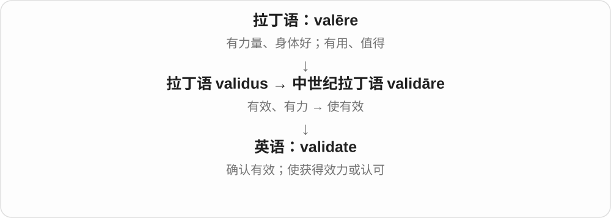
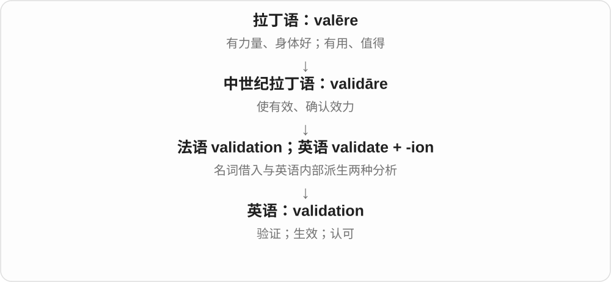
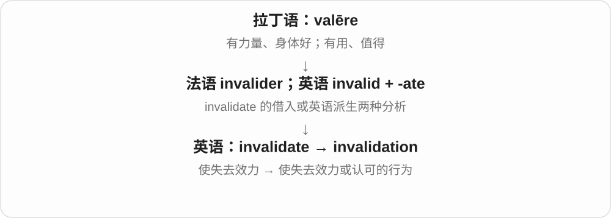
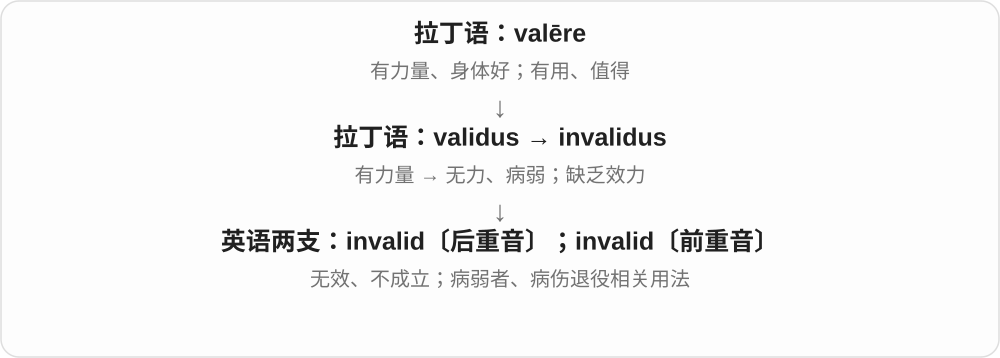

# 1860 · validation — 核验；确认满足要求、有效；被认可的过程等

[逐词精讲目录](../00_逐词精讲目录.md) · [总目录](../00_总目录_按常用程度.md)

## 核心词根与来源

validation 与 validate、valid 连着拉丁有效、有力的词族，经相应抽象名词形式发展。不是每个场景都在证明一个事实绝对真实。

**VALIDATION：先说清按什么标准确认**

表单校验看格式、必填项；研究验证看方法、证据；情感认可看感受被理解。不同对象下，确认的目标不同。

- **性质与动作**：valid · invalid；validate
- **核验、确认及取消效力**：validation · invalidation
- **执行核验的人、工具**：validator

## 词形与演化规律

valid ↔ validate ↔ validation；validate + -or → validator；in- + validation → invalidation。词尾分别让有效性质、核验动作、过程和执行者进入不同位置。

## 单词速览（按词族由简到繁）

同一基础词的相关扩展放在一起，先读基础形式，再读扩展；各组之间优先读常用的。具体词源关系见各词讲解。

| 单词 | 音标 | 核心意思 |
|---|---|---|
| [valid](#w-3) | 英、美 /ˈvælɪd/ | 有效的；有充分根据的；符合规则的 |
| [validate](#w-5) | 英、美 /ˈvælɪdeɪt/ | 确认有效；验证；使生效；认可感受 |
| [validation](#w-1) | 英、美 /ˌvælɪˈdeɪʃən/ | 验证；使生效；认可、肯定 |
| [invalidation](#w-2) | 英、美 /ɪnˌvælɪˈdeɪʃən/ | 使无效；宣布无效；否定他人感受 |
| [validator](#w-6) | 英 /ˈvælɪdeɪtə/；美 /ˈvælɪdeɪtər/ | 验证、核验的人；校验器、验证工具 |
| [invalid](#w-4) | 无效义：英、美 /ɪnˈvælɪd/；病弱者及相关动词：英、美 /ˈɪnvəlɪd/ | 无效、不成立的；病弱者〔旧用语〕；因病伤使退役 |

## 逐词讲解

### 1. valid — 有效的；有充分根据的；符合规则的

**音标**：英、美 /ˈvælɪd/

**先抓住这个画面**

把东西拿来检验，它站得住、规则认它、理由撑得住。力量从身体转移到了证件、理由和推理上。

**怎么拆**

法语 valide 来自拉丁语 validus“强健、有力”，更早是 valēre。

**怎么变成今天的意思**

a valid ticket 是可按规定使用的票；a valid reason 是有根据的理由。逻辑里的 valid 说推理形式成立：前提若真，结论不能假，并不单独保证前提真实。

**常见搭配与例句**

a valid passport；a valid reason；valid for six months。

> The pass is valid for thirty days from the date of purchase.

这张通票自购买之日起三十天内有效。

> You have raised a valid concern about the timetable.

你对时间表提出的担忧有道理。

**别混淆**

true 描述陈述真假；valid 可描述推理是否成立，不能只用“真”替换。

### 2. validate — 确认有效；验证；使生效；认可感受

**音标**：英、美 /ˈvælɪdeɪt/

**先抓住这个画面**

拿到证据或完成手续，让“这个站得住、这个可以用”得到确认。对感受说 validate，则是承认它值得被理解。

**怎么拆**

来自中世纪拉丁语 validāre 的分词 validātus；现代能看成 valid + -ate。

**怎么变成今天的意思**

validate a ticket 可以指让车票开始生效；validate a model 是检验模型是否适合预定用途。validate someone’s feelings 是承认其感受，并不等于同意其每个判断。

**常见搭配与例句**

validate a ticket；validate a method；validate someone’s feelings。

> Please validate your ticket before boarding.

上车前请完成车票生效手续。

> The team used new data to validate the model.

团队用新数据验证模型。

> Listening carefully can help validate a friend’s feelings.

认真倾听能让朋友感到自己的感受被理解和认可。

**别混淆**

verify 常偏向核实某项信息；validate 常偏向确认有效、适用或可接受，技术领域会有更具体的约定。

### 3. validation — 验证；使生效；认可、肯定

**音标**：英、美 /ˌvælɪˈdeɪʃən/

**先抓住这个画面**

用证据或程序确认东西可用；在人际关系中，则是得到“你的感受或付出被看见了”的肯定。

**怎么拆**

属于 validāre / validate 词族；词典有英语 validate + -ion 和法语 validation 借入两种处理，现代词形关系清楚。

**怎么变成今天的意思**

data validation 检查数据是否符合要求；seek validation 是寻求他人的认可。被认可不自动等于观点已被证明正确。

**常见搭配与例句**

data validation；model validation；seek external validation。

> The form performs validation before saving the data.

表单在保存数据前会进行校验。

> She wanted honest feedback rather than constant validation.

她想要的是诚实反馈，而不是持续不断的肯定。

**别混淆**

validation 可以是技术核查，也可以是情感认可；要看它的对象。

### 4. invalidation — 使无效；宣布无效；否定他人感受

**音标**：英、美 /ɪnˌvælɪˈdeɪʃən/

**先抓住这个画面**

把某事原先拥有或声称拥有的效力撤掉；在人际语境里，也可能是把别人的感受说成不值一提。

**怎么拆**

invalidate 的 -ate 变 -ation；也能按 in- + validation 分析。

**怎么变成今天的意思**

既可指结果、票据被判无效，也能指 emotional invalidation。后者不是普通意见不一致，而是把对方的感受直接否定掉。

**常见搭配与例句**

invalidation of results；the invalidation of a vote；emotional invalidation。

> The error led to the invalidation of the test results.

这个错误导致测试结果被判无效。

> The discussion focused on how repeated invalidation affects trust.

讨论聚焦于反复否定对方感受会怎样影响信任。

**别混淆**

disagreement 是观点不同；invalidation 在情感语境中强调否定感受的合理存在。

### 5. validator — 验证、核验的人；校验器、验证工具

**音标**：英 /ˈvælɪdeɪtə/；美 /ˈvælɪdeɪtər/

**先抓住这个画面**

把一份输入交给它，它按规定逐项检查：日期格式对吗、必填项齐吗？做这件核验工作的工具，可以叫 validator。

**怎么拆**

validate 验证、使有效 + -or，去末尾 e；人物、工具后缀指出承担核验功能的对象。底层接拉丁 validus 有力、有效等词族。

**怎么变成今天的意思**

**validate + -or → validator**  
执行核验的人或工具

↓

**计算等领域常用 validator**  
按规则检查格式、条件等的组件

a form validator 表单校验器；a JSON validator 检查 JSON 等内容是否满足相应规则的工具。通过格式校验，含义只是满足所检查的那些条件。

**常见搭配与例句**

an input validator；run a validator。

> The validator highlighted an invalid date.

校验器标出了一个无效日期。

> We added a validator for email address formats.

我们增加了一个电子邮箱地址格式校验器。

**别混淆**

validation 是核验过程、结果等名词；validator 是做核验的人、工具。格式正确也不自动证明内容陈述真实，检查目标不同。

### 6. invalid — 无效、不成立的；病弱者〔旧用语〕；因病伤使退役

**音标**：无效义：英、美 /ɪnˈvælɪd/；病弱者及相关动词：英、美 /ˈɪnvəlɪd/

**先抓住这个画面**

两支都可追到“没有力量”：一支是证件或论证没有效力；另一支是身体病弱。现代读音用不同重音把它们分开。

**怎么拆**

拉丁语 in-“不” + validus“强健、有力”；无效义与病弱义分别发展，病弱支也受法语 invalide 影响。

**怎么变成今天的意思**

invalid password 是无效密码，重音在 val。旧书里的 an invalid 指长期病弱的人，重音在开头；现代一般按具体状况说 person with an illness 等，避免拿它笼统称呼残障者。be invalided out of the army 是因伤病退役。

**常见搭配与例句**

an invalid ticket；an invalid argument；be invalided out of…。

> The system rejected the invalid date.

系统拒绝了这个无效日期。

> In the old novel, the aunt is described as an invalid.

那部旧小说把姑妈描述为长期病弱的人。

> He was invalided out of the army after the injury.

他受伤后因伤退役。

**别混淆**

invalid“无效”不等于 illegal“违法”；一张过期票无效，不表示买票行为违法。

## 这一组要分清什么

validator 是工具或人物，validation 是过程、确认等；一个值符合格式，不等于相关事实已经被同一检查证明。

## 串起来练习

The validator performs format validation before the form is submitted.

表单提交前，校验器先进行格式校验。
