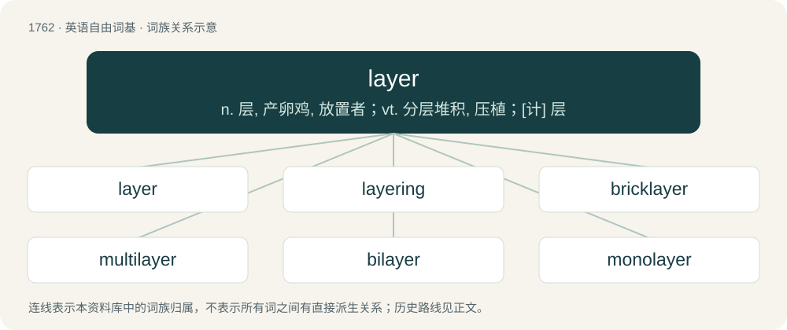

# 1861 · layer — n. 层, 产卵鸡, 放置者；vt. 分层堆积, 压植；\[计\] 层

[总目录](../00_总目录_按常用程度.md)

**类型**：英语自由词基　｜　**来源语言**：见词源记录

## 核心含义与来源

- 核心含义：n. 层, 产卵鸡, 放置者；vt. 分层堆积, 压植；\[计\] 层
- 英文含义：A single thickness of some material covering a surface.
- 词形：layer

**多个词源／构词路径**：同一拼写可能有不同来源；以下按词性和含义分别列出。

**来源记录 1**（名词；A single thickness of some material covering a surface.）

Appears at first glance to be from Middle English leyer, leyare (“a layer of stones or bricks”), equivalent to lay + -er. In which case, ultimately identical to etymology 2 below. For the pronunciation compare prayer. However, this word layer (referring to a thickness of a material covering a surface) has also been argued to be from a respelling of an obsolete sense of the word lair that was once used by farmers, which had to do with soil. The connecting sense between the usual meaning of lair and the specialised farming meaning was: an area where cows typically rest, the ground being fertilised by their waste. Related to lie, ledger.

**来源记录 2**（名词；A person who lays anything, such as tiles or a wager.）

From lay + -er.

## 词族图

## 单词速览（常用到不常用）

| 单词 | 音标 | 释义 |
|---|---|---|
| [layer](#w-1) | 英 /ˈleɪ.ə/；美 /ˈleɪ̯ɚ/ | n. 层, 产卵鸡, 放置者；vt. 分层堆积, 压植；\[计\] 层 |
| [layering](#w-2) | /ˈleiəriŋ/ | \[计\] 分层；\[医\] 分层 |
| [bricklayer](#w-3) | /ˈbrikleiə/ | n. 砌砖工人 |
| [multilayer](#w-4) | /ˈmʌlti,leiə/ | \[计\] 多层(印刷电路板)；\[化\] 多层 |
| [bilayer](#w-5) | /,baiˈleiə/ | \[机\] 双分子层 |
| [monolayer](#w-6) | /ˈmɔnəuˈleiə/ | n. 单层；\[计\] 单层 |

## 逐词详解

### 1. layer

**词性**：名词　｜　**音标**：英 /ˈleɪ.ə/；美 /ˈleɪ̯ɚ/

**中文释义**：n. 层, 产卵鸡, 放置者；vt. 分层堆积, 压植；\[计\] 层

**英文义项**：A single thickness of some material covering a surface. / An item of clothing worn under or over another.

**构词拆分**：lay + -er

**词源与演化**：

Appears at first glance to be from Middle English leyer, leyare (“a layer of stones or bricks”), equivalent to lay + -er. In which case, ultimately identical to etymology 2 below. For the pronunciation compare prayer. However, this word layer (referring to a thickness of a material covering a surface) has also been argued to be from a respelling of an obsolete sense of the word lair that was once used by farmers, which had to do with soil. The connecting sense between the usual meaning of lair and the specialised farming meaning was: an area where cows typically rest, the ground being fertilised by their waste. Related to lie, ledger.

**例句**：

> It's cold now but it will warm up this afternoon. Make sure you wear layers.

该用例对应义项：An item of clothing worn under or over another.

### 2. layering

**词性**：名词　｜　**音标**：/ˈleiəriŋ/

**中文释义**：\[计\] 分层；\[医\] 分层

**英文义项**：A structure made up of layers. / A method of plant propagation by rooting cuttings.

**构词拆分**：layer + -ing

**词源与演化**：

From layer + -ing.

**例句**：

> He always feels cold because he does not have enough fatty layering on his body.

### 3. bricklayer

**词性**：名词　｜　**音标**：/ˈbrikleiə/

**中文释义**：n. 砌砖工人

**英文义项**：A craftsman who builds walls and suchlike out of bricks.

**构词拆分**：brick + layer

**词源与演化**：

From Middle English brekelayeer, brekelayer, equivalent to brick + layer.

**例句**：

> The bricklayer calculated that he would need 500 bricks for the wall.

### 4. multilayer

**词性**：形容词　｜　**音标**：/ˈmʌlti,leiə/

**中文释义**：\[计\] 多层(印刷电路板)；\[化\] 多层

**英文义项**：Any system of multiple layers, especially of multiple monolayers

**构词拆分**：multi- + layer

**词源与演化**：

From multi- + layer.

### 5. bilayer

**词性**：名词　｜　**音标**：/,baiˈleiə/

**中文释义**：\[机\] 双分子层

**英文义项**：Any structure consisting of two layers of molecules

**构词拆分**：bi- + layer

**词源与演化**：

From bi- + layer.

### 6. monolayer

**词性**：名词　｜　**音标**：/ˈmɔnəuˈleiə/

**中文释义**：n. 单层；\[计\] 单层

**英文义项**：A layer of material that is one molecule thick / A layer of tissue that is one cell thick

**构词拆分**：mono- + layer

**词源与演化**：

From mono- + layer.
