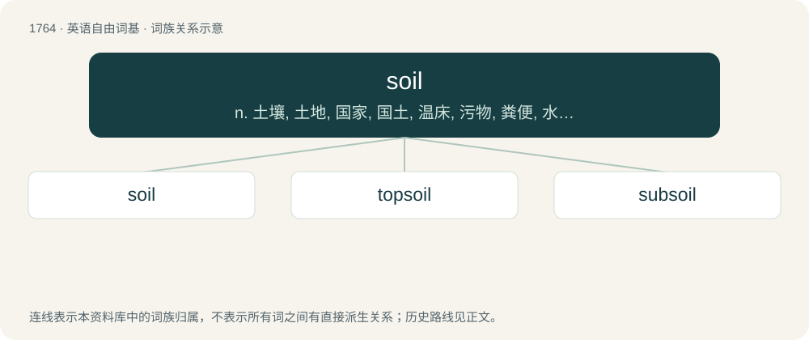

# 1862 · soil — n. 土壤, 土地, 国家, 国土, 温床, 污物, 粪便, 水池；vt. 弄脏, 污辱；vi. 变脏

[总目录](../00_总目录_按常用程度.md)

**类型**：英语自由词基　｜　**来源语言**：见词源记录

## 核心含义与来源

- 核心含义：n. 土壤, 土地, 国家, 国土, 温床, 污物, 粪便, 水池；vt. 弄脏, 污辱；vi. 变脏
- 英文含义：A mixture of mineral particles and organic material, used to support plant growth.
- 词形：soil

**多个词源／构词路径**：同一拼写可能有不同来源；以下按词性和含义分别列出。

**来源记录 1**（名词；A mixture of mineral particles and organic material, used to support plant growth.）

From Middle English soile, soyle, sule (“ground, earth”), partly from Anglo-Norman soyl (“bottom, ground, pavement”), from Latin solium (“seat, chair; throne”), mistaken for Latin solum (“ground, foundation, earth, sole of the foot”); and partly from Old English sol (“mud, mire, wet sand”), from Proto-Germanic \*sulą (“mud, spot”), from Proto-Indo-European \*sūl- (“thick liquid”). Cognate with Middle Low German söle (“dirt, mud”), Middle Dutch sol (“dirt, filth”), Middle High German sol, söl (“dirt, mud, mire”), Danish søle (“mud, muck”). Compare French seuil (“level; threshold”) and sol (“soil, earth; ground”). See also sole, soal, solum. For the sole and soil relation, compare typologically Russian по́чва (póčva) akin to подо́шва (podóšva).

**来源记录 2**（动词；To make dirty.）

From Middle English soilen, soulen, suylen (“to sully, make dirty”), partly from Old French soillier, souillier (“to soil, make dirty, wallow in mire”), from Old Frankish \*saulijan, \*sulwijan (“to make dirty, soil”); partly from Old English solian, sylian (“to soil, make dirty”), from Proto-Germanic \*sulwōną, \*sulwijaną, \*saulijaną (“to soil, make dirty”), from Proto-Indo-European \*sūl- (“thick liquid”). Cognate with Old Frisian sulia (“to soil, mire”), Middle Dutch soluwen, seulewen (“to soil, besmirch”), Old High German solōn, bisulen (“to make dirty”), German suhlen (“to soil, make dirty”), Danish søle (“to make dirty, defile”), Swedish söla (“to soil, make dirty”), Gothic 𐌱𐌹𐍃𐌰𐌿𐌻𐌾𐌰𐌽 (bisauljan, “to bemire”). Compare sully.

**来源记录 3**（名词；A wet or marshy place in which a boar or other such game seeks refuge when hunted.）

From Middle English soyl, from Old French soil, souil (“quagmire, marsh”), from Frankish \*sōlja, \*saulja (“mire, miry place, wallow”), from Proto-Germanic \*saulijō (“mud, puddle, feces”), from Proto-Indo-European \*sūl- (“thick liquid”). Cognate with Old English syle, sylu, sylen (“miry place, wallow”), Old High German sol, gisol (“miry place”), German Suhle (“a wallow, mud pit, muddy pool”).

**来源记录 4**（动词；To feed, as cattle or horses, in the barn or an enclosure, with fresh grass or green food cut for them, instead of sending them out to pasture; hence (due to such food having the effect of purging them) to purge by feeding on green food.）

From Old French saoler, saouler (“to satiate”).

## 词族图

## 单词速览（常用到不常用）

| 单词 | 音标 | 释义 |
|---|---|---|
| [soil](#w-1) | /sɔɪl/ | n. 土壤, 土地, 国家, 国土, 温床, 污物, 粪便, 水池；vt. 弄脏, 污辱；vi. 变脏 |
| [topsoil](#w-2) | /ˈtɒpsɒil/ | n. 上层土, 表层土 |
| [subsoil](#w-3) | /ˈsʌbsɔɪl/ | n. 下层土, 底土；vt. 掘起...的底土 |

## 逐词详解

### 1. soil

**词性**：名词　｜　**音标**：/sɔɪl/

**中文释义**：n. 土壤, 土地, 国家, 国土, 温床, 污物, 粪便, 水池；vt. 弄脏, 污辱；vi. 变脏

**英文义项**：A mixture of mineral particles and organic material, used to support plant growth. / The unconsolidated mineral or organic material on the immediate surface of the earth that serves as a natural medium for the growth of land plants.

**词源与演化**：

From Middle English soile, soyle, sule (“ground, earth”), partly from Anglo-Norman soyl (“bottom, ground, pavement”), from Latin solium (“seat, chair; throne”), mistaken for Latin solum (“ground, foundation, earth, sole of the foot”); and partly from Old English sol (“mud, mire, wet sand”), from Proto-Germanic \*sulą (“mud, spot”), from Proto-Indo-European \*sūl- (“thick liquid”). Cognate with Middle Low German söle (“dirt, mud”), Middle Dutch sol (“dirt, filth”), Middle High German sol, söl (“dirt, mud, mire”), Danish søle (“mud, muck”). Compare French seuil (“level; threshold”) and sol (“soil, earth; ground”). See also sole, soal, solum. For the sole and soil relation, compare typologically Russian по́чва (póčva) akin to подо́шва (podóšva).

**例句**：

> We bought a bag of soil for the houseplants.

该用例对应义项：A mixture of mineral particles and organic material, used to support plant growth.

### 2. topsoil

**词性**：名词　｜　**音标**：/ˈtɒpsɒil/

**中文释义**：n. 上层土, 表层土

**英文义项**：The upper layer of soil, typically most fertile and in which it is the easiest to start new plants.

**构词拆分**：top + soil

**词源与演化**：

From top + soil.

**例句**：

> Little grew on the farm, after the floods from the hurricane washed away the topsoil.

该用例对应义项：The upper layer of soil, typically most fertile and in which it is the easiest to start new plants.

### 3. subsoil

**词性**：名词　｜　**音标**：/ˈsʌbsɔɪl/

**中文释义**：n. 下层土, 底土；vt. 掘起...的底土

**英文义项**：The layer of earth that is below the topsoil.

**构词拆分**：sub- + soil

**词源与演化**：

From sub- + soil.

**例句**：

> Algeria's subsoil is overflowing with riches.
