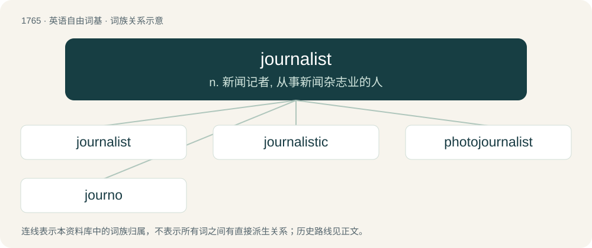

# 1863 · journalist — n. 新闻记者, 从事新闻杂志业的人

[总目录](../00_总目录_按常用程度.md)

**类型**：英语自由词基　｜　**来源语言**：见词源记录

## 核心含义与来源

- 核心含义：n. 新闻记者, 从事新闻杂志业的人
- 英文含义：The keeper of a personal journal, who writes in it regularly.
- 词形：journalist

**来源记录 1**（名词；The keeper of a personal journal, who writes in it regularly.）

From journal + -ist.

## 词族图

## 单词速览（常用到不常用）

| 单词 | 音标 | 释义 |
|---|---|---|
| [journalist](#w-1) | 英 /ˈd͡ʒɜːnəlɪst/；美 /ˈd͡ʒɝnəlɪst/ | n. 新闻记者, 从事新闻杂志业的人 |
| [journalistic](#w-2) | /ˌd͡ʒɜː(ɹ)nəˈlɪstɪk/ | a. 新闻业的, 新闻工作者的, 报刊特有的, 新闻工作的 |
| [photojournalist](#w-3) |  | n. 新闻摄影记者 |
| [journo](#w-4) | /ˈdʒ\\\\ːnəj/ | n. &lt;澳俚&gt;报人,记者 |

## 逐词详解

### 1. journalist

**词性**：名词　｜　**音标**：英 /ˈd͡ʒɜːnəlɪst/；美 /ˈd͡ʒɝnəlɪst/

**中文释义**：n. 新闻记者, 从事新闻杂志业的人

**英文义项**：The keeper of a personal journal, who writes in it regularly. / One whose occupation is journalism, originally only writing in the printed press.

**构词拆分**：journal + -ist

**词源与演化**：

From journal + -ist.

**例句**：

> This journalist, whose article you were so interested in, is my neighbor.

### 2. journalistic

**词性**：形容词　｜　**音标**：/ˌd͡ʒɜː(ɹ)nəˈlɪstɪk/

**中文释义**：a. 新闻业的, 新闻工作者的, 报刊特有的, 新闻工作的

**英文义项**：Related to journalism or journalists.

**构词拆分**：journal + -istic (“adjective”)；journalist + -ic (“adjective”)

**词源与演化**：

From journal + -istic (“adjective”). Also parsed directly as journalist + -ic (“adjective”), also used in sense of related journalism (having to do with journalism).

**例句**：

> Substituting "\[expletive\]" for swear words in an article's text is a journalistic practice of sensibility.

该用例对应义项：Related to journalism or journalists.

### 3. photojournalist

**词性**：名词

**中文释义**：n. 新闻摄影记者

**英文义项**：A journalist who uses photojournalism.

**构词拆分**：photo- + journalist

**词源与演化**：

From photo- + journalist.

### 4. journo

**词性**：名词　｜　**音标**：/ˈdʒ\\\\ːnəj/

**中文释义**：n. &lt;澳俚&gt;报人,记者

**英文义项**：A journalist.

**构词拆分**：journalist + -o

**词源与演化**：

From journalist + -o (“diminutive suffix”).
