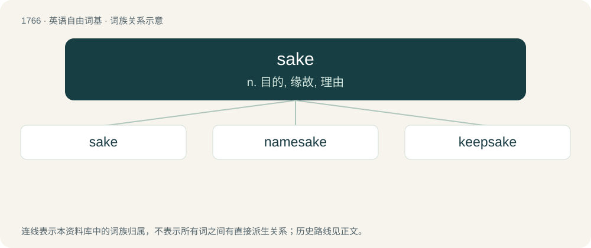

# 1864 · sake — n. 目的, 缘故, 理由

[总目录](../00_总目录_按常用程度.md)

**类型**：英语自由词基　｜　**来源语言**：见词源记录

## 核心含义与来源

- 核心含义：n. 目的, 缘故, 理由
- 英文含义：Cause, interest or account.
- 词形：sake

**来源记录 1**（名词；Cause, interest or account.）

From Middle English sake (“sake, cause”), from Old English sacu (“cause, lawsuit, legal action, complaint, issue, dispute”), from Proto-West Germanic \*saku, from Proto-Germanic \*sakō (“affair, thing, charge, accusation, matter”), from Proto-Indo-European \*seh₂g- (“to investigate”). Akin to West Frisian saak (“cause; business”), Low German Saak, Dutch zaak (“matter; cause; business”), German Sache (“thing; matter; cause; legal cause”), Danish sag, Norwegian Bokmål, Norwegian Nynorsk, and Swedish sak, Gothic 𐍃𐌰𐌺𐌾𐍉 (sakjō, “dispute, argument”), Old English sōcn (“inquiry, prosecution”), Old English sēcan (“to seek”). More at soke, soken, seek.

## 词族图

## 单词速览（常用到不常用）

| 单词 | 音标 | 释义 |
|---|---|---|
| [sake](#w-1) | /ˈseɪ̯k/ | n. 目的, 缘故, 理由 |
| [namesake](#w-2) | /ˈneɪmseɪk/ | n. 同名人, 同名物 |
| [keepsake](#w-3) | /ˈkiːp.seɪk/ | n. 纪念品 |

## 逐词详解

### 1. sake

**词性**：名词　｜　**音标**：/ˈseɪ̯k/

**中文释义**：n. 目的, 缘故, 理由

**英文义项**：Cause, interest or account. / Purpose or end; reason.

**词源与演化**：

From Middle English sake (“sake, cause”), from Old English sacu (“cause, lawsuit, legal action, complaint, issue, dispute”), from Proto-West Germanic \*saku, from Proto-Germanic \*sakō (“affair, thing, charge, accusation, matter”), from Proto-Indo-European \*seh₂g- (“to investigate”). Akin to West Frisian saak (“cause; business”), Low German Saak, Dutch zaak (“matter; cause; business”), German Sache (“thing; matter; cause; legal cause”), Danish sag, Norwegian Bokmål, Norwegian Nynorsk, and Swedish sak, Gothic 𐍃𐌰𐌺𐌾𐍉 (sakjō, “dispute, argument”), Old English sōcn (“inquiry, prosecution”), Old English sēcan (“to seek”). More at soke, soken, seek.

**例句**：

> It's not worth risking your life for the sake of getting there a few minutes earlier.

该用例对应义项：Purpose or end; reason.

### 2. namesake

**词性**：名词　｜　**音标**：/ˈneɪmseɪk/

**中文释义**：n. 同名人, 同名物

**英文义项**：An entity that lends its name to another entity. / A person with the same name as another.

**构词拆分**：name + sake

**词源与演化**：

Mid-17th century. Equivalent to name + sake. From the phrase “for (one's) name's sake”, first found in Bible translations as a rendering of a Calque of Hebrew לְמַעַן שְׁמוֹ (l'má'an sh'mó) idiom meaning “to protect one's reputation” or possibly “vouched for by one's reputation”. A familiar example is in Psalm 23:3.

**例句**：

> The statesman Winston Churchill has a namesake, the American novelist Winston Churchill.

该用例对应义项：A person with the same name as another.

### 3. keepsake

**词性**：名词　｜　**音标**：/ˈkiːp.seɪk/

**中文释义**：n. 纪念品

**英文义项**：An object given by a person and retained in memory of something or someone; something kept for sentimental or nostalgic reasons.

**构词拆分**：keep + sake

**词源与演化**：

From keep + sake.

**例句**：

> This is a keepsake from when I was a soldier.
