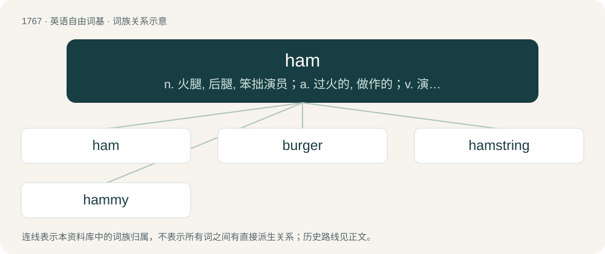

# 1865 · ham — n. 火腿, 后腿, 笨拙演员；a. 过火的, 做作的；v. 演得过火

[总目录](../00_总目录_按常用程度.md)

**类型**：英语自由词基　｜　**来源语言**：见词源记录

## 核心含义与来源

- 核心含义：n. 火腿, 后腿, 笨拙演员；a. 过火的, 做作的；v. 演得过火
- 英文含义：The region back of the knee joint; the popliteal space; the hock.
- 词形：ham

**多个词源／构词路径**：同一拼写可能有不同来源；以下按词性和含义分别列出。

**来源记录 1**（名词；The region back of the knee joint; the popliteal space; the hock.）

Inherited from Middle English hamme, from Old English hamm (“inner or hind part of the knee, ham”), from Proto-West Germanic \*hammu, from Proto-Germanic \*hamō, \*hammō, \*hanmō, from Proto-Indo-European \*kónh₂m (“leg”). Cognate with Dutch ham (“ham”), dialectal German Hamme (“hind part of the knee, ham”), dialectal Swedish ham (“the hind part of the knee”), Icelandic höm (“the ham or haunch of a horse”), Old Irish cnáim (“bone”), Ancient Greek κνήμη (knḗmē, “shinbone”). Compare gammon and gam.

**来源记录 2**（名词；An overacting or amateurish performer; an actor with an especially showy or exaggerated style.）

Uncertain, though it is generally agreed upon that it first appeared in print around the 1880s. At least four theories persist: \* It came naturally from the word amateur. Deemed likely by Hendrickson (1997), but then the question would be why it took so long to pop up. He rejects the folk etymology of Cockney slang hamateur because it originated in American English. \* From the play Hamlet, where the title character was often played poorly and/or in an exaggerated manner. Also deemed likely by Hendrickson, though he raises the issue that the term would have likely been around earlier if this were case. \* From the minstrel's practice of using ham fat to remove heavy black makeup used during performances. \* Shortened from hamfatter (“inferior actor”), said to derive from the 1863 minstrel show song The Ham-fat Man. William and Mary Morris (1988) argue that it's not known whether the song inspired the term or the term inspired the song, but that they believe the latter is the case.

## 词族图

## 单词速览（常用到不常用）

| 单词 | 音标 | 释义 |
|---|---|---|
| [ham](#w-1) | 英 /ˈhæm/；美 /ˈhæm/ | n. 火腿, 后腿, 笨拙演员；a. 过火的, 做作的；v. 演得过火 |
| [burger](#w-2) | 英 /ˈbɜːɡə/；美 /ˈbɝ.ɡɚ/ | n. 汉堡包（等于hamburger） |
| [hamstring](#w-3) | /ˈhæmstɹɪŋ/ | n. 后腿腱；vt. 切断腿腱使成跛腿, 使瘫痪 |
| [hammy](#w-4) | /ˈhæmi/ | a. 有火腿香味的, (非正式)表演过火的 |

## 逐词详解

### 1. ham

**词性**：名词　｜　**音标**：英 /ˈhæm/；美 /ˈhæm/

**中文释义**：n. 火腿, 后腿, 笨拙演员；a. 过火的, 做作的；v. 演得过火

**英文义项**：The region back of the knee joint; the popliteal space; the hock. / A thigh and/or buttock of a hog slaughtered for meat; (occasionally) the corresponding cut from some other animal.

**词源与演化**：

Inherited from Middle English hamme, from Old English hamm (“inner or hind part of the knee, ham”), from Proto-West Germanic \*hammu, from Proto-Germanic \*hamō, \*hammō, \*hanmō, from Proto-Indo-European \*kónh₂m (“leg”). Cognate with Dutch ham (“ham”), dialectal German Hamme (“hind part of the knee, ham”), dialectal Swedish ham (“the hind part of the knee”), Icelandic höm (“the ham or haunch of a horse”), Old Irish cnáim (“bone”), Ancient Greek κνήμη (knḗmē, “shinbone”). Compare gammon and gam.

**用法示例／搭配（非完整句）**：

> a little piece of ham for the cat

该用例对应义项：Meat from the thigh and/or buttock of a hog cured for food.

### 2. burger

**词性**：名词　｜　**音标**：英 /ˈbɜːɡə/；美 /ˈbɝ.ɡɚ/

**中文释义**：n. 汉堡包（等于hamburger）

**英文义项**：A hamburger. / A similar sandwich or patty.

**词源与演化**：

Clipping of hamburger, rebracketing it as ham + burger. First use appears c. 1937. Sense 5 is likely a back-formation from Burgerland.

**例句**：

> She was planning to have a burger for dinner.

该用例对应义项：A similar sandwich or patty.

### 3. hamstring

**词性**：名词　｜　**音标**：/ˈhæmstɹɪŋ/

**中文释义**：n. 后腿腱；vt. 切断腿腱使成跛腿, 使瘫痪

**英文义项**：One of the great tendons situated in each side of the ham, or space back of the knee, and connected with the muscles of the back of the thigh. / The biceps femoris, semimembranosus, and semitendinosus muscles.

**构词拆分**：From ham (“region back of the knee joint”) + string.

**词源与演化**：

From ham (“region back of the knee joint”) + string.

**例句**：

> The hamstring muscles include the biceps femoris, the semitendinosus and the semimembranosus.

### 4. hammy

**词性**：形容词　｜　**音标**：/ˈhæmi/

**中文释义**：a. 有火腿香味的, (非正式)表演过火的

**英文义项**：Resembling or characteristic of ham. / Amateurish; characterized by overacting.

**构词拆分**：From ham + -y.

**词源与演化**：

From ham + -y.
