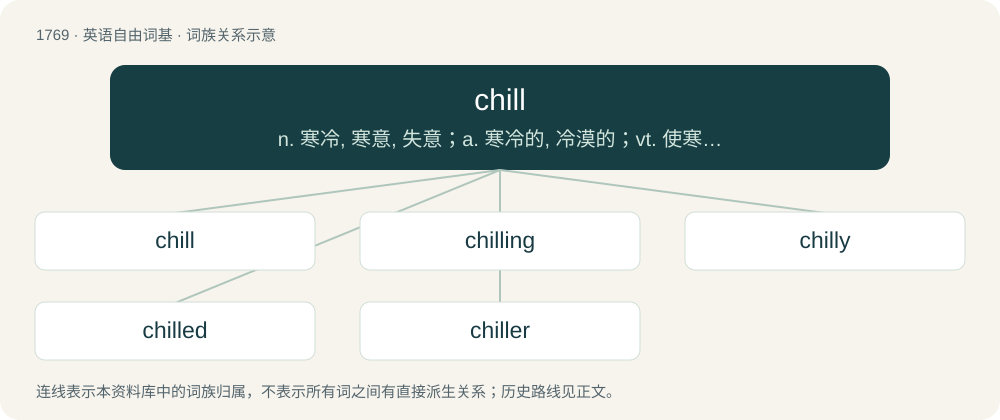

# 1866 · chill — n. 寒冷, 寒意, 失意；a. 寒冷的, 冷漠的；vt. 使寒心, 冷冻

[总目录](../00_总目录_按常用程度.md)

**类型**：英语自由词基　｜　**来源语言**：见词源记录

## 核心含义与来源

- 核心含义：n. 寒冷, 寒意, 失意；a. 寒冷的, 冷漠的；vt. 使寒心, 冷冻
- 英文含义：A moderate, but uncomfortable and penetrating coldness.
- 词形：chill

**多个词源／构词路径**：同一拼写可能有不同来源；以下按词性和含义分别列出。

**来源记录 1**（名词；A moderate, but uncomfortable and penetrating coldness.）

From Middle English chele, chile, from Old English ċiele, ċele (“cold; coldness”), from Proto-West Germanic \*kali, from Proto-Germanic \*kaliz, from Proto-Indo-European \*gel- (“to be cold”). Closely related with Dutch kil. Also akin to cool, cold, gel, and congeal, which see.

**来源记录 2**（动词；To lower the temperature of something; to cool.）

From Middle English chillen, from Old English ċilian (“to be cold”), from Proto-West Germanic \*kilēn (“to be cold”). Cognate with Middle Dutch killen (“to be cold”), Dutch killen (“to be cold, shiver”).

## 词族图

## 单词速览（常用到不常用）

| 单词 | 音标 | 释义 |
|---|---|---|
| [chill](#w-1) | 英 /tʃɪl/；/dʒɪl(lɯ)/ | n. 寒冷, 寒意, 失意；a. 寒冷的, 冷漠的；vt. 使寒心, 冷冻 |
| [chilling](#w-2) | /ˈt͡ʃɪlɪŋ/ | \[计\] 冷却, 致冷 |
| [chilly](#w-3) | 英 /ˈt͡ʃɪli/ | a. 寒冷的, 冷淡的, 不友好的；\[建\] 番椒, 冷 |
| [chilled](#w-4) | /t͡ʃɪld/ | a. 已冷的, 冷硬了的, 冷冻了的；\[建\] 冷却了的, 冷凝了的, 淬火迟的 |
| [chiller](#w-5) | 英 /ˈt͡ʃɪləː/；美 /ˈt͡ʃɪlɚ/ | n. 惊险小说, 冰箱内的食物冷冻格, 脱蜡冷冻结晶器, 冷却装置, 冷冻工人；\[化\] 激冷器 |

## 逐词详解

### 1. chill

**词性**：名词　｜　**音标**：英 /tʃɪl/；/dʒɪl(lɯ)/

**中文释义**：n. 寒冷, 寒意, 失意；a. 寒冷的, 冷漠的；vt. 使寒心, 冷冻

**英文义项**：A moderate, but uncomfortable and penetrating coldness. / A sudden penetrating sense of cold, especially one that causes a brief trembling nerve response through the body; the trembling response itself; often associated with illness: fevers and chills, or susceptibility to illness.

**词源与演化**：

From Middle English chele, chile, from Old English ċiele, ċele (“cold; coldness”), from Proto-West Germanic \*kali, from Proto-Germanic \*kaliz, from Proto-Indo-European \*gel- (“to be cold”). Closely related with Dutch kil. Also akin to cool, cold, gel, and congeal, which see.

**例句**：

> Despite the heat, he felt a chill as he entered the crime scene.

该用例对应义项：An uncomfortable and numbing sense of fear, dread, anxiety, or alarm, often one that is sudden and usually accompanied by a trembling nerve response resembling the body's response to biting cold.

### 2. chilling

**词性**：形容词　｜　**音标**：/ˈt͡ʃɪlɪŋ/

**中文释义**：\[计\] 冷却, 致冷

**英文义项**：Becoming cold. / Causing cold.

**构词拆分**：chill + -ing

**词源与演化**：

From Middle English chilling, chelling, chyllinge, chillynge, chillande, equivalent to chill + -ing.

**例句**：

> It was a chilling story, but the children enjoyed it.

该用例对应义项：Causing mild fear.

### 3. chilly

**词性**：形容词　｜　**音标**：英 /ˈt͡ʃɪli/

**中文释义**：a. 寒冷的, 冷淡的, 不友好的；\[建\] 番椒, 冷

**英文义项**：Cold enough to cause discomfort. / Feeling uncomfortably cold.

**构词拆分**：chill + -y

**词源与演化**：

From chill + -y. Cognate with Swedish kylig (“chilly”), Norwegian kjølig (“chilly”).

**例句**：

> I’m getting rather chilly over here – could you shut the window please?

该用例对应义项：Feeling uncomfortably cold.

### 4. chilled

**词性**：形容词　｜　**音标**：/t͡ʃɪld/

**中文释义**：a. 已冷的, 冷硬了的, 冷冻了的；\[建\] 冷却了的, 冷凝了的, 淬火迟的

**英文义项**：Cooled. / Having chills, filled with an uncomfortable sense of fear, dread, or alarm.

**构词拆分**：chill + -ed

**词源与演化**：

From Middle English chilled, chylled, equivalent to chill + -ed.

**例句**：

> The chilled beer was refreshing on the hot day.

该用例对应义项：Cooled.

### 5. chiller

**词性**：名词　｜　**音标**：英 /ˈt͡ʃɪləː/；美 /ˈt͡ʃɪlɚ/

**中文释义**：n. 惊险小说, 冰箱内的食物冷冻格, 脱蜡冷冻结晶器, 冷却装置, 冷冻工人；\[化\] 激冷器

**英文义项**：a machine that produces cold air, either for air conditioning, to prepare chilled foods etc. / a heat exchanger between a coolant and a refrigerant, to transfer heat from the coolant loop into the refrigeration system

**构词拆分**：chill + -er

**词源与演化**：

From chill + -er.
