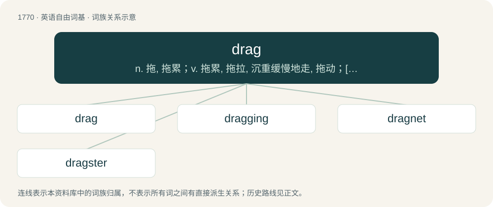

# 1868 · drag — n. 拖, 拖累；v. 拖累, 拖拉, 沉重缓慢地走, 拖动；\[计\] 拖动

[总目录](../00_总目录_按常用程度.md)

**类型**：英语自由词基　｜　**来源语言**：见词源记录

## 核心含义与来源

- 核心含义：n. 拖, 拖累；v. 拖累, 拖拉, 沉重缓慢地走, 拖动；\[计\] 拖动
- 英文含义：Resistance of a fluid to something moving through it.
- 词形：drag

**多个词源／构词路径**：同一拼写可能有不同来源；以下按词性和含义分别列出。

**来源记录 1**（名词；Resistance of a fluid to something moving through it.）

From Middle English draggen (“to drag”), early Middle English dragen (“to draw, carry”), confluence of Old English dragan (“to drag, draw, draw oneself, go, protract”) and Old Norse draga (“to draw, attract”); both from Proto-Germanic \*draganą (“to draw, drag”), from Proto-Indo-European \*dʰregʰ- (“to draw, drag”). Verb sense influenced due to association with the noun drag (“that which is hauled or dragged”), related to Low German dragge (“a drag-anchor, grapnel”). Cognate with Danish drægge (“to dredge”), Danish drage (“to draw, attract”), Swedish dragga (“to drag, drag anchor, sweep”), Swedish draga (“to draw, go”), Icelandic draga (“to drag, pull”). Doublet of draw.

**来源记录 2**（名词；A performance art form associated with the LGBTQ+ community, that features a stylized and exaggerated portrayal of femininity or, at times, masculinity, often playing with gender stereotypes.）

Possibly from English drag (“to pull along a surface”) because of the sensation of long skirts trailing on the floor, or from Yiddish טראָגן (trogn, “to wear”)

## 词族图

## 单词速览（常用到不常用）

| 单词 | 音标 | 释义 |
|---|---|---|
| [drag](#w-1) | 英 /dɹæɡ/；/dɹeɪɡ/ | n. 拖, 拖累；v. 拖累, 拖拉, 沉重缓慢地走, 拖动；\[计\] 拖动 |
| [dragging](#w-2) | /ˈdɹæɡɪŋ/ | \[计\] 牵引, 慢移动 |
| [dragnet](#w-3) | 英 /ˈdɹæɡˌnɛt/；/ˈdɹeɪ̯ɡˌnɛt/ | n. 拖网, (喻)法网 |
| [dragster](#w-4) | 美 /ˈdɹæɡstɚ/ | 改装而成的高速赛车 |

## 逐词详解

### 1. drag

**词性**：名词　｜　**音标**：英 /dɹæɡ/；/dɹeɪɡ/

**中文释义**：n. 拖, 拖累；v. 拖累, 拖拉, 沉重缓慢地走, 拖动；\[计\] 拖动

**英文义项**：Resistance of a fluid to something moving through it. / Any force acting in opposition to the motion of an object.

**词源与演化**：

From Middle English draggen (“to drag”), early Middle English dragen (“to draw, carry”), confluence of Old English dragan (“to drag, draw, draw oneself, go, protract”) and Old Norse draga (“to draw, attract”); both from Proto-Germanic \*draganą (“to draw, drag”), from Proto-Indo-European \*dʰregʰ- (“to draw, drag”). Verb sense influenced due to association with the noun drag (“that which is hauled or dragged”), related to Low German dragge (“a drag-anchor, grapnel”). Cognate with Danish drægge (“to dredge”), Danish drage (“to draw, attract”), Swedish dragga (“to drag, drag anchor, sweep”), Swedish draga (“to draw, go”), Icelandic draga (“to drag, pull”). Doublet of draw.

**例句**：

> A high thrust-to-weight ratio helps a rocket to overcome the effects of gravity drag.

该用例对应义项：Any force acting in opposition to the motion of an object.

### 2. dragging

**词性**：形容词　｜　**音标**：/ˈdɹæɡɪŋ/

**中文释义**：\[计\] 牵引, 慢移动

**英文义项**：That drags. / boring; dull

**构词拆分**：drag + -ing

**词源与演化**：

From drag + -ing.

**例句**：

> The subversive group was dragging Algeria to the brink of utter destruction.

### 3. dragnet

**词性**：名词　｜　**音标**：英 /ˈdɹæɡˌnɛt/；/ˈdɹeɪ̯ɡˌnɛt/

**中文释义**：n. 拖网, (喻)法网

**英文义项**：A net dragged across the bottom of a body of water. / A heightened effort by law enforcement personnel undertaken in order to capture suspects.

**构词拆分**：drag + net；dray + net

**词源与演化**：

From drag + net, probably based on the model of Middle English draynet, dreynett (“dragnet”), Old English dræġnet, dræġnett (“dragnet”), equivalent to dray + net. Cognate with Swedish dragnät, Norwegian dragnett, from Icelandic dragnet.

### 4. dragster

**词性**：名词　｜　**音标**：美 /ˈdɹæɡstɚ/

**中文释义**：改装而成的高速赛车

**英文义项**：A heavily modified or custom-built vehicle used in drag racing. / One who takes part in drag racing.

**构词拆分**：drag + -ster

**词源与演化**：

Derived from drag + -ster.
