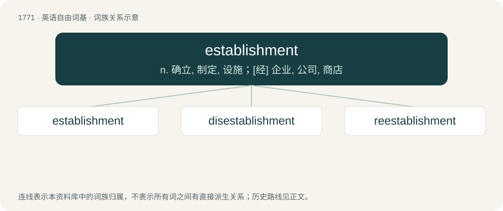

# 1869 · establishment — n. 确立, 制定, 设施；\[经\] 企业, 公司, 商店

[总目录](../00_总目录_按常用程度.md)

**类型**：英语自由词基　｜　**来源语言**：见词源记录

## 核心含义与来源

- 核心含义：n. 确立, 制定, 设施；\[经\] 企业, 公司, 商店
- 英文含义：The act or process of establishing; a ratifying or ordaining; settlement; confirmation.
- 词形：establishment

**来源记录 1**（名词；The act or process of establishing; a ratifying or ordaining; settlement; confirmation.）

Inherited from Middle English \*establishment, stablishment, stablisshement, from Old French establissement (modern French établissement), from the verb establir. By surface analysis, establish + -ment.

## 词族图

## 单词速览（常用到不常用）

| 单词 | 音标 | 释义 |
|---|---|---|
| [establishment](#w-1) | 英 /ɪˈstæb.lɪʃ.mənt/ | n. 确立, 制定, 设施；\[经\] 企业, 公司, 商店 |
| [disestablishment](#w-2) | /dɪs.ɪsˈtæblɪʃ.mənt/ | n. 解除官职；政教分离 |
| [reestablishment](#w-3) |  | \[法\] 使复位, 使复职, 恢复 |

## 逐词详解

### 1. establishment

**词性**：名词　｜　**音标**：英 /ɪˈstæb.lɪʃ.mənt/

**中文释义**：n. 确立, 制定, 设施；\[经\] 企业, 公司, 商店

**英文义项**：The act or process of establishing; a ratifying or ordaining; settlement; confirmation. / The state of being established, founded, etc.; fixed state.

**词源与演化**：

Inherited from Middle English \*establishment, stablishment, stablisshement, from Old French establissement (modern French établissement), from the verb establir. By surface analysis, establish + -ment.

**例句**：

> Since their establishment of the company in 1984, they have grown into a global business.

该用例对应义项：The act or process of establishing; a ratifying or ordaining; settlement; confirmation.

### 2. disestablishment

**词性**：名词　｜　**音标**：/dɪs.ɪsˈtæblɪʃ.mənt/

**中文释义**：n. 解除官职；政教分离

**英文义项**：The downgrading or dissolution of something that had been established. / Specifically, the removal of state privileges or patronage from a given church; the removal of a policy of having an official governing religion.

**构词拆分**：dis- + establishment + dis- + establish + -ment；dis- + establish + -ment

**词源与演化**：

By surface analysis, dis- + establishment or dis- + establish + -ment.

### 3. reestablishment

**词性**：名词

**中文释义**：\[法\] 使复位, 使复职, 恢复

**英文义项**：The condition of being reestablished; restoration. / A second or subsequent establishment.

**构词拆分**：re- + establishment

**词源与演化**：

From re- + establishment.
