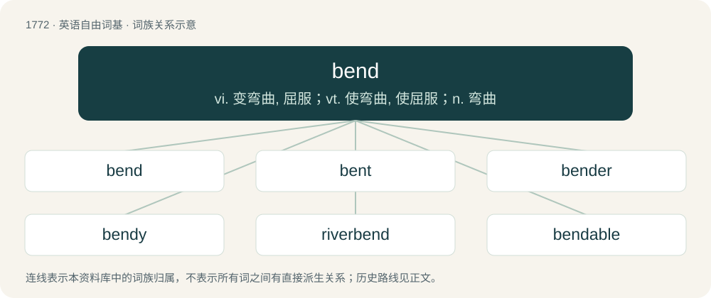

# 1870 · bend — vi. 变弯曲, 屈服；vt. 使弯曲, 使屈服；n. 弯曲

[总目录](../00_总目录_按常用程度.md)

**类型**：英语自由词基　｜　**来源语言**：见词源记录

## 核心含义与来源

- 核心含义：vi. 变弯曲, 屈服；vt. 使弯曲, 使屈服；n. 弯曲
- 英文含义：To cause (something) to change its shape into a curve, by physical force, chemical action, or any other means.
- 词形：bend

**来源记录 1**（动词；To cause (something) to change its shape into a curve, by physical force, chemical action, or any other means.）

From Middle English benden, from Old English bendan (“to bind or bend (a bow), fetter, restrain”), from Proto-West Germanic \*bandijan, from Proto-Germanic \*bandijaną (“to bend”), from Proto-Indo-European \*bʰendʰ- (“to bind, tie”). Cognate with Middle High German benden (“to fetter”), Danish bænde (“to bend”), Norwegian bende (“to bend”), Faroese benda (“to bend, inflect”), Icelandic benda (“to bend”). Related to bind, band, bond.

## 词族图

## 单词速览（常用到不常用）

| 单词 | 音标 | 释义 |
|---|---|---|
| [bend](#w-1) | /bɛnd/ | vi. 变弯曲, 屈服；vt. 使弯曲, 使屈服；n. 弯曲 |
| [bent](#w-2) | 英 /bɛnt/ | a. 弯曲的, 决心的；n. 爱好；bend的过去式和过去分词 |
| [bender](#w-3) | 英 /ˈbɛndə/；美 /ˈbɛndɚ/ | n. 扭弄物体的人, 六便士银币, 饮酒作乐 |
| [bendy](#w-4) | /ˈbɛndi/ | a. 易弯曲的,柔韧的 |
| [riverbend](#w-5) | 美 /ˈɹɪvɚˌbɛnd/ | 【英文】A knee or meander in a river. |
| [bendable](#w-6) | /ˈbɛndəbəl/ | 可弯曲的 |
| [prebend](#w-7) | /priˈbɛnd/ | 【英文】To bend in advance. |

## 逐词详解

### 1. bend

**词性**：动词　｜　**音标**：/bɛnd/

**中文释义**：vi. 变弯曲, 屈服；vt. 使弯曲, 使屈服；n. 弯曲

**英文义项**：To cause (something) to change its shape into a curve, by physical force, chemical action, or any other means. / To become curved.

**词源与演化**：

From Middle English benden, from Old English bendan (“to bind or bend (a bow), fetter, restrain”), from Proto-West Germanic \*bandijan, from Proto-Germanic \*bandijaną (“to bend”), from Proto-Indo-European \*bʰendʰ- (“to bind, tie”). Cognate with Middle High German benden (“to fetter”), Danish bænde (“to bend”), Norwegian bende (“to bend”), Faroese benda (“to bend, inflect”), Icelandic benda (“to bend”). Related to bind, band, bond.

**例句**：

> You should bend the G slightly sharp in the next measure.

该用例对应义项：To smoothly change the pitch of a note.

### 2. bent

**词性**：形容词　｜　**音标**：英 /bɛnt/

**中文释义**：a. 弯曲的, 决心的；n. 爱好；bend的过去式和过去分词

**英文义项**：Folded or dented out of its usual shape. / Corrupt, dishonest.

**构词拆分**：bend + -t

**词源与演化**：

From Middle English bent-, preterite stem (as in bente, benten, etc.), and Middle English bent, ibent, ybent, past participle forms of Middle English benden (“to bend”). Equivalent to bend + -t.

**例句**：

> She was bent about "certain kinds of people" having civil rights; she wanted to roll those back.

该用例对应义项：Annoyed; out of sorts; having a bee in one's bonnet.

### 3. bender

**词性**：名词　｜　**音标**：英 /ˈbɛndə/；美 /ˈbɛndɚ/

**中文释义**：n. 扭弄物体的人, 六便士银币, 饮酒作乐

**英文义项**：One who, or that which, bends. / A device to aid bending of pipes to a specific angle.

**构词拆分**：bend + -er

**词源与演化**：

Hypotheses: \* bend + -er. In sense of “heavy drinking”, originally generally “spree”, from 1846, of uncertain origin – vague contemporary sense of “something extraordinary”, connection to bend (e.g., bending elbow to drink (bend one's elbow)) or perhaps from Scottish sense of “strong drinker”. \* In Britain, for about four centuries, a sixpence was known as a bender because its silver content made it easy to bend in the hands. This was commonly done to create ‘love tokens’, many of which survive in collections to this day. The value of a sixpence was also enough to get thoroughly inebriated as taverns would often allow you to drink all day for two pence. This gave rise to the expression ‘going on a bender’. \* (interjection): From over the bender, referring to a person's arm (and sometimes accompanied by a gesture of the thumb backward over the shoulder); compare over the left shoulder.

**例句**：

> He's been out on a bender with his mates.

该用例对应义项：A bout of heavy drinking or drug use.

### 4. bendy

**词性**：形容词　｜　**音标**：/ˈbɛndi/

**中文释义**：a. 易弯曲的,柔韧的

**英文义项**：Having the ability to be bent easily. / Of a person, flexible; having the ability to bend easily; resilient.

**构词拆分**：bend + -y

**词源与演化**：

From bend + -y.

**例句**：

> Bendy rulers are far more fun than the wooden ones.

该用例对应义项：Having the ability to be bent easily.

### 5. riverbend

**词性**：名词　｜　**音标**：美 /ˈɹɪvɚˌbɛnd/

**英文义项**：A knee or meander in a river.

**构词拆分**：river + bend

**词源与演化**：

From river + bend.

### 6. bendable

**词性**：形容词　｜　**音标**：/ˈbɛndəbəl/

**中文释义**：可弯曲的

**英文义项**：Able to be bent or flexed or twisted without breaking.

**构词拆分**：bend + -able

**词源与演化**：

From bend + -able.

**例句**：

> It's bendable, stretchable, transparent, super light. The best conductor of heat, the best conductor of electricity.

### 7. prebend

**词性**：动词　｜　**音标**：/priˈbɛnd/

**英文义项**：To bend in advance.

**构词拆分**：pre- + bend

**词源与演化**：

From pre- + bend.
