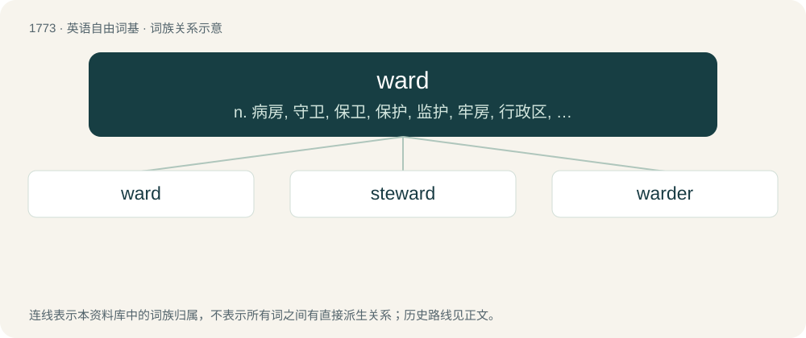

# 1872 · ward — n. 病房, 守卫, 保卫, 保护, 监护, 牢房, 行政区, 锁孔内的榫舌；vt. 使入病房, 守护, 保卫

[总目录](../00_总目录_按常用程度.md)

**类型**：英语自由词基　｜　**来源语言**：见词源记录

## 核心含义与来源

- 核心含义：n. 病房, 守卫, 保卫, 保护, 监护, 牢房, 行政区, 锁孔内的榫舌；vt. 使入病房, 守护, 保卫
- 英文含义：The action of a watchman; monitoring, surveillance (usually in phrases keep ward etc.)
- 词形：ward

**多个词源／构词路径**：同一拼写可能有不同来源；以下按词性和含义分别列出。

**来源记录 1**（名词；The action of a watchman; monitoring, surveillance (usually in phrases keep ward etc.)）

From Middle English ward, warde, from Old English weard (“watching, ward, protection, guardianship; advance post; waiting for, lurking, ambuscade”), from Proto-West Germanic \*wardu, from Proto-Germanic \*wardō (“protection, attention, keeping”), an extension of the stem \*wara- (“attentive”) (English wary, beware), from Proto-Indo-European \*wer- (“to cover”). Cognate with German Warte (“watchtower”), warten (“wait for”); English guard is a parallel form which came via Old French.

**来源记录 2**（动词；To keep in safety, to watch over, to guard.）

From Middle English warden, from Old English weardian (“to watch, guard, keep, protect, preserve; hold, possess, occupy, inhabit; rule, govern”), from Proto-West Germanic \*wardēn, from Proto-Germanic \*wardōną, \*wardāną (“to guard”), from Proto-Indo-European \*wer- (“to heed, defend”). Doublet of guard.

## 词族图

## 单词速览（常用到不常用）

| 单词 | 音标 | 释义 |
|---|---|---|
| [ward](#w-1) | 英 /wɔːd/；美 /wɔɹd/ | n. 病房, 守卫, 保卫, 保护, 监护, 牢房, 行政区, 锁孔内的榫舌；vt. 使入病房, 守护, 保卫 |
| [steward](#w-2) | 美 /ˈstu.ɚd/；/ˈstjuː.əːd/ | n. 管理人, 招待员, 管家, 乘务员；\[经\] 轮船, 飞机的服务员, (财务)管理员 |
| [warder](#w-3) | /ˈwɒːdə/ | n. 看守, 守卫, 看门人；\[法\] 监狱看守人, 门警, 管理人 |

## 逐词详解

### 1. ward

**词性**：名词　｜　**音标**：英 /wɔːd/；美 /wɔɹd/

**中文释义**：n. 病房, 守卫, 保卫, 保护, 监护, 牢房, 行政区, 锁孔内的榫舌；vt. 使入病房, 守护, 保卫

**英文义项**：The action of a watchman; monitoring, surveillance (usually in phrases keep ward etc.) / Guardianship, especially of a child or prisoner.

**词源与演化**：

From Middle English ward, warde, from Old English weard (“watching, ward, protection, guardianship; advance post; waiting for, lurking, ambuscade”), from Proto-West Germanic \*wardu, from Proto-Germanic \*wardō (“protection, attention, keeping”), an extension of the stem \*wara- (“attentive”) (English wary, beware), from Proto-Indo-European \*wer- (“to cover”). Cognate with German Warte (“watchtower”), warten (“wait for”); English guard is a parallel form which came via Old French.

**例句**：

> On our last visit to Tokyo, we went to Chiyoda ward and visited the Emperor’s palace.

该用例对应义项：An administrative division of a borough, city or council.

### 2. steward

**词性**：名词　｜　**音标**：美 /ˈstu.ɚd/；/ˈstjuː.əːd/

**中文释义**：n. 管理人, 招待员, 管家, 乘务员；\[经\] 轮船, 飞机的服务员, (财务)管理员

**英文义项**：A person who manages the property or affairs for another entity. / A ship's officer who is in charge of making dining arrangements and provisions.

**构词拆分**：sty + ward

**词源与演化**：

From Middle English steward, stiward, from Old English stiġweard (“steward, housekeeper, one who has the superintendence of household affairs, guardian”), from stiġ (“a wooden enclosure; house, hall”) + weard (“ward, guard, guardian, keeper”), equivalent to sty + ward. Compare Icelandic stívarður (“steward”). More at sty, ward.

**用法示例／搭配（非完整句）**：

> a steward in a Methodist church

该用例对应义项：A fiscal agent of certain bodies.

### 3. warder

**词性**：名词　｜　**音标**：/ˈwɒːdə/

**中文释义**：n. 看守, 守卫, 看门人；\[法\] 监狱看守人, 门警, 管理人

**英文义项**：A guard, especially in a prison. / One who or that which wards or repels.

**构词拆分**：ward + -er

**词源与演化**：

From Middle English warder, wardere, perhaps in part continuing Old English weardere (“one who holds a country; inhabitant”), from Proto-West Germanic \*wardārī (“guard, follower, watchman, lookout”), equivalent to ward + -er. Cognate with Dutch waarder (“inspector”), German Low German Wärder (“guard, watchman”), German Wärter (“guard, keeper, attendant”).
