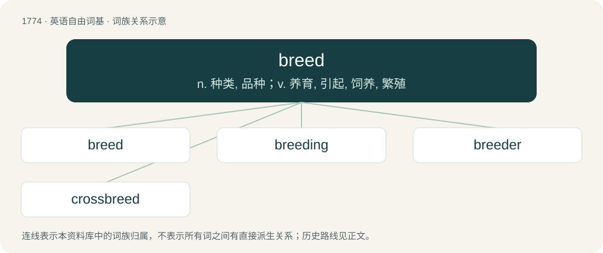

# 1873 · breed — n. 种类, 品种；v. 养育, 引起, 饲养, 繁殖

[总目录](../00_总目录_按常用程度.md)

**类型**：英语自由词基　｜　**来源语言**：见词源记录

## 核心含义与来源

- 核心含义：n. 种类, 品种；v. 养育, 引起, 饲养, 繁殖
- 英文含义：To produce offspring sexually; to bear young.
- 词形：breed

**来源记录 1**（动词；To produce offspring sexually; to bear young.）

Inherited from Middle English breden, from Old English brēdan, from Proto-Germanic \*brōdijaną (“to brood”), from Proto-Indo-European \*bʰreh₁- (“warm”). Cognate with Scots brede, breid, Saterland Frisian briede, West Frisian briede, Low German bröden, Dutch broeden, German brüten.

## 词族图

## 单词速览（常用到不常用）

| 单词 | 音标 | 释义 |
|---|---|---|
| [breed](#w-1) | /ˈbɹiːd/ | n. 种类, 品种；v. 养育, 引起, 饲养, 繁殖 |
| [breeding](#w-2) | /ˈbɹiːdɪŋ/ | n. 教养, 生育, 饲养；\[医\] 生育, 繁殖, 育种, 饲养 |
| [breeder](#w-3) | /ˈbɹiːdɚ/ | n. 饲养员, 养育员, 起因, 起源者 |
| [crossbreed](#w-4) | /ˈkɹɑːsˌbɹiːd/ | n. 杂种；v. 异种交配, 培育杂种, (使)杂交 |

## 逐词详解

### 1. breed

**词性**：动词　｜　**音标**：/ˈbɹiːd/

**中文释义**：n. 种类, 品种；v. 养育, 引起, 饲养, 繁殖

**英文义项**：To produce offspring sexually; to bear young. / To give birth to; to be the native place of.

**词源与演化**：

Inherited from Middle English breden, from Old English brēdan, from Proto-Germanic \*brōdijaną (“to brood”), from Proto-Indo-European \*bʰreh₁- (“warm”). Cognate with Scots brede, breid, Saterland Frisian briede, West Frisian briede, Low German bröden, Dutch broeden, German brüten.

**例句**：

> She wanted to breed her cow to the neighbor's registered bull.

该用例对应义项：To arrange the mating of (specific animals).

### 2. breeding

**词性**：名词　｜　**音标**：/ˈbɹiːdɪŋ/

**中文释义**：n. 教养, 生育, 饲养；\[医\] 生育, 繁殖, 育种, 饲养

**英文义项**：Propagation of offspring through sexual reproduction. / The act of insemination by natural or artificial means.

**构词拆分**：breed + -ing

**词源与演化**：

From Middle English breedyng, bredynge (“gestation, incubation, propagation, hatching; engineering, formation, development, growth”), equivalent to breed + -ing.

**例句**：

> Your dog has good breeding.

该用例对应义项：Descent; pedigree; extraction.

### 3. breeder

**词性**：名词　｜　**音标**：/ˈbɹiːdɚ/

**中文释义**：n. 饲养员, 养育员, 起因, 起源者

**英文义项**：A person who breeds plants or animals (professionally). / A pattern that exhibits quadratic growth by generating multiple copies of a secondary pattern, each of which then generates multiple copies of a tertiary pattern.

**构词拆分**：breed + -er

**词源与演化**：

From breed + -er. Cognate with West Frisian brieder (“one who breeds, breeder”), Dutch broeier (“brooder, vagrant”).

**例句**：

> Since the breeders started coming here, you can never tell who likes cock.

该用例对应义项：A heterosexual person; one whose sexual intercourse can lead to breeding; straggot.

### 4. crossbreed

**词性**：动词　｜　**音标**：/ˈkɹɑːsˌbɹiːd/

**中文释义**：n. 杂种；v. 异种交配, 培育杂种, (使)杂交

**英文义项**：To produce (an organism) by the mating of individuals of different breeds, varieties, or species; hybridize. / To mate so as to produce a hybrid; interbreed.

**构词拆分**：cross- + breed

**词源与演化**：

From cross- + breed.

**例句**：

> Believing nectarines to be a crossbreed of plums and peaches is a widespread misconception.
