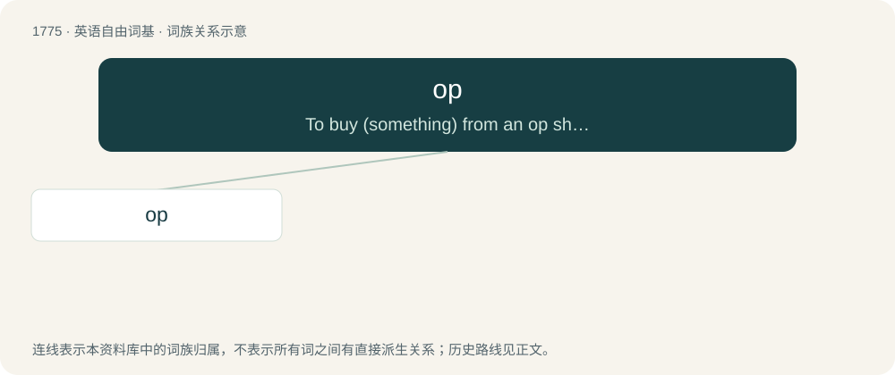

# 1875 · op — To buy (something) from an op shop.

[总目录](../00_总目录_按常用程度.md)

**类型**：英语自由词基　｜　**来源语言**：见词源记录

## 核心含义与来源

- 核心含义：To buy (something) from an op shop.
- 英文含义：To buy (something) from an op shop.
- 词形：op

**来源记录 1**（动词；To buy (something) from an op shop.）

From op shop.

## 词族图

## 单词速览（常用到不常用）

| 单词 | 音标 | 释义 |
|---|---|---|
| [op](#w-1) | 英 /ɒp/；美 /ɑp/ | 【英文】To buy (something) from an op shop. |

## 逐词详解

### 1. op

**词性**：动词　｜　**音标**：英 /ɒp/；美 /ɑp/

**英文义项**：To buy (something) from an op shop. / To shop at op shops.

**词源与演化**：

From op shop.

**例句**：

> Because it was a black op, we didn't know what was happening.
