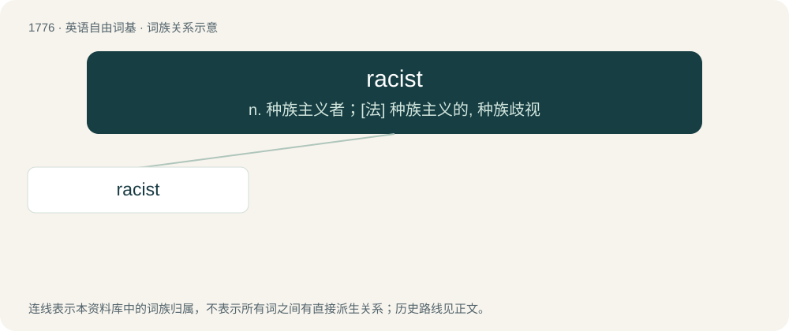

# 1876 · racist — n. 种族主义者；\[法\] 种族主义的, 种族歧视

[总目录](../00_总目录_按常用程度.md)

**类型**：英语自由词基　｜　**来源语言**：见词源记录

## 核心含义与来源

- 核心含义：n. 种族主义者；\[法\] 种族主义的, 种族歧视
- 英文含义：A person who believes in or supports racism; a person who believes that a particular race is superior to others, or who discriminates against other races.
- 词形：racist

**来源记录 1**（名词；A person who believes in or supports racism; a person who believes that a particular race is superior to others, or who discriminates against other races.）

1932 (noun), 1938 (adjective). Formed from racism (1928), paralleling French raciste (1892). Replaced older racialist (1910). Equivalent to race + -ist.

## 词族图

## 单词速览（常用到不常用）

| 单词 | 音标 | 释义 |
|---|---|---|
| [racist](#w-1) | 英 /ˈɹeɪ.sɪst/ | n. 种族主义者；\[法\] 种族主义的, 种族歧视 |

## 逐词详解

### 1. racist

**词性**：形容词　｜　**音标**：英 /ˈɹeɪ.sɪst/

**中文释义**：n. 种族主义者；\[法\] 种族主义的, 种族歧视

**英文义项**：Constituting, exhibiting, advocating, or pertaining to racism. / Discriminatory.

**构词拆分**：race + -ist

**词源与演化**：

1932 (noun), 1938 (adjective). Formed from racism (1928), paralleling French raciste (1892). Replaced older racialist (1910). Equivalent to race + -ist.

**例句**：

> They don't allow Muslims and gays to join the club? That's racist!

该用例对应义项：Discriminatory.
