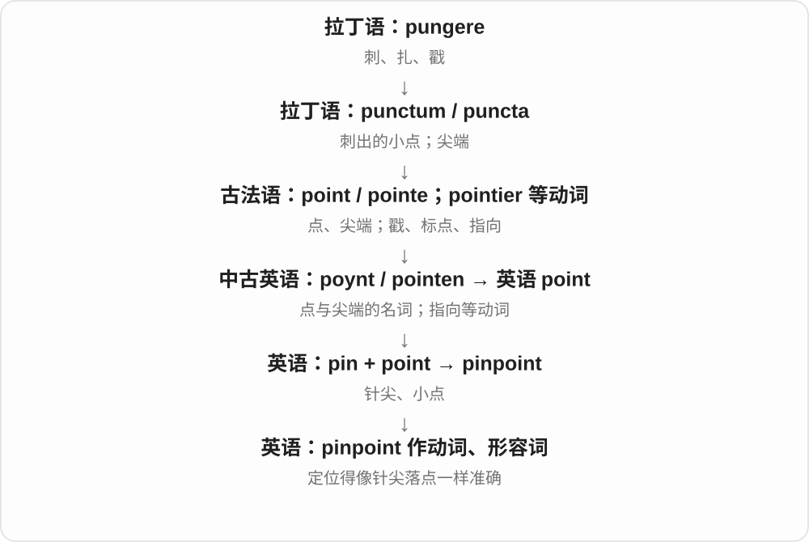

# 1878 · pin — 针销的固定、细小形状，以及基础支撑

[逐词精讲目录](../00_逐词精讲目录.md) · [总目录](../00_总目录_按常用程度.md)

## 核心词根与来源

基本针销、数字置顶、理论基础放进不同分支。细小和固定是两种主要联想，球机、条纹、针头分别取不同特点。

**PIN：小针能固定东西，也能把位置和希望钉在一点上**

pin → pinned；underpin 下方支撑；pinstripe 细线；pinhead 小头；pinball、pincushion 按用途组合。

- **固定动作与基础**：pin · pinned · underpin
- **细小形态和位置**：pinstripe · pinhead · pinpoint · pinhole
- **游戏、针具及其他组合**：pinball · pincushion · hairpin · kingpin
- **pin → pins：小钉、别针、固定**：pin · pins
- **hairpin → hairpins：发夹到发夹形急转弯**：pin · hairpin · hairpins
- **pin 的晾衣工具组合及复数**：pin · clothespin · clothespins

## 词形与演化规律

pinn → pin；pin + -ed 双写 n；under- + pin；pin + ball/stripe/head/cushion/point/hole；king/hair + pin。

名词可转为固定的动作，电子界面的置顶是后来的比喻。

器物形态成为道路弯曲形状的比喻。

器物名沿用，现代可采用弹簧夹式结构。

## 单词速览（按词族由简到繁）

同一基础词的相关扩展放在一起，先读基础形式，再读扩展；各组之间优先读常用的。具体词源关系见各词讲解。

| 单词 | 音标 | 核心意思 |
|---|---|---|
| [pin](#w-1) | /pɪn/ | 别针；销钉；固定、钉住；PIN 个人识别码〔缩写〕 |
| [pins](#w-13) | /pɪnz/ | 别针、小钉；固定、钉住、置顶〔动词第三人称单数〕 |
| [pinned](#w-2) | /pɪnd/ | 钉住、别住、固定了；已置顶的；有销、针的 |
| [pinpoint](#w-3) | 英、美 /ˈpɪnpɔɪnt/ | 准确找出；精确定位；针尖、小点；极精确的 |
| [pinball](#w-4) | 英 /ˈpɪnbɔːl/；美 /ˈpɪnbɔːl/ | 弹球游戏；快速乱弹、穿梭 |
| [pinhole](#w-8) | 英 /ˈpɪnhəʊl/；美 /ˈpɪnhoʊl/ | 针孔；极小孔洞 |
| [pinstripe](#w-9) | /ˈpɪnstraɪp/ | 细条纹；细条纹布料 |
| [pinhead](#w-10) | /ˈpɪnhed/ | 针头、别针顶端；笨蛋〔贬称〕 |
| [pincushion](#w-12) | /ˈpɪnkʊʃən/ | 针插、插针垫；针垫状物 |
| [kingpin](#w-5) | /ˈkɪŋpɪn/ | 关键人物；头目；机械主销等 |
| [hairpin](#w-6) | 英 /ˈheəpɪn/；美 /ˈherpɪn/ | 发夹、发簪；发夹状的急弯 |
| [hairpins](#w-14) | 英 /ˈheəpɪnz/；美 /ˈherpɪnz/ | 发夹、发簪；发夹形急转弯〔复数〕 |
| [underpin](#w-7) | 英 /ˌʌndəˈpɪn/；美 /ˌʌndərˈpɪn/ | 从下面支撑、加固；构成……的基础 |
| [clothespin](#w-15) | 英 /ˈkləʊðzpɪn/；美 /ˈkloʊðzpɪn/，clothes 部分也常省去 /ð/ | 晾衣夹〔常见美式〕 |
| [clothespins](#w-16) | 英 /ˈkləʊðzpɪnz/；美 /ˈkloʊðzpɪnz/，clothes 部分也有简化读法 | 晾衣夹〔复数〕 |

## 逐词讲解

### 1. pin — 别针；销钉；固定、钉住；PIN 个人识别码〔缩写〕

**音标**：/pɪn/

**先抓住这个画面**

一根细小的钉状东西把两样物件固定在一起；从这个动作又能想到把位置、消息或注意力固定住。

**怎么拆**

经古英语 pinn，属于日耳曼语中的钉、栓词族；主流分析把它接到拉丁 pinna“尖端、突出部分”的早期借入。拉丁 pinna 与 penna“羽毛”通常联系起来，但具体古老关系曾有不同分析。现代 PIN 则另是 personal identification number 的缩写。

**怎么变成今天的意思**

**拉丁 pinna**  
羽毛、翼及尖端、突出部分等义

↓

**日耳曼语钉栓词族 → 古英语 pinn → pin**  
细长的钉、栓，后来包括别针等

↓

**英语名词 pin → 动词 pin**  
用针固定 → 钉住、压住；后来用于界面固定

↓

**另支：personal identification number → PIN**  
个人识别码，缩写与普通 pin 同音

pin a note to a board 是钉住纸条；pin a message 在软件里常是固定或置顶消息，让它容易找到。pin someone against a wall 则是把人压住、限制活动。pin your hopes on 是把希望寄托在某事上，不是真的拿针去扎。

**常见搭配与例句**

a safety pin；a metal pin；pin something to a board；pin a message；pin your hopes on。过去式 pinned，进行式 pinning。

> She fastened the fabric with a pin.

她用一根别针固定住布料。

> Please pin the announcement so everyone can find it.

请把公告置顶，方便大家找到。

> The team pinned its hopes on the final test.

团队把希望寄托在最后一次测试上。

**别混淆**

pin 作物件通常是一根细长的固定件；needle 常指针，有缝纫、注射等具体用途。银行或设备里的 PIN 是代码缩写，词源与金属别针无关。

### 2. pins — 别针、小钉；固定、钉住、置顶〔动词第三人称单数〕

**音标**：/pɪnz/

**先抓住这个画面**

把一根小尖物插进去，让东西待在原处，就是 pins 的共同画面。屏幕上把重要内容固定在前面，也沿用 pin。

**怎么拆**

pin 经古英语 pinn 延续，常追溯拉丁 pinna 尖头、突出物的一支，细节有讨论。名词转为固定动作；现代加 -s，尾 /z/。

**怎么变成今天的意思**

**古英语 pinn 等 → pin**  
钉、销、别针等小尖物

↓

**pin 转为固定动作；pin + -s → pins**  
多根别针、小钉；某人固定、置顶

safety pins 安全别针；pins a note to the board 把便条钉在板上。

**常见搭配与例句**

drawing pins 图钉〔英式〕；pins the message 把消息置顶〔电子界面比喻〕。

> She kept spare pins in the sewing box.

她在针线盒里放着备用别针。

> He pins the note to the board.

他把便条钉在板上。

**别混淆**

大写 PIN 表示密码时是首字母缩略语，和小钉的这条历史另算。普通 pins 则可为名词复数或动词单数形式。

### 3. pinned — 钉住、别住、固定了；已置顶的；有销、针的

**音标**：/pɪnd/

**先抓住这个画面**

把便条别在板上，它就固定不乱跑；聊天里把重要消息固定在上面，也叫 pinned。

**怎么拆**

pin 双写 n + -ed，过去式、过去分词及状态形容词。/n/ 后 -ed 读 /d/，不另加 /ɪd/ 音节；具备某种销针的形容词构造也存在。

**怎么变成今天的意思**

**古英语 pinn 等 → pin**  
销、钉、别针等细小固定件

↓

**英语 pin**  
针状固定物 → 钉住、置顶、把希望寄托其上等

↓

**pin + -ed → pinned**  
被固定、固定了；数字界面已置顶

pinned to the board 钉在板上，a pinned message 置顶消息，pinned her hopes on 把希望寄托在。固定动作借到位置、心理依靠。

**常见搭配与例句**

pinned to；a pinned message；pin your hopes on。

> The note was pinned to the board.

便条被别在板上。

> Check the pinned message for the meeting time.

查看置顶消息里的开会时间。

**别混淆**

pinned 已固定或置顶，不是所有 highlighted 高亮都等于置顶；数字界面颜色醒目与位置固定可以分开。

### 4. pinpoint — 准确找出；精确定位；针尖、小点；极精确的

**音标**：英、美 /ˈpɪnpɔɪnt/

**先抓住这个画面**

不是说“就在那一片”，而是把针尖稳稳落在那个确切的位置上。

**怎么拆**

pin“针” + point“尖端”。先有针尖、小点名词，后有“精确定位”动词。

**怎么变成今天的意思**

可以 pinpoint a location，也可以 pinpoint a cause。pinpoint accuracy 是极高的精确度，重点是把范围缩到具体的一点。

**常见搭配与例句**

pinpoint the source；pinpoint the cause；pinpoint accuracy。

> The sensor helped us pinpoint the source of the leak.

传感器帮助我们准确找到了漏水位置。

> A pinpoint of light appeared at the far end of the tunnel.

隧道远端出现了一点针尖般的亮光。

**别混淆**

identify 是识别或确定；pinpoint 更强调准确到具体位置、时间或原因。

### 5. pinball — 弹球游戏；快速乱弹、穿梭

**音标**：英 /ˈpɪnbɔːl/；美 /ˈpɪnbɔːl/

**先抓住这个画面**

一颗球在斜台上撞障碍、打目标、弹回来，像在销钉和挡块间不停改道；人、物穿梭时也可借它说东撞西弹。

**怎么拆**

pin 销、钉等障碍材料 + ball 球，名字保留早期弹球装置特征；后来有对应动词、比喻用法。

**怎么变成今天的意思**

**古英语 pinn 等 → pin**  
销、钉、别针等细小固定件

↓

**英语 pin**  
针状固定物 → 钉住、置顶、把希望寄托其上等

↓

**pin + ball → pinball**  
球在带钉、障碍的台面上弹动的游戏

↓

**动作比喻**  
快速来回弹跳、穿梭

a pinball machine 弹球机，play pinball 玩弹球，pinball around 到处快速弹动、穿梭。

**常见搭配与例句**

a pinball machine；play pinball；pinball around。

> They played pinball at the arcade.

他们在游乐厅玩弹球。

> Ideas pinballed around the room during the meeting.

开会时，各种想法在屋里飞来飞去。

**别混淆**

pinball 通常指特定弹球游戏，bowling 保龄球是另一种球戏；不要看见 pin 和 ball 就把不同装置当一样。

### 6. pinhole — 针孔；极小孔洞

**音标**：英 /ˈpɪnhəʊl/；美 /ˈpɪnhoʊl/

**先抓住这个画面**

小得像针尖扎出来的孔；实际不必真由针扎。

**怎么拆**

pin 针 + hole，按小孔大小、形成形象命名。技术里也可用于小孔成像等固定名称。

**怎么变成今天的意思**

**古英语 hol → 中古英语 hol、hole → hole**  
孔、洞、空腔；与 hollow 相关

↓

**现代 hole**  
洞、坑；缺口、漏洞、困境等比喻

↓

**pin + hole → pinhole**  
针般细小的孔洞

a pinhole in the fabric 布料针孔，a pinhole camera 针孔相机。

**常见搭配与例句**

a pinhole in；a pinhole camera；a tiny pinhole。

> Light shone through a pinhole in the curtain.

光从窗帘的针孔里透过来。

> The class built a simple pinhole camera.

班里做了一台简单针孔相机。

**别混淆**

pinhole 小孔，peephole 为观察而开的孔；一个按大小形象，一个按用途，不是所有针孔都用来窥看。

### 7. pinstripe — 细条纹；细条纹布料

**音标**：/ˈpɪnstraɪp/

**先抓住这个画面**

像别针那么细的一道线，许多平行线排在西装布上；pin 在这儿用来把条纹说细。

**怎么拆**

pin 细小、针样 + stripe 条纹，不是把实物别针钉成整排。布料名、服装定语再沿纹样发展。

**怎么变成今天的意思**

**古英语 pinn 等 → pin**  
销、钉、别针等细小固定件

↓

**英语 pin**  
针状固定物 → 钉住、置顶、把希望寄托其上等

↓

**pin + stripe → pinstripe**  
针样细线 → 细条纹、相应布料

a pinstripe suit 细条纹西装，white pinstripes 白色细条纹，pinstripe fabric 细条纹布。

**常见搭配与例句**

a pinstripe suit；white pinstripes；pinstripe fabric。

> He wore a dark pinstripe suit.

他穿着深色细条纹西装。

> The fabric has narrow white pinstripes.

布料上有细细的白条纹。

**别混淆**

pinstripe 细条纹，stripe 泛指条纹；条纹宽到一大块时，未必还自然叫 pinstripe。

### 8. pinhead — 针头、别针顶端；笨蛋〔贬称〕

**音标**：/ˈpɪnhed/

**先抓住这个画面**

别针顶端那颗小帽，常用来比非常小的面积；拿它叫人，则是在骂对方脑子小、愚蠢。

**怎么拆**

pin + head，head 取器物顶部义；人物贬称借小头、少见识的夸张，并非任何实际头围判断。

**怎么变成今天的意思**

**古英语 pinn 等 → pin**  
销、钉、别针等细小固定件

↓

**英语 pin**  
针状固定物 → 钉住、置顶、把希望寄托其上等

↓

**pin + head → pinhead**  
针的顶端小头

↓

**人物侮辱**  
愚蠢者的贬称

the size of a pinhead 针头大小，on the head of a pin/on a pinhead 针尖小地方；call someone a pinhead 骂某人笨蛋。

**常见搭配与例句**

the size of a pinhead；on a pinhead；a pinhead〔贬称〕。

> The spot was no bigger than a pinhead.

那个斑点还没有针头大。

> He regretted calling his colleague a pinhead.

他后悔骂同事笨蛋。

**别混淆**

pinhead 器物义中性，称人则冒犯；不是医学或智力测量术语。针尖尖端也不一定是 head 指的钝顶端，按实物分。

### 9. pincushion — 针插、插针垫；针垫状物

**音标**：/ˈpɪnkʊʃən/

**先抓住这个画面**

一只填得鼓鼓的小垫子，把缝衣针、别针插在上面收好；密密插起的外观还能给植物、形状借名。

**怎么拆**

pin + cushion 小垫，按储针用途命名。现代也有磁性等储针器具沿用名，不保证都得像沙发靠垫。

**怎么变成今天的意思**

**古英语 pinn 等 → pin**  
销、钉、别针等细小固定件

↓

**英语 pin**  
针状固定物 → 钉住、置顶、把希望寄托其上等

↓

**pin + cushion → pincushion**  
放针的小垫子

↓

**外形借名**  
像针垫的植物、形状或表面

a sewing pincushion 缝纫针插，a magnetic pincushion 磁性针座，pincushion distortion 枕形、针垫形畸变。

**常见搭配与例句**

a sewing pincushion；a magnetic pincushion；pincushion distortion。

> She kept spare pins in a red pincushion.

她把备用别针插在红色针垫上。

> The sewing kit includes a small pincushion.

针线包里有一个小针插。

**别混淆**

pincushion 存针的小器物，cushion 更宽指垫子；pincushion distortion 是外形比喻，不是针把镜头戳坏的字面故事。

### 10. kingpin — 关键人物；头目；机械主销等

**音标**：/ˈkɪŋpɪn/

**先抓住这个画面**

一个结构靠它稳住、一群人由它带动；人物义把关键、居中的作用借了过来。

**怎么拆**

king 主要的、居首的 + pin 销、柱，历史有球戏主要柱和机械主销等用法。人物引申与这些中心部件的画面相关，具体分支先后不强编成唯一来源。

**怎么变成今天的意思**

**king 主要、居首的；pin 销、柱**  
并列构词部分

↓

**kingpin**  
关键柱、主销 → 群体中的关键人物

a criminal kingpin 犯罪组织头目，an industry kingpin 行业重要人物；mechanical kingpin 则是机械部件名称。

**常见搭配与例句**

an industry kingpin；a criminal kingpin；a central kingpin。

> The documentary examines the rise of an industry kingpin.

纪录片考察了一位行业大人物的崛起。

> The mechanic inspected the vehicle’s kingpin.

机械师检查了车辆的主销。

**别混淆**

kingpin 常是实际掌握关键力量者，kingmaker 强调能决定谁上位；kingpin 本身不必有君主头衔。

### 11. hairpin — 发夹、发簪；发夹状的急弯

**音标**：英 /ˈheəpɪn/；美 /ˈherpɪn/

**先抓住这个画面**

先想一根弯成窄 U 形、固定头发的小夹子；道路猛地折回，形状也像它。

**怎么拆**

hair + pin 别针、簪，先有发夹器物义，再按形状形成 hairpin bend、hairpin turn 急转弯。

**怎么变成今天的意思**

**古英语 hǣr → 中古英语 her、heer → hair**  
头发、毛发

↓

**现代 hair 词族**  
毛发集合与单根；护理、造型、发际线和细如发丝的比喻

↓

**hair + pin → hairpin**  
固定头发的小簪 → 发夹状急弯

secure hair with a hairpin 用发夹固定头发，a hairpin bend 发夹弯；后者不是路上落了一枚夹子。

**常见搭配与例句**

a metal hairpin；a hairpin bend；a hairpin turn。

> She secured the bun with two hairpins.

她用两枚发夹固定发髻。

> The mountain road has several sharp hairpin bends.

这条山路有几个急剧回折的发夹弯。

**别混淆**

hairpin bend 强调急折回的形状，winding road 可泛说一路弯曲；不一定每个弯都尖得像发夹。

### 12. hairpins — 发夹、发簪；发夹形急转弯〔复数〕

**音标**：英 /ˈheəpɪnz/；美 /ˈherpɪnz/

**先抓住这个画面**

夹住头发、常有两条靠近长边的发夹，是 hairpins。路向前走又突然折回来，形状像发夹，也可叫 hairpins。

**怎么拆**

hair + pin → hairpin，器物名后来按形状引申为急转弯；现代整词加 -s，/n/ 后读 /z/。

**怎么变成今天的意思**

**hair + pin → hairpin**  
固定头发的小夹、簪

↓

**形状引申；hairpin + -s → hairpins**  
多只发夹；道路上多个发夹形急弯

silver hairpins 银发簪；a series of hairpins 一连串发夹弯。

**常见搭配与例句**

put in hairpins 插上发夹；hairpins on the mountain road 山路上的急回弯。

> She fixed her hair with two hairpins.

她用两只发夹固定头发。

> The road climbed through a series of hairpins.

道路经过一连串发夹弯向上爬升。

**别混淆**

山路语境可以用 hairpins 简称 hairpin bends、hairpin turns。它突出弯道折返很急的形状，不表示某个固定角度数值。

### 13. underpin — 从下面支撑、加固；构成……的基础

**音标**：英 /ˌʌndəˈpɪn/；美 /ˌʌndərˈpɪn/

**先抓住这个画面**

上面一座房，下面加支撑；理论、判断也需要下面有证据托住。证据 underpin a claim，就是给说法打基础。

**怎么拆**

under- 在下面 + pin 固定、支撑的动词支。历史上字面、比喻用法都很早，不能武断地说一定先修地基才有所有抽象义。

**怎么变成今天的意思**

**古英语 pinn 等 → pin**  
销、钉、别针等细小固定件

↓

**英语 pin**  
针状固定物 → 钉住、置顶、把希望寄托其上等

↓

**under- + pin → underpin**  
从下方固定支撑；为观点、系统提供基础

underpin a theory 支撑理论，underpin an argument 构成论证依据，values that underpin a system 体系的基础价值观。过去 underpin → underpinned。

**常见搭配与例句**

underpin a theory；underpin an argument；values that underpin。

> Several studies underpin the theory.

几项研究为理论提供了基础。

> Trust underpins their working relationship.

信任是他们工作关系的基础。

**别混淆**

underpin 不是只把针放在下面；abstract support 是基础作用，不保证单条证据就最终证明所有结论。

### 14. clothespin — 晾衣夹〔常见美式〕

**音标**：英 /ˈkləʊðzpɪn/；美 /ˈkloʊðzpɪn/，clothes 部分也常省去 /ð/

**先抓住这个画面**

把衣服夹在晾衣绳上、防止掉下来，这个小夹子是 clothespin。clothes 给对象，pin 给固定器具。

**怎么拆**

clothes + pin 的英语组合。clothes 已是衣物名称的固定形式，pin 取小固定器具名；现代夹子不一定仍是单根针状结构。

**怎么变成今天的意思**

**clothes + pin → clothespin**  
衣物 + 固定器具 → 晾衣夹

↓

**固定家用品名称**  
可采用木夹、弹簧夹等不同结构

a wooden clothespin 木晾衣夹；a plastic clothespin 塑料晾衣夹。

**常见搭配与例句**

clip with a clothespin 用晾衣夹夹住；a clothespin on the line 绳上的晾衣夹。

> She fixed the towel to the line with a clothespin.

她用晾衣夹把毛巾固定在绳上。

> A wooden clothespin lay on the basket.

篮子上放着一个木晾衣夹。

**别混淆**

英式常叫 clothes peg。前部是衣物 clothes，不是少了 e 的一块布 cloth；实际读音里 /ðz/ 也常简化。

### 15. clothespins — 晾衣夹〔复数〕

**音标**：英 /ˈkləʊðzpɪnz/；美 /ˈkloʊðzpɪnz/，clothes 部分也有简化读法

**先抓住这个画面**

一篮子用来夹住晾晒衣物的小夹子，就是 clothespins。最后的 pins 在数夹具，clothes 保持不变。

**怎么拆**

clothes + pin → clothespin，再在完整词后加 -s，/n/ 后读 /z/。前部 clothes 的 s 是它原有的固定词形，不是这次复数才加。

**怎么变成今天的意思**

**clothes + pin → clothespin**  
按所固定的衣物组成器具名

↓

**clothespin + -s → clothespins**  
多个晾衣夹

wooden clothespins 木晾衣夹；a basket of clothespins 一篮子晾衣夹。

**常见搭配与例句**

collect the clothespins 收晾衣夹；clothespins on the line 晾衣绳上的夹子。

> The basket held wooden clothespins.

篮子里装着木晾衣夹。

> She collected the clothespins after bringing in the washing.

她收进晾好的衣物后，把晾衣夹也收好了。

**别混淆**

一个词里可同时有固定前部 clothes 和最后真正数整件器物的复数 s。按这两层来认，便不易漏掉前面的 s。

## 这一组要分清什么

pinned/highlighted 置顶与高亮；underpin 不必实物针；pinhead 人物义冒犯；pinball 不等于保龄球。

## 串起来练习

The pinned note explains how to store pins in the pincushion.

钉住的便条说明了怎样把别针收在针插上。
