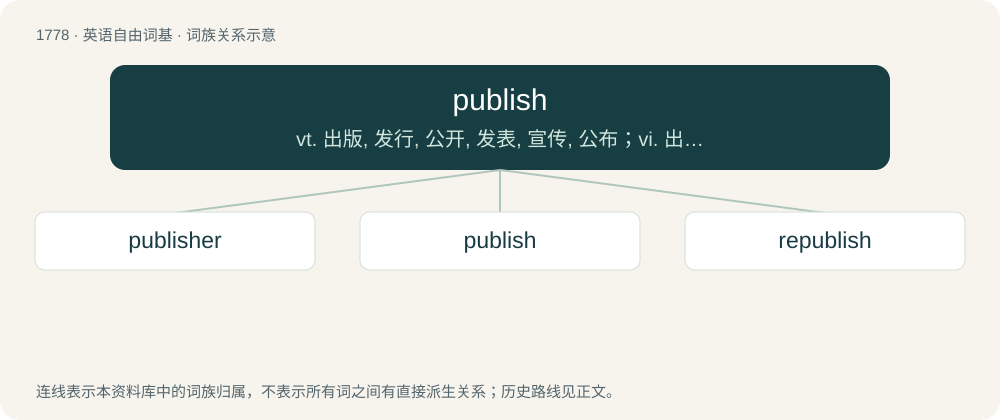

# 1878 · publish — vt. 出版, 发行, 公开, 发表, 宣传, 公布；vi. 出版, 发行

[总目录](../00_总目录_按常用程度.md)

**类型**：英语自由词基　｜　**来源语言**：见词源记录

## 核心含义与来源

- 核心含义：vt. 出版, 发行, 公开, 发表, 宣传, 公布；vi. 出版, 发行
- 英文含义：To issue (something, such as printed work) for distribution and/or sale.
- 词形：publish

**来源记录 1**（动词；To issue (something, such as printed work) for distribution and/or sale.）

From Middle English publicen (by analogy with banish, finish), from Old French publier, from Latin publicare (“to make public, show or tell to the people, make known, declare, also (and earlier) confiscate for public use”), from publicus (“pertaining to the people, public”); see public.

## 词族图

## 单词速览（常用到不常用）

| 单词 | 音标 | 释义 |
|---|---|---|
| [publisher](#w-1) | 美 /ˈpʌblɪʃɚ/ | n. 出版者, 发行人；\[法\] 发行人, 出版者, 报刊发行者 |
| [publish](#w-2) | /ˈpʌblɪʃ/ | vt. 出版, 发行, 公开, 发表, 宣传, 公布；vi. 出版, 发行 |
| [republish](#w-3) | /ɹiˈpʌb.lɪʃ/ | vt. 再版, 再发布；\[法\] 再版, 再印刷, 再发行 |

## 逐词详解

### 1. publisher

**词性**：名词　｜　**音标**：美 /ˈpʌblɪʃɚ/

**中文释义**：n. 出版者, 发行人；\[法\] 发行人, 出版者, 报刊发行者

**英文义项**：A person or (especially) a company who publishes, especially books. / A system or component that allows other components (subscribers) to receive notifications of something, such as an event.

**构词拆分**：publish + -er

**词源与演化**：

From publish + -er.

**例句**：

> The editor and publisher of this magazine was criticized by some readers.

### 2. publish

**词性**：动词　｜　**音标**：/ˈpʌblɪʃ/

**中文释义**：vt. 出版, 发行, 公开, 发表, 宣传, 公布；vi. 出版, 发行

**英文义项**：To issue (something, such as printed work) for distribution and/or sale. / To announce to the public.

**词源与演化**：

From Middle English publicen (by analogy with banish, finish), from Old French publier, from Latin publicare (“to make public, show or tell to the people, make known, declare, also (and earlier) confiscate for public use”), from publicus (“pertaining to the people, public”); see public.

**例句**：

> The Times published the investigative piece about the governor both in print and online.

该用例对应义项：To issue (something, such as printed work) for distribution and/or sale.

### 3. republish

**词性**：动词　｜　**音标**：/ɹiˈpʌb.lɪʃ/

**中文释义**：vt. 再版, 再发布；\[法\] 再版, 再印刷, 再发行

**英文义项**：To publish once again; to print and distribute copies of a work that has previously been printed and distributed.

**构词拆分**：re- + publish

**词源与演化**：

From re- + publish.
