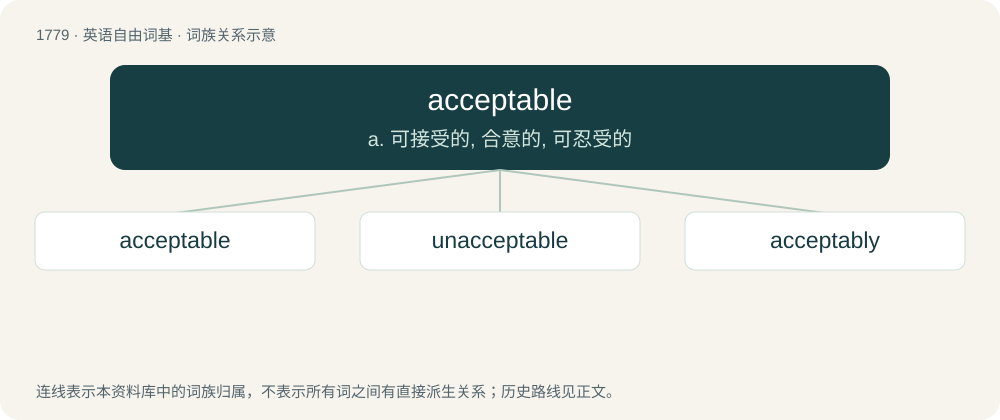

# 1879 · acceptable — a. 可接受的, 合意的, 可忍受的

[总目录](../00_总目录_按常用程度.md)

**类型**：英语自由词基　｜　**来源语言**：见词源记录

## 核心含义与来源

- 核心含义：a. 可接受的, 合意的, 可忍受的
- 英文含义：Capable, worthy, or sure of being accepted or received with pleasure; welcome; gratifying; pleasing to a receiver.
- 词形：acceptable

**来源记录 1**（形容词；Capable, worthy, or sure of being accepted or received with pleasure; welcome; gratifying; pleasing to a receiver.）

From Middle English acceptable, from Anglo-Norman and Middle French acceptable, from Late Latin acceptābilis (“worthy of acceptance”). Morphologically accept + -able.

## 词族图

## 单词速览（常用到不常用）

| 单词 | 音标 | 释义 |
|---|---|---|
| [acceptable](#w-1) | /əkˈsɛp.tə.bəl/ | a. 可接受的, 合意的, 可忍受的 |
| [unacceptable](#w-2) | 英 /ˌʌn.ækˈsɛp.tə.bl̩/；美 /ˌʌn.ækˈsɛp.tə.bl̩/ | a. 无法接受的, 不受欢迎的；\[法\] 不能接受的, 不受欢迎的, 难以承认的 |
| [acceptably](#w-3) | 美 /ækˈsɛp.tə.bli/ | adv. 可欣然接受地, 承受得住地, 能合人意地 |

## 逐词详解

### 1. acceptable

**词性**：形容词　｜　**音标**：/əkˈsɛp.tə.bəl/

**中文释义**：a. 可接受的, 合意的, 可忍受的

**英文义项**：Capable, worthy, or sure of being accepted or received with pleasure; welcome; gratifying; pleasing to a receiver. / Barely worthy, less than excellent; passable.

**构词拆分**：accept + -able

**词源与演化**：

From Middle English acceptable, from Anglo-Norman and Middle French acceptable, from Late Latin acceptābilis (“worthy of acceptance”). Morphologically accept + -able.

**例句**：

> The designs were acceptable, but they were nothing special either.

该用例对应义项：Barely worthy, less than excellent; passable.

### 2. unacceptable

**词性**：形容词　｜　**音标**：英 /ˌʌn.ækˈsɛp.tə.bl̩/；美 /ˌʌn.ækˈsɛp.tə.bl̩/

**中文释义**：a. 无法接受的, 不受欢迎的；\[法\] 不能接受的, 不受欢迎的, 难以承认的

**英文义项**：Unsatisfactory; not acceptable. / Not conforming to accepted usage.

**构词拆分**：un- + acceptable

**词源与演化**：

From Middle English unacceptabylle, equivalent to un- + acceptable.

**例句**：

> The following use of `access' was judged unacceptable by a panel of linguists; `You can access your cash at any of 300 automatic tellers'.

该用例对应义项：not conforming to standard usage

### 3. acceptably

**词性**：副词　｜　**音标**：美 /ækˈsɛp.tə.bli/

**中文释义**：adv. 可欣然接受地, 承受得住地, 能合人意地

**英文义项**：In an acceptable manner; in a manner to please or give satisfaction. / To an acceptable degree.

**构词拆分**：acceptable + -ly

**词源与演化**：

From Middle English acceptably, equivalent to acceptable + -ly.
