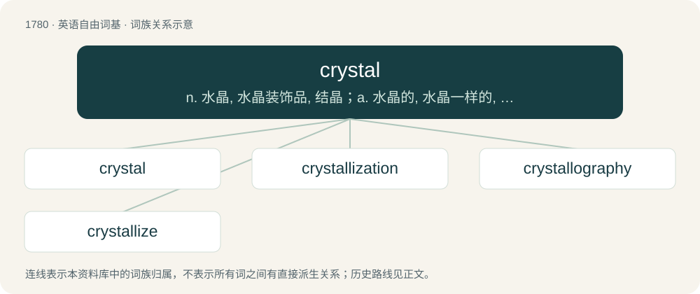

# 1880 · crystal — n. 水晶, 水晶装饰品, 结晶；a. 水晶的, 水晶一样的, 透明的

[总目录](../00_总目录_按常用程度.md)

**类型**：英语自由词基　｜　**来源语言**：见词源记录

## 核心含义与来源

- 核心含义：n. 水晶, 水晶装饰品, 结晶；a. 水晶的, 水晶一样的, 透明的
- 英文含义：A solid composed of an array of atoms or molecules possessing long-range order and arranged in a pattern which is periodic in three dimensions.
- 词形：crystal

**来源记录 1**（名词；A solid composed of an array of atoms or molecules possessing long-range order and arranged in a pattern which is periodic in three dimensions.）

From Middle English crystal, cristal, criȝstall, representing a merger of Old English cristalla (from Latin crystallus) and Anglo-Norman cristall, Old French cristal (from Latin crystallum). The Latin is derived from Ancient Greek κρύσταλλος (krústallos, “clear ice”), from κρύος (krúos, “frost”), from Proto-Indo-European \*krews- (“hard, hard outer surface, crust”).

## 词族图

## 单词速览（常用到不常用）

| 单词 | 音标 | 释义 |
|---|---|---|
| [crystal](#w-1) | /ˈkɹɪstəl/ | n. 水晶, 水晶装饰品, 结晶；a. 水晶的, 水晶一样的, 透明的 |
| [crystallization](#w-2) | 美 /ˌkɹɪstəlaɪˈzeɪʃən/ | n. 结晶, 定形, 明朗化, 具体化；\[化\] 结晶 |
| [crystallography](#w-3) | 英 /ˌkɹɪstəˈlɒɡɹəfi/；美 /ˌkɹɪstəˈlɑɡɹəfi/ | n. 结晶学；\[化\] 晶体学; 结晶学 |
| [crystallize](#w-4) | /ˈkɹɪstəlaɪz/ | vt. 使结晶, 使具体化；vi. 结晶, 具体化 |

## 逐词详解

### 1. crystal

**词性**：形容词　｜　**音标**：/ˈkɹɪstəl/

**中文释义**：n. 水晶, 水晶装饰品, 结晶；a. 水晶的, 水晶一样的, 透明的

**英文义项**：Made of crystal. / Very clear; coherent.

**词源与演化**：

From Middle English crystal, cristal, criȝstall, representing a merger of Old English cristalla (from Latin crystallus) and Anglo-Norman cristall, Old French cristal (from Latin crystallum). The Latin is derived from Ancient Greek κρύσταλλος (krústallos, “clear ice”), from κρύος (krúos, “frost”), from Proto-Indo-European \*krews- (“hard, hard outer surface, crust”).

**例句**：

> "Do I make myself clear?" / "Crystal."

该用例对应义项：Very clear; coherent.

### 2. crystallization

**词性**：名词　｜　**音标**：美 /ˌkɹɪstəlaɪˈzeɪʃən/

**中文释义**：n. 结晶, 定形, 明朗化, 具体化；\[化\] 结晶

**英文义项**：The act or process by which a substance in solidifying assumes the form and structure of a crystal, or becomes crystallized. / The body formed by crystallizing.

**构词拆分**：crystal + -ization

**词源与演化**：

From crystal + -ization.

**例句**：

> Silver on precipitation forms arborescent crystallizations.

该用例对应义项：The body formed by crystallizing.

### 3. crystallography

**词性**：名词　｜　**音标**：英 /ˌkɹɪstəˈlɒɡɹəfi/；美 /ˌkɹɪstəˈlɑɡɹəfi/

**中文释义**：n. 结晶学；\[化\] 晶体学; 结晶学

**英文义项**：The experimental science of determining the arrangement of atoms in solids. / The study of crystals.

**构词拆分**：crystal + -graphy

**词源与演化**：

From crystal + -ography.

### 4. crystallize

**词性**：动词　｜　**音标**：/ˈkɹɪstəlaɪz/

**中文释义**：vt. 使结晶, 使具体化；vi. 结晶, 具体化

**英文义项**：To make something form into crystals. / To assume a crystalline form.

**构词拆分**：crystal + -ize

**词源与演化**：

From crystal + -ize. The double l reflects the classical stem found in its etyma, Latin crystallus and Ancient Greek κρύσταλλος (krústallos), rather than the simplified spelling of the English base noun. Compare Hellenistic Greek κρυσταλλίζειν (krustallízein, “to shine like crystal”), post‐classical Latin crystallizare (“to change into crystal”), and French cristalliser.

**例句**：

> He tried to crystallize his thoughts.

该用例对应义项：cause to take on a definite and clear shape
