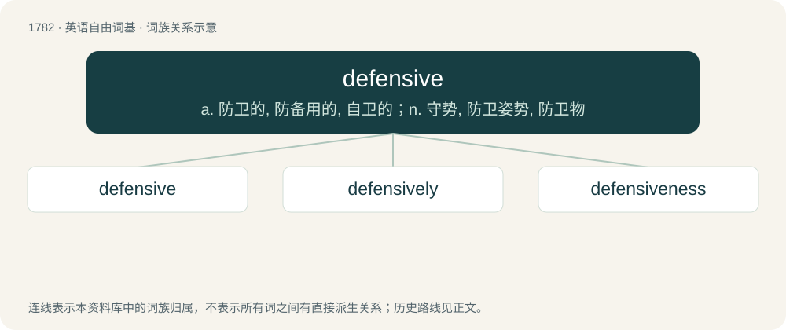

# 1883 · defensive — a. 防卫的, 防备用的, 自卫的；n. 守势, 防卫姿势, 防卫物

[总目录](../00_总目录_按常用程度.md)

**类型**：英语自由词基　｜　**来源语言**：见词源记录

## 核心含义与来源

- 核心含义：a. 防卫的, 防备用的, 自卫的；n. 守势, 防卫姿势, 防卫物
- 英文含义：Intended for defence; protective.
- 词形：defensive

**来源记录 1**（形容词；Intended for defence; protective.）

From Middle French défensif. Morphologically defense + -ive.

## 词族图

## 单词速览（常用到不常用）

| 单词 | 音标 | 释义 |
|---|---|---|
| [defensive](#w-1) | 英 /dɪˈfɛn.sɪv/ | a. 防卫的, 防备用的, 自卫的；n. 守势, 防卫姿势, 防卫物 |
| [defensively](#w-2) | 英 /dɪˈfɛnsɪvli/ | adv. 防御地；守势地 |
| [defensiveness](#w-3) | 英 /dɪˈfɛnsɪvnəs/ | 防御性 |

## 逐词详解

### 1. defensive

**词性**：形容词　｜　**音标**：英 /dɪˈfɛn.sɪv/

**中文释义**：a. 防卫的, 防备用的, 自卫的；n. 守势, 防卫姿势, 防卫物

**英文义项**：Intended for defence; protective. / Intended to deter attack.

**构词拆分**：defense + -ive

**词源与演化**：

From Middle French défensif. Morphologically defense + -ive.

**例句**：

> The victim held up his hand to repel the attacker and received a defensive knife wound.

该用例对应义项：Pertaining to defense, as opposed to attack.

### 2. defensively

**词性**：副词　｜　**音标**：英 /dɪˈfɛnsɪvli/

**中文释义**：adv. 防御地；守势地

**英文义项**：In a defensive manner.

**构词拆分**：defensive + -ly

**词源与演化**：

From defensive + -ly.

**例句**：

> The general conviction that our side is in the right and acting defensively over what Russians call the German question and Americans the Berlin crisis.

该用例对应义项：in a defensive manner

### 3. defensiveness

**词性**：名词　｜　**音标**：英 /dɪˈfɛnsɪvnəs/

**中文释义**：防御性

**英文义项**：The state or quality of being defensive.

**构词拆分**：defensive + -ness

**词源与演化**：

From defensive + -ness.

**例句**：

> His excessive defensiveness and avoidance of direct questions suggest an attempt to hide the truth.
