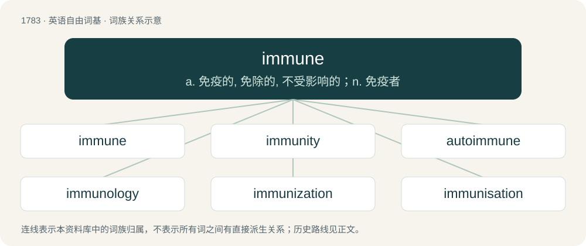

# 1884 · immune — a. 免疫的, 免除的, 不受影响的；n. 免疫者

[总目录](../00_总目录_按常用程度.md)

**类型**：英语自由词基　｜　**来源语言**：见词源记录

## 核心含义与来源

- 核心含义：a. 免疫的, 免除的, 不受影响的；n. 免疫者
- 英文含义：Exempt; not subject to.
- 词形：immune

**来源记录 1**（形容词；Exempt; not subject to.）

From Middle English, from Middle French immun, from Latin immūnis (“exempt from public service”), from in- (“not”) + mūnus (“service”).

## 词族图

## 单词速览（常用到不常用）

| 单词 | 音标 | 释义 |
|---|---|---|
| [immune](#w-1) | 美 /ɪˈmjuːn/ | a. 免疫的, 免除的, 不受影响的；n. 免疫者 |
| [immunity](#w-2) | /ɪˈmjuːnəti/ | n. 免疫, 免疫性, 免除；\[化\] 免疫性 |
| [autoimmune](#w-3) | /ˌɔːtəʊɪˈmjuːn/ | a. 自体/自身免疫的 |
| [immunology](#w-4) | 英 /ˌɪm.jʊˈnɒl.ə.dʒi/；美 /ˌɪm.jəˈnɑː.lə.dʒi/ | n. 免疫学；\[化\] 免疫学 |
| [immunization](#w-5) | /.imjuːnaiˈzeiʃən/ | n. 免疫；\[医\] 免疫法 |
| [immunisation](#w-6) | /ˌɪmjʊnaɪˈzeɪʃən/ | n. 免疫(immunization) |
| [immunize](#w-7) | 美 /ˈɪm.ju.naɪz/ | vt. 使免疫, 赋予免疫性 |

## 逐词详解

### 1. immune

**词性**：形容词　｜　**音标**：美 /ɪˈmjuːn/

**中文释义**：a. 免疫的, 免除的, 不受影响的；n. 免疫者

**英文义项**：Exempt; not subject to. / Protected by inoculation, or due to innate resistance to pathogens.

**词源与演化**：

From Middle English, from Middle French immun, from Latin immūnis (“exempt from public service”), from in- (“not”) + mūnus (“service”).

**例句**：

> As a diplomat, you are immune from prosecution.

该用例对应义项：Exempt; not subject to.

### 2. immunity

**词性**：名词　｜　**音标**：/ɪˈmjuːnəti/

**中文释义**：n. 免疫, 免疫性, 免除；\[化\] 免疫性

**英文义项**：Protective resistance against disease. / An exemption from specified duties, such as payments or services.

**构词拆分**：immune + -ity

**词源与演化**：

From Middle English immunite, from Old French immunité, from Latin immūnitās, in the legal sense; for the medical use see immunization. Equivalent to immune + -ity. Displaced native Old English frēols (“privilege, immunity”).

**例句**：

> Superbugs are bacteria that develop an immunity to antibiotics.

该用例对应义项：A resistance to a specific thing.

### 3. autoimmune

**词性**：形容词　｜　**音标**：/ˌɔːtəʊɪˈmjuːn/

**中文释义**：a. 自体/自身免疫的

**英文义项**：Of or pertaining to autoimmunity.

**构词拆分**：auto- + immune

**词源与演化**：

From auto- + immune.

**例句**：

> The birth rates are declining due to the impact of autoimmune diseases.

### 4. immunology

**词性**：名词　｜　**音标**：英 /ˌɪm.jʊˈnɒl.ə.dʒi/；美 /ˌɪm.jəˈnɑː.lə.dʒi/

**中文释义**：n. 免疫学；\[化\] 免疫学

**英文义项**：The branch of medicine that concerns the body's immune system.

**构词拆分**：immune + -ology

**词源与演化**：

From immune + -ology.

### 5. immunization

**词性**：名词　｜　**音标**：/.imjuːnaiˈzeiʃən/

**中文释义**：n. 免疫；\[医\] 免疫法

**英文义项**：The process by which a person is safely exposed in a controlled manner to a material that is designed to prime their immune system against that material. / One such exposure.

**构词拆分**：immunize + -ation；immune + -ization

**词源与演化**：

From French immunisation. Coined by Albert Calmette. Equivalent to immunize + -ation or immune + -ization.

**例句**：

> Immunization against influenza is important for all child-care workers.

该用例对应义项：The process by which a person is safely exposed in a controlled manner to a material that is designed to prime their immune system against that material.

### 6. immunisation

**词性**：名词　｜　**音标**：/ˌɪmjʊnaɪˈzeɪʃən/

**中文释义**：n. 免疫(immunization)

**英文义项**：The process of immunising signalling and traction power supplies so they don't interfere with each other.

**构词拆分**：immunise + -ation；immune + -isation

**词源与演化**：

From French immunisation. Equivalent to immunise + -ation or immune + -isation.

### 7. immunize

**词性**：动词　｜　**音标**：美 /ˈɪm.ju.naɪz/

**中文释义**：vt. 使免疫, 赋予免疫性

**英文义项**：To make someone or something immune to something. / To inoculate someone, and thus produce immunity from a disease.

**构词拆分**：immune + -ize

**词源与演化**：

From French immuniser, equivalent to immune + -ize.

**例句**：

> It is important to immunize children against polio.
