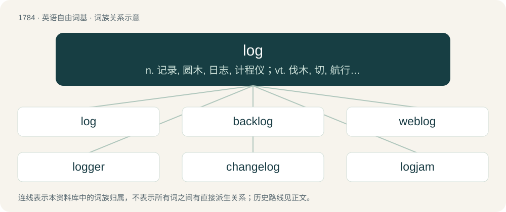

# 1885 · log — n. 记录, 圆木, 日志, 计程仪；vt. 伐木, 切, 航行；vi. 伐木

[总目录](../00_总目录_按常用程度.md)

**类型**：英语自由词基　｜　**来源语言**：见词源记录

## 核心含义与来源

- 核心含义：n. 记录, 圆木, 日志, 计程仪；vt. 伐木, 切, 航行；vi. 伐木
- 英文含义：The trunk of a dead tree, cleared of branches.
- 词形：log

**多个词源／构词路径**：同一拼写可能有不同来源；以下按词性和含义分别列出。

**来源记录 1**（名词；The trunk of a dead tree, cleared of branches.）

From Middle English logge, logg (first recorded in Anglo-Latin as loggum), of uncertain origin, but probably from Old Norse lóg, lág (“felled tree, log”), derived from Old Norse liggja (“to lie”). If so, then cognate with Norwegian låg (“fallen tree”), Dutch loog (“wood, timber, lumber”). Alternatively, directly from Norwegian låg (“fallen tree”), which could have been borrowed through the Norwegian timber trade. However the Old Norse/Middle Norwegian vowel is long while Middle English vowel is short.

**来源记录 2**（名词；A logbook, or journal of a vessel's (or aircraft's) progress.）

Clipping of logbook, itself from log (etymology 1) + book, from a wooden float (chip log) used to measure speed.

**来源记录 3**（动词；To log out; to disconnect from an online video game.）

Ellipsis of log out, itself from Etymology 2.

**来源记录 4**（名词；Synonym of logarithm.）

A clipping of logarithm.

## 词族图

## 单词速览（常用到不常用）

| 单词 | 音标 | 释义 |
|---|---|---|
| [log](#w-1) | 英 /lɒɡ/；美 /lɔɡ/ | n. 记录, 圆木, 日志, 计程仪；vt. 伐木, 切, 航行；vi. 伐木 |
| [backlog](#w-2) | 美 /ˈbæk(ˌ)lɔɡ/ | n. 积压待办的事务, 积压而未交付的订货, 积压的工作；vt. 储备, 把...积压起来；\[计\] 储备, 后备, 积压 |
| [weblog](#w-3) | 英 /ˈwɛb.lɒɡ/；美 /ˈwɛb.lɔɡ/ | n. 网络日志 |
| [logger](#w-4) | 英 /ˈlɒɡə/；美 /ˈlɑɡɚ/ | n. 樵夫, 圆木装车机；\[计\] 记录器; 注册器; 登记器 |
| [changelog](#w-5) | 英 /ˈtʃeɪndʒˌlɒɡ/ | 【英文】A log that records changes between versions, as in source control. |
| [logjam](#w-6) | /ˈlɒgdʒæm/ | n. 拥挤, 行不通, 为许多圆木材所阻 |

## 逐词详解

### 1. log

**词性**：名词　｜　**音标**：英 /lɒɡ/；美 /lɔɡ/

**中文释义**：n. 记录, 圆木, 日志, 计程仪；vt. 伐木, 切, 航行；vi. 伐木

**英文义项**：The trunk of a dead tree, cleared of branches. / Any bulky piece as cut from the above, used as timber, fuel etc.

**词源与演化**：

From Middle English logge, logg (first recorded in Anglo-Latin as loggum), of uncertain origin, but probably from Old Norse lóg, lág (“felled tree, log”), derived from Old Norse liggja (“to lie”). If so, then cognate with Norwegian låg (“fallen tree”), Dutch loog (“wood, timber, lumber”). Alternatively, directly from Norwegian låg (“fallen tree”), which could have been borrowed through the Norwegian timber trade. However the Old Norse/Middle Norwegian vowel is long while Middle English vowel is short.

**例句**：

> They walked across the stream on a fallen log.

该用例对应义项：The trunk of a dead tree, cleared of branches.

### 2. backlog

**词性**：名词　｜　**音标**：美 /ˈbæk(ˌ)lɔɡ/

**中文释义**：n. 积压待办的事务, 积压而未交付的订货, 积压的工作；vt. 储备, 把...积压起来；\[计\] 储备, 后备, 积压

**英文义项**：A large log to burn at the back of a fire. / A reserve source or supply.

**构词拆分**：back + log

**词源与演化**：

From back + log. 1680s; originally a large log at the back of a fire. Figurative sense from 1880s, meaning "something stored up for later use". Possibly influenced by logbook as well.

**例句**：

> Kyle purchased a new one despite having a backlog of video games that he hasn't played.

该用例对应义项：An accumulation or buildup, especially of unfilled orders, unconsumed products or unfinished work.

### 3. weblog

**词性**：名词　｜　**音标**：英 /ˈwɛb.lɒɡ/；美 /ˈwɛb.lɔɡ/

**中文释义**：n. 网络日志

**英文义项**：A website in the form of an ongoing journal.

**构词拆分**：Web + log

**词源与演化**：

Compound of Web + log. Coined by American blogger Jorn Barger in 1997.

### 4. logger

**词性**：名词　｜　**音标**：英 /ˈlɒɡə/；美 /ˈlɑɡɚ/

**中文释义**：n. 樵夫, 圆木装车机；\[计\] 记录器; 注册器; 登记器

**英文义项**：A worker whose occupation is to harvest trees. / That which logs, such as a computer program to keep track of events.

**构词拆分**：From log + -er.

**词源与演化**：

From log + -er.

**例句**：

> The thousand-year-old tree was cut down by the logger.

### 5. changelog

**词性**：名词　｜　**音标**：英 /ˈtʃeɪndʒˌlɒɡ/

**英文义项**：A log that records changes between versions, as in source control.

**构词拆分**：change + log

**词源与演化**：

From change + log.

### 6. logjam

**词性**：名词　｜　**音标**：/ˈlɒgdʒæm/

**中文释义**：n. 拥挤, 行不通, 为许多圆木材所阻

**英文义项**：An excess of logs being conveyed on a river, so that their motion halts. / A clog or such jam or mess that halts or greatly delays progress.

**构词拆分**：log + jam

**词源与演化**：

From log + jam.

**例句**：

> Efforts to amend the law got sidetracked in an administrative logjam.

该用例对应义项：A clog or such jam or mess that halts or greatly delays progress.
