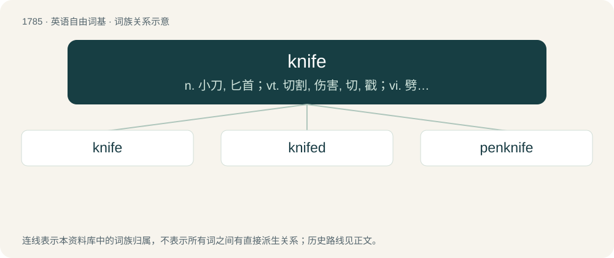

# 1887 · knife — n. 小刀, 匕首；vt. 切割, 伤害, 切, 戳；vi. 劈开, 穿过

[总目录](../00_总目录_按常用程度.md)

**类型**：英语自由词基　｜　**来源语言**：见词源记录

## 核心含义与来源

- 核心含义：n. 小刀, 匕首；vt. 切割, 伤害, 切, 戳；vi. 劈开, 穿过
- 英文含义：A utensil or a tool designed for cutting, consisting of a flat piece of hard material, usually steel or other metal (the blade), usually sharpened on one edge, attached to a handle. The blade may be pointed for piercing.
- 词形：knife

**来源记录 1**（名词；A utensil or a tool designed for cutting, consisting of a flat piece of hard material, usually steel or other metal (the blade), usually sharpened on one edge, attached to a handle. The blade may be pointed for piercing.）

From Middle English knyf, knif, from late Old English cnīf, from Old Norse knífr or Proto-West Germanic \*knīb, from Proto-Germanic \*knībaz, from \*knīpaną (“to pinch”), Proto-Indo-European \*gneybʰ- (compare Lithuanian gnýbti, žnýbti (“to pinch”), gnaibis (“pinching”)). Displaced native Middle English sax (“knife”), from Old English seax; and Middle English coutel, qwetyll (“knife”) from Old French coutel. \* The verb is first attested in 1865. The variant knive is first attested in 1733. Cognates Cognate with Yola kunnife (“knife”), North Frisian knif (“knife”), Dutch knijf (“long pointy knife, poniard”), German Knifte (“rifle; thick slicebread”), German Low German Knief (“knife”), Luxembourgish Knäip (“paring knife”), Danish, Norwegian Bokmål, and Norwegian Nynorsk kniv (“knife”), Faroese knívur (“knife”), Icelandic hnífur, knífur (“knife”), Swedish knif, kniv (“knife”).

## 词族图

## 单词速览（常用到不常用）

| 单词 | 音标 | 释义 |
|---|---|---|
| [knife](#w-1) | 英 /ˈnaɪ̯f/；/ˈnɐɪ̯f/ | n. 小刀, 匕首；vt. 切割, 伤害, 切, 戳；vi. 劈开, 穿过 |
| [knifed](#w-2) | /naɪft/ | v. 刮涂( knifing的过去式和过去分词 ); 刮膜; 切深; 切割 |
| [penknife](#w-3) | /ˈpennaif/ | n. 袖珍折刀 |

## 逐词详解

### 1. knife

**词性**：名词　｜　**音标**：英 /ˈnaɪ̯f/；/ˈnɐɪ̯f/

**中文释义**：n. 小刀, 匕首；vt. 切割, 伤害, 切, 戳；vi. 劈开, 穿过

**英文义项**：A utensil or a tool designed for cutting, consisting of a flat piece of hard material, usually steel or other metal (the blade), usually sharpened on one edge, attached to a handle. The blade may be pointed for piercing. / A weapon designed with the aforementioned specifications intended for slashing or stabbing but too short to be called a sword; a dagger.

**词源与演化**：

From Middle English knyf, knif, from late Old English cnīf, from Old Norse knífr or Proto-West Germanic \*knīb, from Proto-Germanic \*knībaz, from \*knīpaną (“to pinch”), Proto-Indo-European \*gneybʰ- (compare Lithuanian gnýbti, žnýbti (“to pinch”), gnaibis (“pinching”)). Displaced native Middle English sax (“knife”), from Old English seax; and Middle English coutel, qwetyll (“knife”) from Old French coutel. \* The verb is first attested in 1865. The variant knive is first attested in 1733. Cognates Cognate with Yola kunnife (“knife”), North Frisian knif (“knife”), Dutch knijf (“long pointy knife, poniard”), German Knifte (“rifle; thick slicebread”), German Low German Knief (“knife”), Luxembourgish Knäip (“paring knife”), Danish, Norwegian Bokmål, and Norwegian Nynorsk kniv (“knife”), Faroese knívur (“knife”), Icelandic hnífur, knífur (“knife”), Swedish knif, kniv (“knife”).

**例句**：

> He was looking for a knife to chop some steak.

该用例对应义项：A utensil or a tool designed for cutting, consisting of a flat piece of hard material, usually steel or other metal (the blade), usually sharpened on one edge, attached to a handle. The blade may be pointed for piercing.

### 2. knifed

**词性**：形容词　｜　**音标**：/naɪft/

**中文释义**：v. 刮涂( knifing的过去式和过去分词 ); 刮膜; 切深; 切割

**英文义项**：Having been cut or stabbed with a knife. / Wearing or carrying (a specified type of) knife (utensil or tool).

**构词拆分**：From knife + -ed.

**词源与演化**：

From knife + -ed.

**例句**：

> Tom was knifed by a fellow gang member.

### 3. penknife

**词性**：名词　｜　**音标**：/ˈpennaif/

**中文释义**：n. 袖珍折刀

**英文义项**：A small pocketknife; (loosely) any pocketknife. / A small knife designed for safe and convenient storage, typically in the form of a miniature clasp-knife, or with blade retractable into the handle.

**构词拆分**：pen + knife

**词源与演化**：

From Middle English penne knyfe; equivalent to pen + knife. In the original sense, named for its purpose: aiding the use of a (traditional) ink pen through the following tasks: trimming the tip of a quill pen, trimming a reed for a nib, and (in some cases) allowing erasure by scraping away some ink.

**例句**：

> He cut off a branch of the tree with his penknife.
