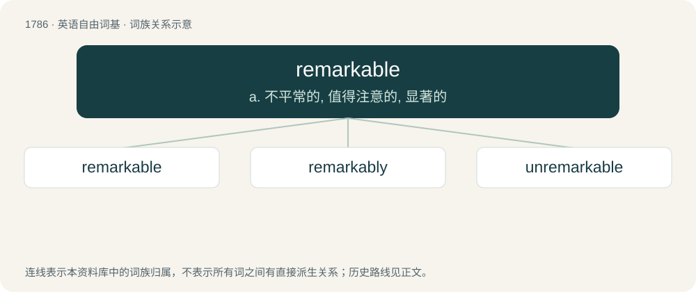

# 1888 · remarkable — a. 不平常的, 值得注意的, 显著的

[总目录](../00_总目录_按常用程度.md)

**类型**：英语自由词基　｜　**来源语言**：见词源记录

## 核心含义与来源

- 核心含义：a. 不平常的, 值得注意的, 显著的
- 英文含义：Worthy of remark; notable; interesting.
- 词形：remarkable

**来源记录 1**（形容词；Worthy of remark; notable; interesting.）

From remark + -able, from French remarquable.

## 词族图

## 单词速览（常用到不常用）

| 单词 | 音标 | 释义 |
|---|---|---|
| [remarkable](#w-1) | 英 /ɹɪˈmɑː.kə.bl̩/；美 /ɹɪˈmɑɹ.kə.bl̩/ | a. 不平常的, 值得注意的, 显著的 |
| [remarkably](#w-2) | 英 /ɹɪˈmɑːkəbli/；美 /ɹɪˈmɑɹkəbli/ | adv. 显著地, 引人注目地, 非常地 |
| [unremarkable](#w-3) | /ˈʌnriˈmɑːkəbl/ | a. 不显著的, 平凡的, 不值得注意的 |

## 逐词详解

### 1. remarkable

**词性**：形容词　｜　**音标**：英 /ɹɪˈmɑː.kə.bl̩/；美 /ɹɪˈmɑɹ.kə.bl̩/

**中文释义**：a. 不平常的, 值得注意的, 显著的

**英文义项**：Worthy of remark; notable; interesting. / Uncommon; unusual.

**构词拆分**：remark + -able

**词源与演化**：

From remark + -able, from French remarquable.

**例句**：

> Her remarkable skill in mathematics is better than everyone else's in the class.

该用例对应义项：Worthy of remark; notable; interesting.

### 2. remarkably

**词性**：副词　｜　**音标**：英 /ɹɪˈmɑːkəbli/；美 /ɹɪˈmɑɹkəbli/

**中文释义**：adv. 显著地, 引人注目地, 非常地

**英文义项**：In a remarkable manner. / To a noteworthy extent.

**构词拆分**：remarkable + -ly

**词源与演化**：

From remarkable + -ly.

**例句**：

> He performed the piece remarkably, offering novel interpretations to its nearly cliched passages.

该用例对应义项：In a remarkable manner.

### 3. unremarkable

**词性**：形容词　｜　**音标**：/ˈʌnriˈmɑːkəbl/

**中文释义**：a. 不显著的, 平凡的, 不值得注意的

**英文义项**：Not remarkable.

**构词拆分**：un- + remarkable

**词源与演化**：

From un- + remarkable.

**例句**：

> I love the setting of this game, but the story is unremarkable.
