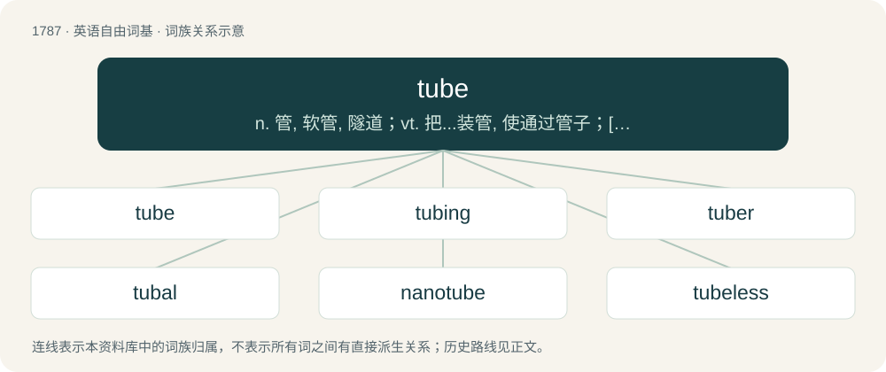

# 1889 · tube — n. 管, 软管, 隧道；vt. 把...装管, 使通过管子；\[计\] 管子

[总目录](../00_总目录_按常用程度.md)

**类型**：英语自由词基　｜　**来源语言**：见词源记录

## 核心含义与来源

- 核心含义：n. 管, 软管, 隧道；vt. 把...装管, 使通过管子；\[计\] 管子
- 英文含义：Anything that is hollow and cylindrical in shape.
- 词形：tube

**来源记录 1**（名词；Anything that is hollow and cylindrical in shape.）

From Middle French tube, from Latin tubus (“tube, pipe”), related to tuba (“long trumpet; war-trumpet”), of obscure ultimate origin, but possibly connected to tībia (“shinbone, reed-pipe”); see there. Doublet of tubus.

## 词族图

## 单词速览（常用到不常用）

| 单词 | 音标 | 释义 |
|---|---|---|
| [tube](#w-1) | /tuːb/ | n. 管, 软管, 隧道；vt. 把...装管, 使通过管子；\[计\] 管子 |
| [tubing](#w-2) | /ˈtjuːbiŋ/ | n. 管料, 管道系统, 管状组织；\[化\] 管工; 管材; 管线; 管道; 管道系统; 铺设管道 |
| [tuber](#w-3) | 英 /ˈtjuːbə(ɹ)/；美 /ˈtubɚ/ | 【英文】One who tubes. |
| [tubal](#w-4) | 英 /ˈtjuːbəl/；美 /ˈtubəl/ | a. 管的, 输卵管的；\[医\] 管的 |
| [nanotube](#w-5) | /neɪnəʊtjʊb/ | n. 毫微管（富勒烯中的圆柱形分子） |
| [tubeless](#w-6) | /tˈjuːbləs/ | a. 无内胎的 |

## 逐词详解

### 1. tube

**词性**：名词　｜　**音标**：/tuːb/

**中文释义**：n. 管, 软管, 隧道；vt. 把...装管, 使通过管子；\[计\] 管子

**英文义项**：Anything that is hollow and cylindrical in shape. / An approximately cylindrical container, usually with a crimped end and a screw top, used to contain and dispense semiliquid substances.

**词源与演化**：

From Middle French tube, from Latin tubus (“tube, pipe”), related to tuba (“long trumpet; war-trumpet”), of obscure ultimate origin, but possibly connected to tībia (“shinbone, reed-pipe”); see there. Doublet of tubus.

**例句**：

> I took the tube to Waterloo and walked the rest of the way.

该用例对应义项：The London Underground railway system, originally referred to the lower level lines that ran in tubular tunnels as opposed to the higher ones which ran in rectangular section tunnels. (Often the tube.)

### 2. tubing

**词性**：名词　｜　**音标**：/ˈtjuːbiŋ/

**中文释义**：n. 管料, 管道系统, 管状组织；\[化\] 管工; 管材; 管线; 管道; 管道系统; 铺设管道

**英文义项**：Tubes, considered as a group. / A length of tube, or a system of tubes.

**构词拆分**：tube + -ing

**词源与演化**：

From tube + -ing.

**例句**：

> Today, the river is popular for canoeing and salmon fishing, and tubing.

### 3. tuber

**词性**：名词　｜　**音标**：英 /ˈtjuːbə(ɹ)/；美 /ˈtubɚ/

**英文义项**：One who tubes.

**构词拆分**：tube + -er

**词源与演化**：

From tube + -er.

### 4. tubal

**词性**：形容词　｜　**音标**：英 /ˈtjuːbəl/；美 /ˈtubəl/

**中文释义**：a. 管的, 输卵管的；\[医\] 管的

**英文义项**：Of or pertaining to a tube, especially an anatomical one.

**构词拆分**：tube + -al

**词源与演化**：

From tube + -al.

### 5. nanotube

**词性**：名词　｜　**音标**：/neɪnəʊtjʊb/

**中文释义**：n. 毫微管（富勒烯中的圆柱形分子）

**英文义项**：Shortening of carbon nanotube; A carbon molecule, in the shape of a tube, having a fullerene structure and a diameter of about 1 or 2 nanometers. / any nanotech tubular structure with a characteristic diameter measured in a few nanometres, such as titanium nanotubes

**构词拆分**：nano- + tube

**词源与演化**：

From nano- + tube.

**例句**：

> Further research is needed before a carbon nanotube biosensor for salmonella is available commercially.

### 6. tubeless

**词性**：形容词　｜　**音标**：/tˈjuːbləs/

**中文释义**：a. 无内胎的

**英文义项**：Without a tube. / Without an inner tube.

**构词拆分**：tube + -less

**词源与演化**：

From tube + -less.

**用法示例／搭配（非完整句）**：

> tubeless tyres

该用例对应义项：Without an inner tube.
