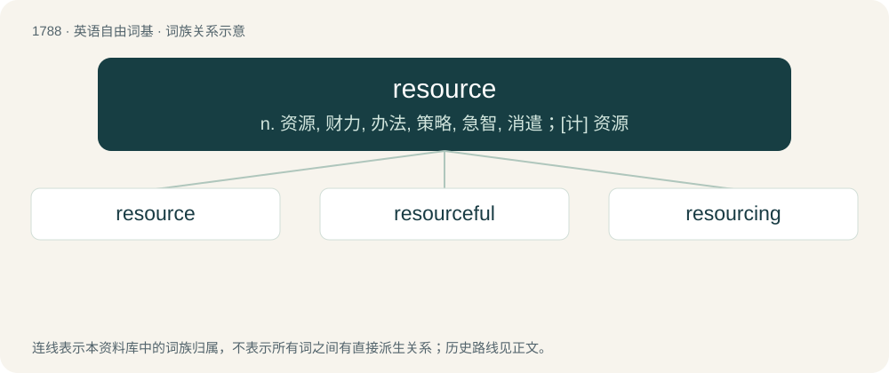

# 1890 · resource — n. 资源, 财力, 办法, 策略, 急智, 消遣；\[计\] 资源

[总目录](../00_总目录_按常用程度.md)

**类型**：英语自由词基　｜　**来源语言**：见词源记录

## 核心含义与来源

- 核心含义：n. 资源, 财力, 办法, 策略, 急智, 消遣；\[计\] 资源
- 英文含义：Something that one uses to achieve an objective, e.g. raw materials or personnel.
- 词形：resource

**多个词源／构词路径**：同一拼写可能有不同来源；以下按词性和含义分别列出。

**来源记录 1**（名词；Something that one uses to achieve an objective, e.g. raw materials or personnel.）

Borrowed from Middle French ressource, from Old French resourse, resource (“a source, spring”), from resourdre, from Latin resurgō (“to rise again, spring up anew”). Equivalent to re- + source. See resourd, resurgent, source.

**来源记录 2**（动词；To source anew or differently; to find or provide a new source for.）

From re- + source.

## 词族图

## 单词速览（常用到不常用）

| 单词 | 音标 | 释义 |
|---|---|---|
| [resource](#w-1) | 英 /ɹɪˈzɔːs/；美 /ˈɹisɔɹs/ | n. 资源, 财力, 办法, 策略, 急智, 消遣；\[计\] 资源 |
| [resourceful](#w-2) | /riˈsɒːsful/ | a. 资源丰富的, 策略的, 机智的；\[法\] 资源丰富的, 善于遂机应变的, 足智多谋的 |
| [resourcing](#w-3) |  | v. 向…提供资源（resource的ing形式） |

## 逐词详解

### 1. resource

**词性**：名词　｜　**音标**：英 /ɹɪˈzɔːs/；美 /ˈɹisɔɹs/

**中文释义**：n. 资源, 财力, 办法, 策略, 急智, 消遣；\[计\] 资源

**英文义项**：Something that one uses to achieve an objective, e.g. raw materials or personnel. / A person's capacity to deal with difficulty.

**构词拆分**：re- + source

**词源与演化**：

Borrowed from Middle French ressource, from Old French resourse, resource (“a source, spring”), from resourdre, from Latin resurgō (“to rise again, spring up anew”). Equivalent to re- + source. See resourd, resurgent, source.

**用法示例／搭配（非完整句）**：

> a man or woman of resource

该用例对应义项：A person's capacity to deal with difficulty.

### 2. resourceful

**词性**：形容词　｜　**音标**：/riˈsɒːsful/

**中文释义**：a. 资源丰富的, 策略的, 机智的；\[法\] 资源丰富的, 善于遂机应变的, 足智多谋的

**英文义项**：Capable or clever; able to put available resources to efficient or ingenious use; using materials at hand wisely or efficiently.

**构词拆分**：resource + -ful

**词源与演化**：

From resource + -ful.

**例句**：

> With a resourceful use of space and a fresh coat of paint, the room became a pleasant library with a comfortable seating area.

该用例对应义项：Capable or clever; able to put available resources to efficient or ingenious use; using materials at hand wisely or efficiently.

### 3. resourcing

**词性**：名词

**中文释义**：v. 向…提供资源（resource的ing形式）

**英文义项**：The provision of resources.

**构词拆分**：From resource + -ing.

**词源与演化**：

From resource + -ing.
