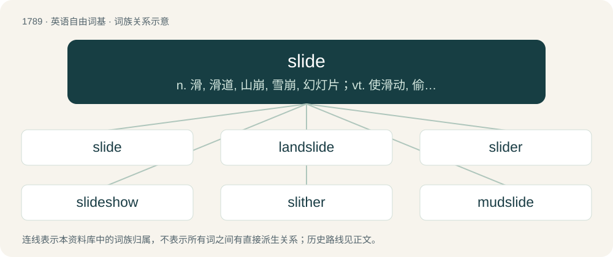

# 1891 · slide — n. 滑, 滑道, 山崩, 雪崩, 幻灯片；vt. 使滑动, 偷偷放入；vi. 滑动, 滑落, 不知不觉陷入, 偷偷地走

[总目录](../00_总目录_按常用程度.md)

**类型**：英语自由词基　｜　**来源语言**：见词源记录

## 核心含义与来源

- 核心含义：n. 滑, 滑道, 山崩, 雪崩, 幻灯片；vt. 使滑动, 偷偷放入；vi. 滑动, 滑落, 不知不觉陷入, 偷偷地走
- 英文含义：To (cause to) move in continuous contact with a surface.
- 词形：slide

**来源记录 1**（动词；To (cause to) move in continuous contact with a surface.）

Inherited from Middle English sliden, from Old English slīdan, from Proto-West Germanic \*slīdan, from Proto-Germanic \*slīdaną, from Proto-Indo-European \*h₃sléydʰeti, from \*h₃sleydʰ- (“slippery”) + \*-eti. Cognate with Old High German slītan (“to slide”) (whence German schlittern), Middle Low German slīden (“to slide”), Middle Dutch slīden (“to slide”) (whence Dutch slijderen, frequentative of now obsolete slijden), Vedic Sanskrit स्रेधति (srédhati, “to err, blunder”).

## 词族图

## 单词速览（常用到不常用）

| 单词 | 音标 | 释义 |
|---|---|---|
| [slide](#w-1) | /ˈslaɪ̯d/ | n. 滑, 滑道, 山崩, 雪崩, 幻灯片；vt. 使滑动, 偷偷放入；vi. 滑动, 滑落, 不知不觉陷入, 偷偷地走 |
| [landslide](#w-2) | 英 /ˈlæn(d).slaɪd/ | n. 山崩；\[化\] 滑坡 |
| [slider](#w-3) | 美 /ˈslaɪdɚ/ | \[电\] 滑动器 |
| [slideshow](#w-4) | 美 /ˈslaɪdˌʃoʊ/ | n. 幻灯片, 幻灯片放映, 播放幻灯片方式 |
| [slither](#w-5) | 英 /ˈslɪðə/；美 /ˈslɪðɚ/ | vi. 不稳地滑动；vt. 使滑动 |
| [mudslide](#w-6) | 美 /ˈmʌdˌslaɪd/ | \[地\](沿缓坡而下的)徐缓黏滞泥流, 泥流 |

## 逐词详解

### 1. slide

**词性**：动词　｜　**音标**：/ˈslaɪ̯d/

**中文释义**：n. 滑, 滑道, 山崩, 雪崩, 幻灯片；vt. 使滑动, 偷偷放入；vi. 滑动, 滑落, 不知不觉陷入, 偷偷地走

**英文义项**：To (cause to) move in continuous contact with a surface. / To move on a low-friction surface.

**词源与演化**：

Inherited from Middle English sliden, from Old English slīdan, from Proto-West Germanic \*slīdan, from Proto-Germanic \*slīdaną, from Proto-Indo-European \*h₃sléydʰeti, from \*h₃sleydʰ- (“slippery”) + \*-eti. Cognate with Old High German slītan (“to slide”) (whence German schlittern), Middle Low German slīden (“to slide”), Middle Dutch slīden (“to slide”) (whence Dutch slijderen, frequentative of now obsolete slijden), Vedic Sanskrit स्रेधति (srédhati, “to err, blunder”).

**例句**：

> Schoolchildren sometimes slide each other notes during class.

该用例对应义项：To pass or put imperceptibly; to slip.

### 2. landslide

**词性**：名词　｜　**音标**：英 /ˈlæn(d).slaɪd/

**中文释义**：n. 山崩；\[化\] 滑坡

**英文义项**：A natural disaster that involves the breakup and downhill flow of rock, mud, water and anything caught in the path. / A vote won by a wide or overwhelming majority.

**构词拆分**：land + slide

**词源与演化**：

From land + slide.

**例句**：

> The candidate won at 61% to 39%, which most people are calling a landslide.

该用例对应义项：A vote won by a wide or overwhelming majority.

### 3. slider

**词性**：名词　｜　**音标**：美 /ˈslaɪdɚ/

**中文释义**：\[电\] 滑动器

**英文义项**：A potentiometer with a linearly sliding control. / A widget allowing the user to select a value or position on a sliding scale.

**构词拆分**：slide + -er

**词源与演化**：

From slide + -er. The meaning "small hamburger" was originally used to describe onion-steamed small burgers at White Castle restaurants, formerly spelt "Slyder". Regarding the senses about control devices or widgets: physical sliders (potentiometers serving as rheostats) predate virtual ones (elements in graphical user interfaces), and the virtual ones are so named because their concept is the abstraction of the physical ones; if more explanation on that topic is needed, it is available in the Wikipedia articles on skeuomorphs, icons, and the desktop metaphor.

**例句**：

> The closer had a wicked slider that was almost unhittable.

该用例对应义项：A pitch thrown with added pressure by middle and ring fingers yielding a combination of backspin and sidespin, resulting in a motion to the left when thrown by a right handed pitcher.

### 4. slideshow

**词性**：名词　｜　**音标**：美 /ˈslaɪdˌʃoʊ/

**中文释义**：n. 幻灯片, 幻灯片放映, 播放幻灯片方式

**英文义项**：A presentation of a series of photographic slides, usually with a spoken or recorded explanation. / Any sequence of images, shown one after the other (not simultaneously).

**构词拆分**：slide + show

**词源与演化**：

From slide + show.

**例句**：

> When there are too many enemies, the whole thing just turns into a slideshow.

该用例对应义项：The situation where a game has a low frame rate due to insufficient computing power.

### 5. slither

**词性**：动词　｜　**音标**：英 /ˈslɪðə/；美 /ˈslɪðɚ/

**中文释义**：vi. 不稳地滑动；vt. 使滑动

**英文义项**：To move about smoothly and from side to side. / To slide.

**构词拆分**：slide + -er (frequentative suffix)

**词源与演化**：

From Middle English slitheren, alteration of slideren (“to slither, creep”), from Old English slidrian (“to slip, slide, slither”), from Proto-West Germanic \*slidrōn (“to slide, slither”), from Proto-Indo-European \*h₃sleydʰ- (“to slip”), equivalent to slide + -er (frequentative suffix). Cognate with Dutch slidderen (“to slip, wriggle, slither”), German schlittern (“to slither, skid”). More at slide.

**例句**：

> Tom saw a snake slither across the path.

### 6. mudslide

**词性**：名词　｜　**音标**：美 /ˈmʌdˌslaɪd/

**中文释义**：\[地\](沿缓坡而下的)徐缓黏滞泥流, 泥流

**英文义项**：A geological event in which viscous mud flows down an incline. / A mixed drink consisting of vodka, Kahlúa and Baileys.

**构词拆分**：mud + slide

**词源与演化**：

From mud + slide.

**例句**：

> A mudslide swept the truck into a ravine.
