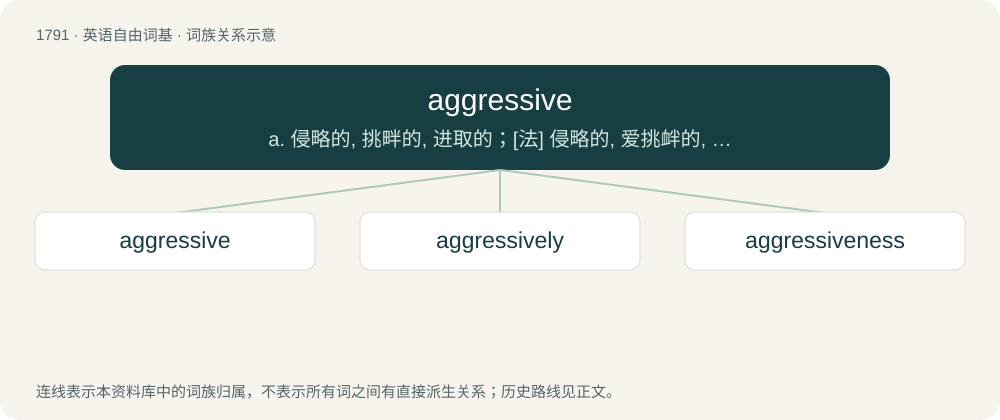

# 1893 · aggressive — a. 侵略的, 挑畔的, 进取的；\[法\] 侵略的, 爱挑衅的, 行为过火的

[总目录](../00_总目录_按常用程度.md)

**类型**：英语自由词基　｜　**来源语言**：见词源记录

## 核心含义与来源

- 核心含义：a. 侵略的, 挑畔的, 进取的；\[法\] 侵略的, 爱挑衅的, 行为过火的
- 英文含义：Characterized by aggression; highly combative; prone to behave in a way that involves attacking (especially if unjustly) or arguing.
- 词形：aggressive

**来源记录 1**（形容词；Characterized by aggression; highly combative; prone to behave in a way that involves attacking (especially if unjustly) or arguing.）

From aggress + -ive. Compare with French agressif.

## 词族图

## 单词速览（常用到不常用）

| 单词 | 音标 | 释义 |
|---|---|---|
| [aggressive](#w-1) | 美 /əˈɡɹɛs.ɪv/ | a. 侵略的, 挑畔的, 进取的；\[法\] 侵略的, 爱挑衅的, 行为过火的 |
| [aggressively](#w-2) |  | adv. (贬)侵略, 侵犯, 寻衅, (褒)敢作敢为, 有进取心, (武器)攻击性, 过分, 放肆 |
| [aggressiveness](#w-3) | /əˈɡrɛsɪvnɪs/ | n. (贬)侵略, 侵犯, 寻衅, (褒)敢作敢为, 有进取心, (武器)攻击性, 过分, 放肆 |

## 逐词详解

### 1. aggressive

**词性**：形容词　｜　**音标**：美 /əˈɡɹɛs.ɪv/

**中文释义**：a. 侵略的, 挑畔的, 进取的；\[法\] 侵略的, 爱挑衅的, 行为过火的

**英文义项**：Characterized by aggression; highly combative; prone to behave in a way that involves attacking (especially if unjustly) or arguing. / Tends to attack the player while unprovoked.

**构词拆分**：aggress + -ive

**词源与演化**：

From aggress + -ive. Compare with French agressif.

**例句**：

> Zombies are aggressive once you are near them.

该用例对应义项：Tends to attack the player while unprovoked.

### 2. aggressively

**词性**：副词

**中文释义**：adv. (贬)侵略, 侵犯, 寻衅, (褒)敢作敢为, 有进取心, (武器)攻击性, 过分, 放肆

**英文义项**：In an aggressive manner.

**构词拆分**：aggressive + -ly

**词源与演化**：

From aggressive + -ly.

**例句**：

> I don't know why I get angry so suddenly and aggressively.

### 3. aggressiveness

**词性**：名词　｜　**音标**：/əˈɡrɛsɪvnɪs/

**中文释义**：n. (贬)侵略, 侵犯, 寻衅, (褒)敢作敢为, 有进取心, (武器)攻击性, 过分, 放肆

**英文义项**：The state or quality of being aggressive. / The propensity of a soil or water to dissolve metal or cement structures.

**构词拆分**：aggressive + -ness

**词源与演化**：

From aggressive + -ness.

**例句**：

> The aggressiveness of various sulfate salts towards concrete is partly related to solubility.

该用例对应义项：The propensity of a soil or water to dissolve metal or cement structures.
