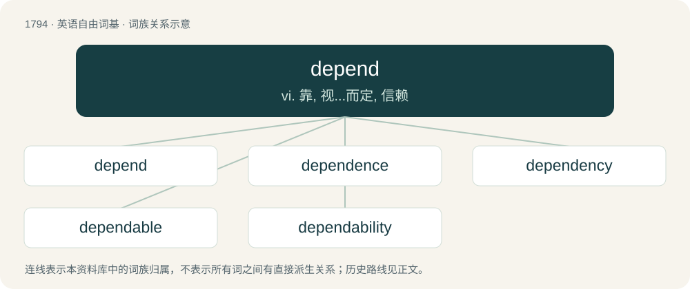

# 1896 · depend — vi. 靠, 视...而定, 信赖

[总目录](../00_总目录_按常用程度.md)

**类型**：英语自由词基　｜　**来源语言**：见词源记录

## 核心含义与来源

- 核心含义：vi. 靠, 视...而定, 信赖
- 英文含义：To be contingent or conditioned; to have something as a necessary condition
- 词形：depend

**来源记录 1**（动词；To be contingent or conditioned; to have something as a necessary condition）

Inherited from Middle English dependen, from Old French dependre, from Latin dependeō, from dē- + pendeō (“to be suspended, hang”). In this sense, displaced native Old English hangian (“to hang or depend”).

## 词族图

## 单词速览（常用到不常用）

| 单词 | 音标 | 释义 |
|---|---|---|
| [depend](#w-1) | 英 /dɪˈpɛnd/；美 /dɪˈpɛnd/ | vi. 靠, 视...而定, 信赖 |
| [dependence](#w-2) | 英 /dɪˈpɛndəns/ | n. 依赖, 依存, 信赖；\[医\] 依赖(如对药物的依赖,即瘾或癖), 从属, 偏利共生 |
| [dependency](#w-3) | 英 /dɪˈpɛndənsi/ | n. 属国, 保护地, 从属物；\[医\] 从属, 从属部 |
| [dependable](#w-4) | /diˈpendəbl/ | a. 可信任的, 可靠的, 可信赖的 |
| [dependability](#w-5) | /di.pendəˈbiliti/ | n. 可信任性, 可靠性 |

## 逐词详解

### 1. depend

**词性**：动词　｜　**音标**：英 /dɪˈpɛnd/；美 /dɪˈpɛnd/

**中文释义**：vi. 靠, 视...而定, 信赖

**英文义项**：To be contingent or conditioned; to have something as a necessary condition / To trust; to have confidence; to rely.

**词源与演化**：

Inherited from Middle English dependen, from Old French dependre, from Latin dependeō, from dē- + pendeō (“to be suspended, hang”). In this sense, displaced native Old English hangian (“to hang or depend”).

**例句**：

> We would like to go skiing, but it depends on the amount of snow.

该用例对应义项：To be contingent or conditioned; to have something as a necessary condition

### 2. dependence

**词性**：名词　｜　**音标**：英 /dɪˈpɛndəns/

**中文释义**：n. 依赖, 依存, 信赖；\[医\] 依赖(如对药物的依赖,即瘾或癖), 从属, 偏利共生

**英文义项**：The state of being dependent, of relying upon another. / An irresistible physical or psychological need, especially for a chemical substance.

**构词拆分**：depend + -ence

**词源与演化**：

From Middle French dépendance. Morphologically depend + -ence.

**例句**：

> He had a deep dependence on her for guidance.

该用例对应义项：The state of being dependent, of relying upon another.

### 3. dependency

**词性**：名词　｜　**音标**：英 /dɪˈpɛndənsi/

**中文释义**：n. 属国, 保护地, 从属物；\[医\] 从属, 从属部

**英文义项**：A state of dependence; a refusal to exercise initiative. / Something dependent on, or subordinate to, something else

**构词拆分**：dependent + -cy；dependence + -y；depend + -ency

**词源与演化**：

From dependent + -cy or dependence + -y or depend + -ency.

**例句**：

> In the United States' governmental structure, the military is conceived as a dependency under the executive branch.

该用例对应义项：Something dependent on, or subordinate to, something else

### 4. dependable

**词性**：形容词　｜　**音标**：/diˈpendəbl/

**中文释义**：a. 可信任的, 可靠的, 可信赖的

**英文义项**：Able, or easily able to be depended on.

**构词拆分**：depend + -able

**词源与演化**：

From depend + -able.

**例句**：

> He was a very dependable person.

该用例对应义项：Able, or easily able to be depended on.

### 5. dependability

**词性**：名词　｜　**音标**：/di.pendəˈbiliti/

**中文释义**：n. 可信任性, 可靠性

**英文义项**：The characteristic of being dependable; the ability to be depended upon.

**构词拆分**：depend + -ability

**词源与演化**：

From depend + -ability.

**例句**：

> Dependability is part of our entrepreneurial culture.
