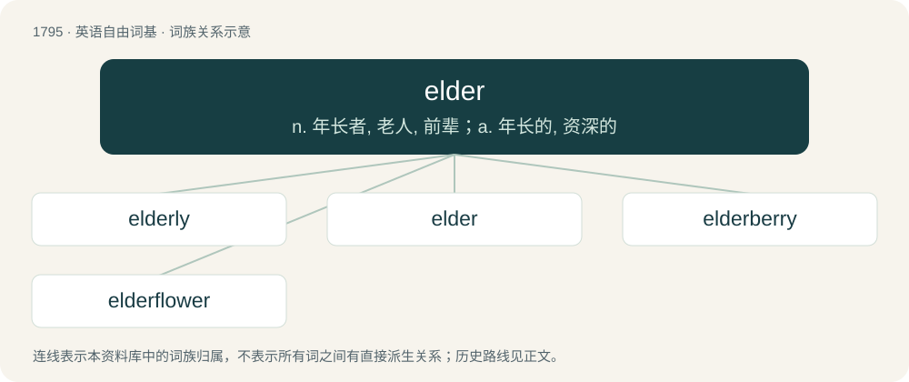

# 1897 · elder — n. 年长者, 老人, 前辈；a. 年长的, 资深的

[总目录](../00_总目录_按常用程度.md)

**类型**：英语自由词基　｜　**来源语言**：见词源记录

## 核心含义与来源

- 核心含义：n. 年长者, 老人, 前辈；a. 年长的, 资深的
- 英文含义：Closer to the dealer, i.e. receiving cards earlier than others.
- 词形：elder

**多个词源／构词路径**：同一拼写可能有不同来源；以下按词性和含义分别列出。

**来源记录 1**（形容词；Closer to the dealer, i.e. receiving cards earlier than others.）

From Middle English eldre, from Old English eldra, yldra, ieldra, from Proto-Germanic \*alþizô. The vowel change from a to e triggered by the following i is called umlaut or I-mutation.

**来源记录 2**（名词；A small tree, Sambucus nigra, having white flowers in a cluster, and edible purple berries.）

\] From Middle English eldre, eller, ellern, from Old English ellærn, from Proto-Germanic \*elernaz, \*eldernaz (compare Low German Elhorn, Elloorn).

**来源记录 3**（名词；A cow's udder, especially used as food.）

Perhaps from Proto-Germanic \*aliþro (“udder”), from \*alaną (“to nourish”). Cognate with dialectal Dutch elder (“udder”).

## 词族图

## 单词速览（常用到不常用）

| 单词 | 音标 | 释义 |
|---|---|---|
| [elderly](#w-1) | 英 /ˈɛldəli/；美 /ˈɛldɚli/ | a. 过了中年的, 稍老的 |
| [elder](#w-2) | 英 /ˈɛldə/；美 /ˈɛldɚ/ | n. 年长者, 老人, 前辈；a. 年长的, 资深的 |
| [elderberry](#w-3) | /ˈɛldə(ɹ)ˌbɛɹi/ | n. 接骨木属植物 |
| [elderflower](#w-4) |  | 接骨木花（用于制作果酒等饮料） |

## 逐词详解

### 1. elderly

**词性**：名词　｜　**音标**：英 /ˈɛldəli/；美 /ˈɛldɚli/

**中文释义**：a. 过了中年的, 稍老的

**英文义项**：Older people as a whole. / An elderly person.

**构词拆分**：elder + -ly

**词源与演化**：

From elder + -ly.

**例句**：

> He lives next door to an elderly.

该用例对应义项：An elderly person.

### 2. elder

**词性**：名词　｜　**音标**：英 /ˈɛldə/；美 /ˈɛldɚ/

**中文释义**：n. 年长者, 老人, 前辈；a. 年长的, 资深的

**英文义项**：A leader or senior member of a tribe or community, often of considerable age, respected as an authority figure, especially in a counselling, consultative, or ceremonial role. / An old person.

**词源与演化**：

From Middle English eldre, from Old English eldra, yldra, ieldra, from Proto-Germanic \*alþizô. The vowel change from a to e triggered by the following i is called umlaut or I-mutation.

**例句**：

> After being a member of the Church for a while, Bill was ordained to the office of elder.

该用例对应义项：One ordained to the lowest office in the Melchizedek priesthood.

### 3. elderberry

**词性**：名词　｜　**音标**：/ˈɛldə(ɹ)ˌbɛɹi/

**中文释义**：n. 接骨木属植物

**英文义项**：Any shrub or tree of the genus Sambucus; / The small, edible, purplish-black fruit of this plant, used in cooking and to flavour drinks etc.

**构词拆分**：elder + berry

**词源与演化**：

Compound of elder + berry.

### 4. elderflower

**词性**：名词

**中文释义**：接骨木花（用于制作果酒等饮料）

**英文义项**：The blossom of the elderberry, often specifically the European species Sambucus nigra

**构词拆分**：elder + flower

**词源与演化**：

From elder + flower.
