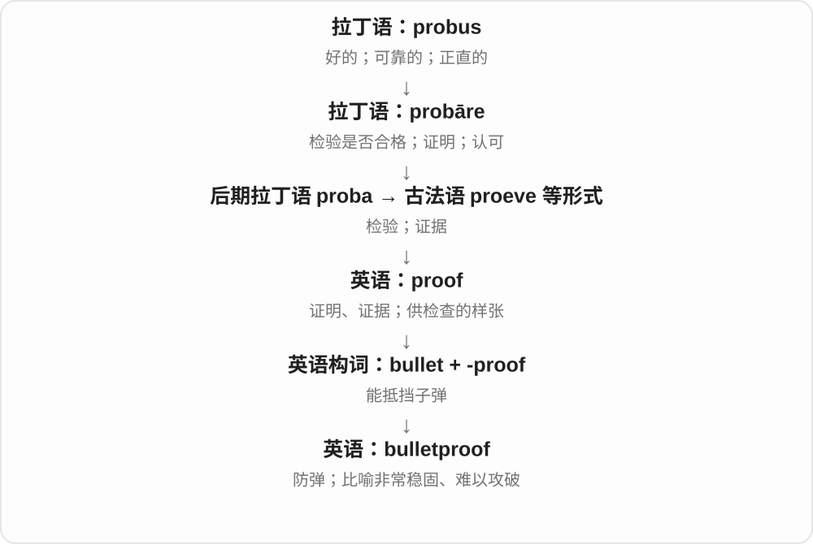

# 1898 · bullet — 小球的历史走向弹丸、圆点符号与快速运动、风险比喻

[逐词精讲目录](../00_逐词精讲目录.md) · [总目录](../00_总目录_按常用程度.md)

## 核心词根与来源

从物件形状到排版符号很直观；固定习语则学整句意义，不能只靠小球推出来。

**BULLET：固定借词，现代不要求总是球形**

bullet → bulletproof；bullet point、dodge a bullet 等看固定搭配。

- **弹丸、符号与相关性质**：bullet · bulletproof
- **bullet → bullets：小球、弹丸与圆点符号**：bullet · bullets
- **bulla 圆物、印封 → bulletin**：bulletin

## 词形与演化规律

boule 球 → 法语小称 bullete 等 → bullet；proof 抵御、经受住的相关性质。

法语 boule 球的小称借入，后固定为弹丸、项目符号等。

bullet 与 bulletin 远处同接拉丁 bulla 圆物。bulletin 经法语及意大利单据词族，由印封、文件联系发展为公告，不说公告来自现代子弹。

## 单词速览（按词族由简到繁）

同一基础词的相关扩展放在一起，先读基础形式，再读扩展；各组之间优先读常用的。具体词源关系见各词讲解。

| 单词 | 音标 | 核心意思 |
|---|---|---|
| [bullet](#w-1) | /ˈbʊlɪt/ | 子弹、弹头；项目符号；快速移动 |
| [bullets](#w-3) | /ˈbʊlɪts/ | 子弹、弹丸；项目符号〔复数〕 |
| [bulletin](#w-4) | 英 /ˈbʊlɪtɪn/；美 /ˈbʊlətɪn/ | 公告；简报；简短新闻播报 |
| [bulletproof](#w-2) | 英 /ˈbʊlɪtpruːf/；美 /ˈbʊlɪtpruːf/ | 防弹的；坚不可摧的；难以反驳的 |

## 逐词讲解

### 1. bullet — 子弹、弹头；项目符号；快速移动

**音标**：/ˈbʊlɪt/

**先抓住这个画面**

名称有小球的历史，现代弹头不必是圆球。排版里一颗实心圆点用来标条目，也因外形叫 bullet。

**怎么拆**

借法语 bullete 等，联系 boule 球的小称，后来受 boulet、boulette 等影响。不是常用弹丸义由 bull 公牛 + -et 组成；小公牛的少见同形词是另回事。

**怎么变成今天的意思**

**法语 boule 球 → bullete 等小称**  
小球；印记、标记等旧借词背景

↓

**英语 bullet 的固定用途**  
弹丸；版面项目符号；迅速运动的比喻

a bullet point 项目要点、带符号条目，a bullet list 项目列表，dodge a bullet 躲过一劫，bite the bullet 硬着头皮面对难事。

**常见搭配与例句**

a bullet point；dodge a bullet；bite the bullet。

> Please put the main ideas into bullet points.

请把主要想法列成项目要点。

> They dodged a bullet when the broken branch missed the car.

断枝没砸中车，他们躲过一劫。

**别混淆**

严格说 bullet 可指射出的弹头，cartridge 是包含壳体等的一整发；日常 bullet 也可能泛说整发。bulletproof 是防弹的或比喻难以攻破。

### 2. bullets — 子弹、弹丸；项目符号〔复数〕

**音标**：/ˈbʊlɪts/

**先抓住这个画面**

小小的一颗圆球，后来专门用作弹丸；版面上一颗颗标出条目的圆点，也叫 bullets。

**怎么拆**

bullet + -s，/t/ 后读 /s/。bullet 借法语 bullete 等与 boule 球相关的小称，后来有相应法语词形影响。

**怎么变成今天的意思**

**法语球的小称 → 英语 bullet**  
小球相关旧名 → 弹丸等固定用途

↓

**bullet + -s → bullets**  
多颗弹丸；多个版面项目符号

bullet points 项目符号条目；rubber bullets 橡胶弹；bullets in a list 清单中的圆点符号。

**常见搭配与例句**

a list with bullets 带项目符号的清单；sweat bullets 紧张得冒汗，口语比喻。

> Use bullets to separate the main points.

用项目符号分开主要要点。

> The museum displayed several old bullets.

博物馆展出了几颗旧弹丸。

**别混淆**

bullets 在排版语境里是项目符号，不是说文档里真的有武器。英语 bullet 可常译子弹，严格技术场合还会区分弹头与整发弹药。

### 3. bulletin — 公告；简报；简短新闻播报

**音标**：英 /ˈbʊlɪtɪn/；美 /ˈbʊlətɪn/

**先抓住这个画面**

把某件事的最新情况整理成一份简短、正式的消息，发给大家看或听，就是 bulletin。可以贴在公告栏，也可以是广播里的新闻简报。

**怎么拆**

经法语 bulletin、意大利 bulletino 等单据、公告词，远接拉丁 bulla 圆物、印封。意大利语里有多层指小形式；现代不把它拆成英语 bullet 子弹加 -in。

**怎么变成今天的意思**

**拉丁 bulla 圆物、印封 → 单据、文件词族 → 意大利、法语 bulletin**  
印封与正式文件相联系，形成公众通报的名称

↓

**bulletin → 公告、定期简报、新闻播报**  
现代纸质、广播、电子消息等都可使用

a news bulletin 是新闻简报；a bulletin board 是公告栏；a weekly bulletin 是每周简报。

**常见搭配与例句**

a news bulletin；a bulletin board；a weekly bulletin。

> The weekly bulletin lists upcoming events.

每周简报列出了即将举行的活动。

> A short news bulletin interrupted the programme.

一段简短新闻播报打断了节目。

**别混淆**

bullet 和 bulletin 远处同接圆物、印封词族，但不是现代子弹变出了新闻公告。report 范围更广，bulletin 常强调简短、面向一群人的信息通报。

### 4. bulletproof — 防弹的；坚不可摧的；难以反驳的

**音标**：英 /ˈbʊlɪtpruːf/；美 /ˈbʊlɪtpruːf/

**先抓住这个画面**

字面上是能挡住子弹；比喻时是攻击、批评打过来，论点或系统仍站得住。

**怎么拆**

bullet 子弹 + -proof 能抵挡；这是英语复合词。

**怎么变成今天的意思**

防护材料在具体条件下发挥作用；比喻 bulletproof argument 则赞扬论证难以推翻，常带夸张。

**常见搭配与例句**

bulletproof glass；a bulletproof argument；a bulletproof system。

> The guard sat behind bulletproof glass.

警卫坐在防弹玻璃后面。

> She wanted stronger evidence before calling the argument bulletproof.

她希望有更强的证据，再把这个论证称为无懈可击。

**别混淆**

bulletproof 比喻“很牢靠”，不是已经严格证明没有任何漏洞。

## 这一组要分清什么

bullet 常用义不来自 bull；bullet 与 cartridge 在精确语境中区分；dodge a bullet 可比喻躲过祸事。

## 串起来练习

The guide uses bullet points to explain what bulletproof means.

指南用项目要点解释 bulletproof 的意思。
